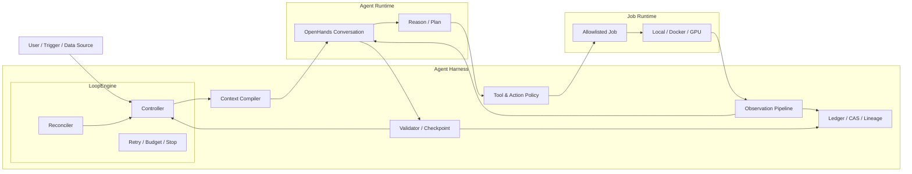
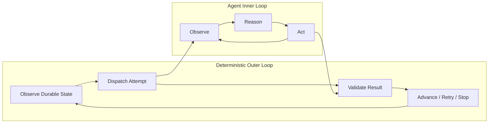
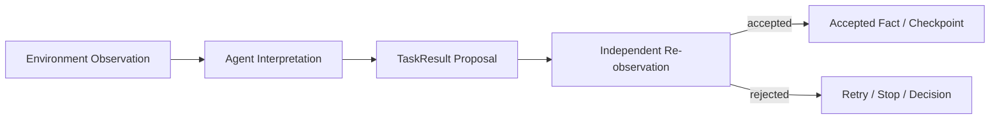
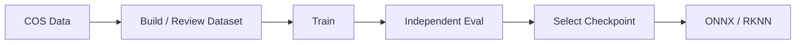

# Building an Agent Harness

## LoopEngine 与 Long-Horizon Agent Execution 的工程实践

> 面试 Presentation / 简历项目说明
>
> 建议时长：18～22 分钟
>
> 版本：2026-07-28

---

## 1. 项目的正确叙事层级

```text
Agent Harness                 我构建了什么
└── LoopEngine               核心运行与控制机制
    └── Long-horizon         最终获得的系统能力

MLOps / 模型工程              验证该架构的 Case Study
```

### Agent Harness 是项目主体

它包围在 Agent Runtime 外部，为 Agent 提供：

- Context；
- Tools 与 Action Policy；
- Observation；
- Memory；
- Execution Runtime；
- Validation；
- Control、Recovery 与 Budget。

### LoopEngine 是 Harness 的控制内核

它把长期目标拆成多个 Task 和 Attempt，并在 Conversation 外部管理状态、调度、验收、重试和恢复。

### Long-horizon 是结果

不是单独实现一个“Long-Horizon 模块”，而是上述工程能力共同产生的系统性质：

> 即使单次 Conversation 有限、Agent 或 Job 可能中断，长期目标仍然能够跨 Episode 持续推进。

### MLOps 是压力测试场

训练—评测—checkpoint 选择链路具有长时间运行、昂贵副作用、多阶段依赖和严格门禁，适合验证 Harness 是否真正可靠。

---

## 2. 问题来源：Conversation 能完成任务，但不能拥有生命周期

日常使用 Codex、Claude Code 或 OpenHands 时，一个 Conversation 已经可以：

- 修改代码和配置；
- 启动训练；
- 读取日志；
- 运行评测；
- 分析失败；
- 找到 checkpoint。

但跨多个 Conversation 后，人仍然是隐藏 Controller：

```text
记住当前进度
→ 判断上一步是否真的完成
→ 把正确输入交给下一步
→ 决定是否重试
→ 控制实验预算
→ 保存模型与评测关系
```

这里缺失的不是更强的推理模型，而是一层 Agent Engineering：

> 如何管理 Agent 看见什么、能做什么、留下什么事实，以及失败后如何继续。

所以我的目标不是做一个更长的 Conversation，而是构建一个 Agent Harness，把 Conversation 变成可调度、可验证、可替换的执行单元。

---

## 3. Agent Harness 总体架构



Harness 的七项职责：

| 子系统 | 职责 |
|---|---|
| Context Compiler | 根据当前状态生成最小、不可变 TaskContext |
| Action Policy | 限制当前 Agent 可以调用的 Job 和 Artifact 类型 |
| Observation Pipeline | 把原始环境信号变成有界、结构化反馈 |
| Durable Memory | 在 Conversation 外保存状态、制品和血缘 |
| Execution Runtime | 运行受控的本地、容器和 GPU Job |
| Validator | 将 Agent proposal 转换为可信 checkpoint |
| LoopEngine | 跨 Conversation 调度、恢复、重试和推进 |

这套分层体现了一个核心原则：

> Agent 负责局部推理，Harness 负责全局可靠性。

---

## 4. LoopEngine：Harness 的控制内核

LoopEngine 使用四级领域模型：

```text
Run
└── Task
    └── Attempt
        └── Conversation
```

### Run

一个完整长期目标，绑定：

- watermark/request ID；
- RunSpec；
- 初始 Artifact；
- TaskSequence；
- duration、cost 和 artifact budget。

### Task

一个具有机器可验证完成条件的步骤，定义：

- objective；
- Agent profile；
- Validator；
- timeout；
- `maxAttempts`；
- Completion Contract；
- human approval gate。

### Attempt

Task 的一次执行。失败后创建新的、单调递增的 Attempt。

### Conversation

Attempt 的 Agent Episode。它不拥有 Run 生命周期，也不承担跨任务记忆。

```text
Run
├── Task A
│   ├── Attempt 1 → Conversation 1
│   └── Attempt 2 → Conversation 2
├── Task B
│   └── Attempt 1 → Conversation 3
└── Task C
    └── Attempt 1 → Conversation 4
```

这个抽象允许：

- Run 持续数小时或数天；
- 每个 Conversation 保持短、局部、可替换；
- retry 不继承旧 Conversation 的错误上下文；
- 重启后从外部状态重建新的 Episode。

---

## 5. 确定性外环与智能内环



### Agent 内环处理不确定性

- 分析日志；
- 选择允许的工具；
- 诊断局部失败；
- 提出下一实验假设；
- 解释候选差异。

### LoopEngine 外环维护不变量

- 创建 Task/Attempt；
- 分配 Lease；
- 持久化状态；
- 验证结果；
- 扣减预算；
- 决定 retry/stop；
- 接受 Artifact/lineage；
- 推进生命周期。

Agent 不能通过自然语言直接推进 Run。

---

## 6. Observation Engineering

Observation 是 Harness 的关键子系统，但不是整个项目的顶层定位。

它解决的是：

> Agent 如何从长时间运行、不断变化的环境中，持续获得新鲜、相关、有界和可验证的反馈。

### 6.1 Observation 类型

| 类型 | 内容 |
|---|---|
| Job Observation | `running/succeeded/failed/cancelled/lost`、return code |
| Log Observation | 有界 log tail、log hash、size |
| Result Observation | `result.json`、metrics、declared outputs |
| Failure Observation | `failure.json`、failure class、evidence |
| Process Observation | PID/container 是否仍存在 |
| Lease Observation | Attempt 是否仍有执行权 |
| Artifact Observation | ownership、kind、size、SHA-256 |
| Validation Observation | schema、gate、lineage、completion contract |

### 6.2 Runtime 状态归一化

Local process 和 Docker container 的底层状态不同，Harness 统一为：

```text
running
succeeded
failed
cancelled
lost
```

成功以受控 Job 写出的 `result.json` 为准，失败使用 `failure.json`，而不是让 Agent 仅凭退出码或日志文本推断。

### 6.3 Bounded Long-Poll

一次 `observe_job`：

- 最长等待约 240 秒；
- poll 从约 1 秒开始指数退避；
- interval 最大约 15 秒；
- Job 终止则提前返回；
- observation window 结束后将控制权还给 Agent。

这样既不会让一个 tool call 阻塞数小时，也避免 Agent 高频轮询消耗 token。

### 6.4 Freshness 与 Dedup 分离

连续的 `running` poll 对 Agent 必须是新 Observation，因此附加新的：

```text
poll_observation_id
```

但 Ledger 不应因为相同运行状态不断膨胀。

系统对 Observation 的语义字段计算 digest；`running` 状态的持久化 digest 忽略持续变化的 log hash/size。只有状态或结构化结果真正变化时，才追加 `JobAttemptObserved` event。

这形成：

```text
Agent 侧：每次 poll 都 fresh
Ledger 侧：相同语义只保存一次
```

### 6.5 Context Boundedness

- log tail 最大约 16 KiB；
- structured output 最多 16 个文件；
- 单文件最大 256 KiB；
- 总大小最大 1 MiB；
- 只读取成功 Job 声明的 JSON output；
- 校验 ownership、kind、path、size 和 SHA-256。

Observation Engineering 的目标不是保留所有环境信息，而是保留足以做下一步决策的状态。

---

## 7. Context 与外部 Memory

Harness 不把 Conversation transcript 当作长期数据库。

| Memory | 实现 | 保存内容 |
|---|---|---|
| Operational Memory | Event Ledger | Run、Task、Attempt、Job、Lease、Event |
| Artifact Memory | Content-addressed CAS | 数据、checkpoint、报告、模型包 |
| Provenance Memory | Lineage | data/code/config/image 到输出的关系 |
| Policy Memory | RunSpec/TaskSpec | 目标、预算、能力、完成条件 |
| Episode Context | TaskContext | 当前 Attempt 所需的最小信息 |

### Event + Projection

Ledger 同时保存：

- append-only domain event；
- 便于查询的当前 projection。

系统可以通过 `replay_run()` 重建状态，并检查 projection 与 replay 是否一致。

### Content-addressed Artifact

```text
artifact_id = kind + sha256(content)
```

下一 Task 接收 sealed Artifact reference，而不是上一 Conversation 中提到的任意路径。

### Context Reconstruction

每个新 Conversation 都由 Harness 重新编译 TaskContext：

```text
objective
Attempt number
Lease
Run policy
sealed input Artifact
Completion Contract
retry spec diff
domain references
```

核心取舍：

> 保存已经验证的事实，按需重建当前上下文，而不是无限回放历史推理。

---

## 8. Trust Boundary：Agent Proposal 不是系统事实

Agent 唯一支持的完成协议是 typed `TaskResult`：

```text
task_id / attempt_id / status
artifact_candidates
lineage_proposals
metrics
evidence_refs
next_attempt_proposal
```

每个 Task 声明 Completion Contract：

```text
required_artifact_kinds
required_evidence
metric_gates
allow_skip_training
```

独立 Validator 检查：

- Artifact 的 kind、path、size 和 hash；
- 输出是否属于当前 Attempt 的受管 Job；
- 结构化报告 schema；
- metric gate；
- evidence；
- lineage 输入是否合法。



Validator 只返回：

```text
accepted | retryable | terminal | needs_decision
```

只有 accepted Artifact 和状态才会进入下一 Conversation 的 TaskContext。

这防止一次错误 belief 被写入长期记忆，并在后续 Episode 中持续放大。

---

## 9. Recovery、Fencing 与 Effectively-Once

### Attempt Lease

每个 MCP 调用必须携带：

```text
attempt_id + lease_id
```

Gateway 检查 Lease 是否匹配、是否过期，以及 Attempt 是否仍为 `RUNNING`。

Lease 过期后：

```text
旧 Conversation 的工具调用被拒绝
→ Attempt 标记 CRASHED
→ 取消在途 Job
→ 记录 agent-conversation-lost
→ 创建新 Attempt
→ 重建 Context
→ 启动新 Conversation
```

这是 fencing，不只是 heartbeat；它避免新旧 Agent 同时写入。

### Reconciler

后台 Reconciler 周期性执行：

```text
读取非终态 Run
→ 检查 Lease 和 policy
→ 恢复过期 Attempt
→ 清理 orphan Job
→ dispatch / validate
→ advance / retry / stop
```

### 幂等与 Outbox

系统使用：

- `(loop_id, watermark)` 唯一 Run；
- stable Task/Attempt/Job identity；
- idempotency key + payload digest；
- `expected_version` 乐观并发；
- Conversation Dispatch Outbox；
- 确定性 Conversation ID；
- Scheduler Lease。

最终语义是：

```text
at-least-once reconciliation
+ idempotent domain commands
+ optimistic concurrency
+ transactional outbox
+ lease fencing
= domain-level effectively-once
```

严格 exactly-once 无法跨数据库、OpenHands 和 GPU Runtime 保证，因此不做不准确承诺。

---

## 10. Execution Harness：受控 Job 与 GPU Runtime

Agent 不直接运行任意 shell，而是调用：

```text
rightarm-mlops <allowlisted-job-kind>
```

Task kind 决定允许的 Job，例如：

```text
train    → train
evaluate → evaluate
package  → export-onnx / build-calibration /
           export-rknn / verify-conversion
```

Hybrid Executor：

- 数据落盘等步骤走 Local Executor；
- 训练、评测等任务走 Docker/GPU；
- route、image、network、GPU 数由 operator 配置。

Docker 安全边界：

- digest-pinned image；
- read-only root filesystem；
- workspace/input 只读；
- 只有受管 output 可写；
- network 默认关闭；
- `cap_drop: ALL`；
- `no-new-privileges`；
- `/tmp` 使用 `noexec,nosuid`；
- CPU、memory、GPU 数固定；
- 非 root UID/GID。

Job output 必须在 `result.json` 中声明 kind、path、size 和 hash，才能成为 Artifact candidate。

---

## 11. Long-Horizon 是如何产生的

Long-horizon 不是单点功能，而是这些机制的组合结果：

| 单次 Agent 的限制 | Harness 提供的能力 |
|---|---|
| Conversation 会结束 | Run 状态存在于 Conversation 外 |
| Context 会膨胀 | 每个 Attempt 重建最小 TaskContext |
| 外部 Job 运行很久 | bounded Observation loop |
| Agent 可能崩溃 | Lease expiry + fresh Attempt |
| 工具调用可能重复 | 幂等命令 + Outbox + version |
| Agent 可能误判 | independent Validator |
| 文件路径不稳定 | CAS + hash identity |
| 错误可能跨任务传播 | 只有 validated checkpoint 可见 |
| Agent 可能无限尝试 | attempt/cost/duration budget |

因此：

> Long horizon 不是让一个 Agent 永远运行，而是让同一个目标能够跨多个可替换 Agent Episode 持续存在。

---

## 12. Case Study：模型训练、评测与选优



| 模型工程问题 | Harness 能力 |
|---|---|
| 训练持续数小时 | Job Observation + external state |
| 日志持续增长 | bounded tail + semantic dedup |
| CUDA OOM | typed failure + evidence-backed retry |
| 多轮调参 | Attempt/Episode + spec diff |
| 多个 checkpoint | CAS identity + lineage |
| 训练日志自报 best | independent evaluation |
| 服务重启 | Ledger replay + Reconciler |
| GPU 成本不可控 | trial/patience/cost/duration budget |

`improve` Run 中：

- Agent 分析误差并提出下一实验假设；
- Harness 校验参数 allowlist/range；
- 确定性代码控制 trial、patience 和资源；
- 独立评测执行 champion/challenger gate；
- 没有合规提升时保留 champion。

MLOps 是 Harness 的落地验证，不是项目的顶层边界。

---

## 13. 工程验证

2026-07-20 历史审计记录：

- OpenHands MLOps、API/model、Conversation tests：281 passed；
- rightArmPerception adapter tests：8 passed；
- LoopSpec/RunSpec Schema 校验通过；
- SQLite Ledger、本地 CAS、S3 adapter contract 已验证；
- digest-pinned Docker executor 完成隔离 smoke。

测试覆盖的关键不变量：

1. 相同 watermark 只创建一个 Run；
2. 多 Task Run 使用多个 Conversation；
3. running poll 保持 fresh，但不重复膨胀 Ledger；
4. Agent 自然语言成功声明不能推进；
5. retry 必须引用当前 Attempt 的真实失败 Job；
6. Lease 过期后旧 Agent 被 fencing；
7. Controller 重启后从 Ledger 恢复；
8. 相同内容只有一个 Artifact identity；
9. lineage 不闭合时拒绝 Release；
10. projection 可以由 Event replay 验证。

项目边界也需要准确表达：

> 已实现并验证 staging Agent Harness 与模型工程 closed loop；生产化仍需要 PostgreSQL、正式 GPU 镜像、真实外部基础设施和端到端验收。

---

## 14. LoopEngine 到 GraphEngine

LoopEngine 已经解决 Node 的可靠执行语义：

- Context；
- Action；
- Observation；
- Attempt；
- Lease；
- Validation；
- Checkpoint；
- Recovery。

GraphEngine 解决的是更复杂的拓扑：

```text
TaskSequence
→ Linear GraphSpec
→ Conditional Edge
→ Branch / Join
→ Parallel Scheduling
→ Partial Replay
```

复用关系：

| Graph 概念 | 现有基础 |
|---|---|
| Node | TaskSpec |
| Node execution | Attempt + Conversation |
| Node result | TaskResult + Validator |
| State | Event Ledger projection |
| Edge condition | validation disposition / policy |
| Data passing | sealed Artifact + lineage |

> LoopEngine 提供可靠执行内核，GraphEngine 在其上增加拓扑表达。

---

## 15. 简历写法

### 推荐标题

```text
Agent Harness / LoopEngine for Reliable Long-Horizon Execution
```

### 推荐项目描述

> 设计并实现面向模型工程的 Agent Harness，以 LoopEngine 作为确定性控制内核，将 OpenHands Conversation 抽象为可恢复的 TaskAttempt；构建结构化 Observation、外部状态与制品记忆、TaskContext 重建、Lease fencing、幂等 Reconciler、Transactional Outbox 和独立 Validator，支持跨数小时/数天的多阶段任务执行。

### 三条简历 Bullet

- 设计 `Run → Task → Attempt → Conversation` 分层模型与确定性 LoopEngine，将短生命周期 Agent Episode 编排为可持久化、可恢复、受预算约束的长周期执行系统。
- 构建 Agent Harness 的 Observation/Memory 层：统一 Job 状态、bounded long-poll、fresh poll identity、semantic dedup、Event Ledger、CAS/lineage 与最小 TaskContext 重建。
- 实现 Lease fencing、幂等事件、乐观并发、Conversation Dispatch Outbox、受控 GPU Executor 与独立结果验证，防止 stale Agent、重复副作用和虚假成功推进系统状态。

### 英文版本

> Built an agent harness around OpenHands with a deterministic LoopEngine, structured observations, durable state and artifact memory, fenced tool execution, idempotent reconciliation and validated checkpoints, enabling recoverable multi-episode execution over long-running ML workloads.

---

## 16. 90 秒面试讲法

> 这个项目最开始来自我使用 Codex 和 OpenHands 的体验。单个 Conversation 已经能很好地改代码、跑训练和读日志，但一旦任务跨数小时和多个步骤，人仍然需要在 Conversation 之间维护状态。
>
> 所以我做的顶层系统是一个 Agent Harness，负责 Context、Tools、Observation、Memory、Validation 和 Recovery；其中 LoopEngine 是确定性控制内核，把长期目标拆成 Run、Task 和 Attempt，每个 Attempt 使用一个独立 OpenHands Conversation。
>
> 技术上我重点解决了几个问题：长任务的 Observation 如何保持有界和新鲜；Conversation 结束后状态和 Artifact 如何保存在外部；旧 Agent 如何通过 Lease fencing 失去工具权限；重复 reconcile 如何通过幂等键、乐观版本和 Outbox 避免重复副作用；以及为什么 Agent 的结果必须经过独立 Validator 才能成为下一 Task 可见的 checkpoint。
>
> 最终获得的能力是 long-horizon execution：不是依赖一个无限上下文的 Agent，而是让同一个目标跨多个可替换 Episode、进程重启和失败持续推进。模型训练、评测和 checkpoint 选择是我用来验证这套 Harness 的实际场景。

---

## 17. PPT 建议

| 页 | 标题 | 核心内容 |
|---:|---|---|
| 1 | From Conversation to Agent Harness | 问题来源 |
| 2 | System Positioning | Harness → LoopEngine → Long-horizon |
| 3 | Agent Harness Architecture | 七个子系统 |
| 4 | LoopEngine Domain Model | Run/Task/Attempt/Conversation |
| 5 | Outer Loop vs Inner Loop | 确定性与智能边界 |
| 6 | Observation Engineering | normalize、bound、fresh、dedup |
| 7 | Context and Durable Memory | Ledger、CAS、TaskContext |
| 8 | Trust Boundary | proposal → validation → fact |
| 9 | Recovery and Fencing | Lease、Reconciler、Outbox |
| 10 | Controlled Execution | Job allowlist、Docker/GPU |
| 11 | How Long Horizon Emerges | 机制到能力 |
| 12 | MLOps Case Study | 训练—评测—选优 |
| 13 | Verification and Boundaries | 不变量与生产边界 |
| 14 | LoopEngine → GraphEngine | 可靠 Node 到复杂拓扑 |
| 15 | Engineering Takeaways | 总结与技术取舍 |

时间分配建议：

```text
问题与定位              2 分钟
Harness + LoopEngine    5 分钟
核心工程难点            8 分钟
Case / Evidence         3 分钟
Graph / Summary         2 分钟
```

---

## 18. 最终总结

```text
Agent Harness          提供完整工程边界
LoopEngine             提供确定性运行内核
Long-horizon           是最终系统能力
MLOps                  是落地与验证场景
```

最适合作为结尾的一句话：

> **我不是通过拉长 Agent Context 实现 long horizon，而是通过 Harness 把 Observation、Memory、Validation 和 Recovery 工程化，再由 LoopEngine 跨多个 Conversation 持续推进同一个目标。**
