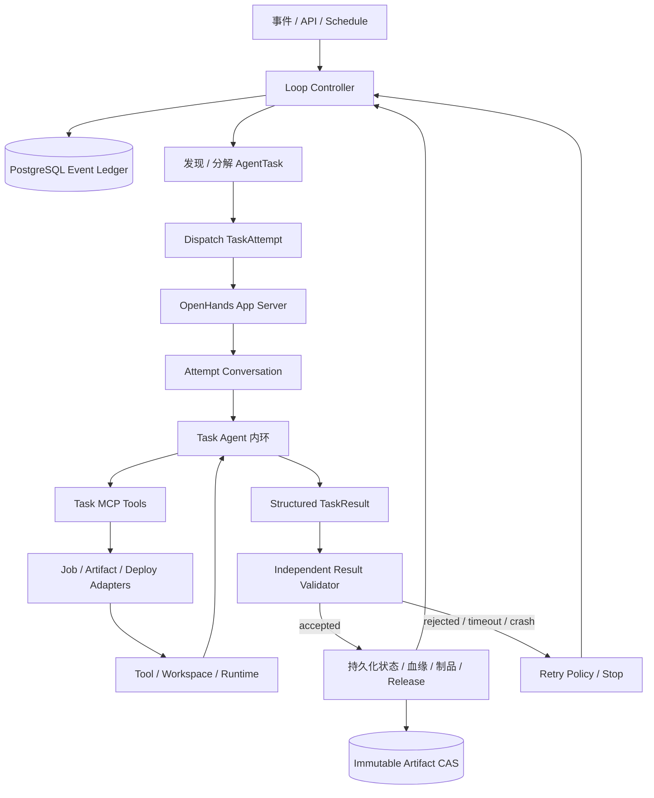

# Agentic MLOps V1 设计

状态：Draft for implementation
目标仓库：OpenHands/OpenHands
基线：OpenHands `main`，OpenHands SDK / Agent Server / Tools `1.36.0`
设计原则：Loop Engineering 外环负责触发、分派、验证、持久化、attempt 级重试与停止；OpenHands Agent 内环负责单个任务中的推理、行动、工具使用与再推理。

## 1. 结论

V1 以 OpenHands 作为任务执行 Agent runtime，在其外部实现一个面向 MLOps 的 Loop Engineering 控制面。外环不是通用 DAG 编排器，而是 agentic system 的确定性生命周期。

每次端到端 MLOps 任务对应：

- 一个 `MLOpsRun`，作为领域生命周期；
- 若干 `AgentTask`，作为可独立分派和验证的阶段任务；
- 一个或多个 `TaskAttempt`，每个 attempt 关联一个或多个有序的 OpenHands Conversation Episode；
- 一个 Loop Controller，负责发现、触发、任务分解、分派、验证结果、持久化状态以及重试/停止；
- 一个 OpenHands Task Agent，负责单个 attempt 内的事件历史、LLM、Action、Tool/Workspace、Observation 和再推理；
- 一个 append-only 事件账本，作为可恢复的领域事实源；
- 一组类型化 MLOps 工具，作为 Agent 产生可验证现实结果的接口；
- 若干隔离执行任务，负责数据落盘、训练、评测、构建和部署；
- 一套不可变制品和血缘关系，保证任意部署可追溯、可重放、可回滚。

V1 不引入 Airflow、Argo、Dagster、Prefect 或 Kubeflow Pipelines。Loop Controller 拥有有限、显式的 MLOps 状态机和 retry policy；OpenHands Conversation 不拥有跨任务状态，执行器也不能自行推进状态。

## 2. 产品目标

用户提交一份 `MLOpsRunSpec` 后，Loop Engineering 外环与 OpenHands Agent 内环共同完成：

1. 理解任务目标和约束；
2. 将原始数据可靠落盘并封存；
3. 建立数据、代码、配置、镜像、模型和部署之间的完整血缘；
4. 生成或修改训练与评测代码；
5. 启动、观察和诊断训练任务；
6. 由 Agent 诊断失败并提出下一步，由外环验证提案、预算和策略后创建新 attempt 或停止；
7. 注册模型候选和不可变评测报告；
8. Agent 形成评测/发布建议，外环独立检查硬性门槛并持久化 Release 状态；
9. 外环分派 canary 任务、验证 observation，并按 policy 继续、重试或回滚；
10. 在 Agent、Conversation 或服务进程崩溃后，由外环从账本恢复并重新分派；
11. 对每个决定给出结构化理由。

## 3. V1 范围

### 3.1 包含

- 批处理数据源：本地文件、HTTP(S)、S3-compatible URI；
- 数据格式：CSV、JSONL、Parquet，以及用户提供的自定义落盘命令；
- 单仓库 Python 训练项目；
- Docker 容器执行器；
- CPU 和单机 GPU 任务；
- 离线评测；
- HTTP 推理服务；
- blue/green 或单实例 canary 发布；
- PostgreSQL 领域账本；
- S3-compatible 内容寻址制品存储；
- OpenTelemetry 链路和结构化日志；
- 全自动发布，以及可选的人类确认策略。

### 3.2 不包含

- 流式数据管道；
- 分布式训练调度器的自研实现；
- Feature Store；
- 多集群和多云容灾；
- 多 Agent 协作；
- 可视化 DAG 编辑器；
- 通用 AutoML 搜索平台；
- 自定义 MLOps Dashboard；
- V1 内直接支持 Kubernetes 原生 Job、KServe 或云厂商训练服务。

这些能力应通过后续执行器和部署适配器扩展，不改变 V1 领域协议。

## 4. 外环与内环的严格边界

### 4.1 Loop Engineering 外环

外环负责：

- 发现事件或接收触发；
- 创建 Run，把 Run 分解为 `AgentTask`；
- 选择 Agent Profile、workspace、输入 artifacts 和预算；
- 分派 `TaskAttempt` 到 OpenHands；
- 使用机器 validator 验证结构化结果，而不是相信自然语言完成声明；
- 持久化 events、artifacts、lineage、attempts、releases 和 deployments；
- 根据验证结果、错误分类、预算和 retry policy 创建下一 attempt；
- 推进 Run / Release / Deployment 状态，或停止并请求人工介入；
- 在 Conversation 丢失时重新分派，不依赖 LLM 记忆恢复。

### 4.2 OpenHands Agent 内环

一个 attempt 内部遵循：

```text
事件历史 -> LLM -> Action -> Tool/Workspace -> Observation -> 再推理
```

Agent 负责：

- 理解外环下发的一个具体 task objective、输入和完成条件；
- 检查代码、数据、日志和工具 observation；
- 生成或修改代码、调用任务工具并进行 action 级自我修正；
- 诊断失败，提交结构化 evidence、failure class 和 next-attempt proposal；
- 产生 `TaskResult`，但不能自行宣称 Run、Release 或 Deployment 已完成；
- 在 attempt 的终止条件满足时干净结束。

### 4.3 两类重试

- **内环 action retry**：同一 Conversation 内因命令拼写、局部测试失败或可修复代码问题再次行动，不创建新 attempt；
- **外环 attempt retry**：Agent 结束、超时、崩溃或结果验证失败后，由 Loop Controller 按预算创建新的 `TaskAttempt`。

Agent 可以提出改 batch size、改代码或换 calibration 的建议，但只有外环能分配新的 attempt number 和 retry budget。

### 4.4 确定性机制

外环的 Domain Service 保证：

- 数据库事务；
- append-only 事件；
- compare-and-swap 版本控制；
- 幂等键；
- 租约与心跳；
- 内容哈希与不可变存储；
- 命令执行与状态观测；
- 超时检测与重新分派；
- outbox 可靠投递。

因此“agentic system 对血缘、重试、制品版本和发布状态负责”不等于“LLM Conversation 保存这些事实”。确定性职责属于外环；OpenHands 是其中处理不确定任务的内环执行器。

## 5. 与 OpenHands 的映射

| OpenHands 能力 | V1 用法 | 当前代码位置 |
|---|---|---|
| App Conversation | 一个 `TaskAttempt` 可由多个 bounded Conversation Episode 续接执行 | `openhands/app_server/app_conversation/` |
| Conversation tags | 保存 `mlopsrunid`、`mlopstaskid`、attempt、协议版本 | `AppConversationInfo.tags` |
| Agent Profile | 固定 Task Agent 的 LLM、MCP 和工具配置 | `openhands/app_server/settings/agent_profiles.py` |
| Plugin | 注入 MLOps Skill、MCP 配置和 hooks | `AppConversationStartRequest.plugins` |
| Event Service | 保存和展示 Agent 的推理、工具调用和结果 | `openhands/app_server/event/` |
| Event Callback | 把 Conversation 终止、错误等事件桥接到领域账本 | `openhands/app_server/event_callback/` |
| Sandbox Service | 隔离 Task Agent 的代码修改和诊断操作 | `openhands/app_server/sandbox/` |
| Secrets | 向 Agent/MCP 提供凭据引用，不写明文到账本 | `openhands/app_server/secrets/` |
| Hooks | 限制生产动作并校验工具调用 | `hook_loader.py`、`pre_tool_use`、`post_tool_use` |
| SDK metrics | 记录 Agent token 与模型成本 | `MetricsSnapshot` |

Conversation tag key 必须满足 SDK 的小写字母数字约束，因此使用 `mlopsrunid`，不能使用 `mlops_run_id`。

OpenHands Event Service 继续作为 Conversation/attempt 的事件源；MLOps Ledger 是 Run 和跨任务状态的事实源。两者通过 `conversation_id`、`task_id` 和 `run_id` 关联，但不能互相替代。

## 6. 总体架构



### 6.1 Loop Controller

Loop Controller 是跨任务状态的唯一 owner。它可以先分派 data task，再根据 validator 结果分派 train、eval、package、deploy 或 monitor task。同一 Run 的任务默认串行，V1 不实现通用 DAG。

Controller 只根据显式状态机、policy、validator 和已持久化的 Agent proposal 行动。它不能把 Agent 的自然语言 final answer 直接当作成功事实。

### 6.2 OpenHands Task Agent

V1 使用一个固定 Task Agent Profile，但一个 Run 可以产生多个 Conversation。Agent 每次只拥有当前 `AgentTask` 的上下文，避免把长生命周期塞入单个上下文窗口。

Task Agent 通过专用 Agent Profile 启动：

- 固定加载 `agentic-mlops-v1` Plugin；
- 只暴露当前 task 所需的 MLOps MCP 工具和必要的文件、Git、终端工具；
- 生产环境禁止用通用 shell 绕过 MLOps 领域工具；
- 每次启动先调用 `mlops_get_task_context`；
- 只能写 task-local observations、artifact candidates 和 result proposal；
- 终止前必须调用 `mlops_submit_task_result` 或以明确 failure 结束；
- 无权直接推进 Run / Release / Deployment 状态。

### 6.3 MLOps Domain Service

新增 App Server 模块，负责：

- 验证命令；
- 检查状态转换；
- 校验 Agent 身份与 Run 租约；
- 在单个事务内追加事件并更新 projection；
- 维护 artifacts、lineage、attempts、releases 和 deployments；
- 通过 outbox 启动外部副作用；
- 向 Loop Controller、validator、MCP 与 REST API 暴露同一个 service layer。

Domain Service 本身不使用 LLM。Loop policy 可以在验证结果明确时确定性地推进、重试或停止；遇到语义不明确的情况则创建新的 diagnostic/decision task，而不是在 Domain Service 内猜测。

### 6.4 MLOps MCP Server

MCP 是 Task Agent 的 task-local 工具边界。MCP Server 应与外环 Domain Service 共享协议和存储，而不是复制业务逻辑。

这样可以：

- 给每个工具提供严格 JSON Schema；
- 对状态变更做统一认证和幂等处理；
- 保持 Agent Server 镜像无 MLOps 私有依赖；
- 允许后续 CLI、API 或其他 Agent 复用协议；
- 使用 OpenHands Plugin/Agent Profile 动态装载。

### 6.5 执行器

V1 Docker Executor 只提供：

- `start(spec) -> external_job_id`；
- `inspect(external_job_id) -> observation`；
- `cancel(external_job_id)`；
- `collect_outputs(external_job_id)`；
- `stream_logs(external_job_id, cursor)`。

它不理解训练、评测或重试。任务语义来自外环下发的 `AgentTaskSpec`；Agent 可以在 attempt 内调用执行器，但执行器不能创建下一 attempt。

### 6.6 Result Validator

每种 task kind 都有独立 validator。例如：

- data task 校验 manifest、hash、schema、split 和报告；
- train task 校验 exit status、checkpoint、resolved config 和输入 lineage；
- eval task 重新计算 hard gates，不信任 Agent 的摘要；
- package task 校验 ONNX/RKNN checksum、input contract 和 parity report；
- deploy task 读取 observed revision、smoke test 和 canary metrics。

Validator 输出 `accepted | retryable | terminal | needs_decision` 以及结构化 reasons。`needs_decision` 会创建一个新的 AgentTask。

### 6.7 Dispatcher & Reconciler

这是外环可靠性组件：

- 回收过期 attempt lease；
- 检测 Conversation timeout、crash 和 terminal event；
- 收集 `TaskResult` 并调用 validator；
- 根据 retry policy 创建下一 attempt 或停止；
- 通过 idempotency key 防止重复分派；
- 不在同一 Conversation 中伪造“继续工作”的无限消息循环。

## 7. Run 状态机

### 7.1 主状态

```text
CREATED
  -> PLANNING
  -> LANDING_DATA
  -> DATA_READY
  -> VALIDATING_DATA
  -> DATA_ACCEPTED
  -> TRAINING
  -> CANDIDATE_READY
  -> EVALUATING
  -> RELEASE_READY
  -> DEPLOYING
  -> CANARY
  -> DEPLOYED
  -> MONITORING
  -> COMPLETED
```

### 7.2 控制状态

```text
WAITING_FOR_JOB
WAITING_FOR_AGENT
WAITING_EXTERNAL
VALIDATING_RESULT
RETRY_SCHEDULED
PAUSED
NEEDS_INTERVENTION
ROLLING_BACK
ROLLED_BACK
FAILED
CANCELLED
```

### 7.3 转换规则

- `current_state` 是 projection，不是事实源；事实来自事件重放；
- 每次转换都要求 `expected_run_version`；
- 目标状态必须在允许的转换图中；
- 所有非终态转换必须由持有 Run controller lease 的 Loop Controller 发起；
- `DATA_READY` 必须引用 sealed raw dataset artifact；
- `DATA_ACCEPTED` 必须引用 validation report；
- `CANDIDATE_READY` 必须引用 model artifact 和成功 training attempt；
- `RELEASE_READY` 必须引用 immutable evaluation report；
- `DEPLOYING` 必须引用 sealed release；
- `DEPLOYED` 必须引用通过 smoke test 的 deployment revision；
- `COMPLETED` 只能从稳定、无未处理 observation 的状态进入；
- `FAILED` 必须包含最终失败分类、validator 结果和可选 Agent evidence；
- `RETRY_SCHEDULED` 必须引用失败 attempt、validator 结果、重试预算和下一次参数差异；
- Agent 提交 `TaskResult` 后只能进入 `VALIDATING_RESULT`，不能直接推进主状态；
- 每个主状态推进都必须引用一个 accepted validator result 或确定性 policy event。

### 7.4 AgentTask 状态

```text
PENDING -> DISPATCHED -> RUNNING
  -> WAITING_EXTERNAL -> RUNNING
  -> RESULT_SUBMITTED -> VALIDATING
  -> SUCCEEDED
  -> RETRY_SCHEDULED -> DISPATCHED
  -> NEEDS_DECISION
  -> FAILED
  -> CANCELLED
```

一个 Run 可以包含多个 task；一个 task 可以包含多个 attempt；一个 attempt 可以跨多个 Conversation Episode。Conversation continuation 不增加 attempt number，也不消耗 retry 或试验预算；只有结构化失败及外环 `RetryDecided` 才能创建新 attempt。task 的成功不等于 Run 完成。

## 8. 事件模型

事件是过去事实，禁止更新和删除。核心事件：

### 8.1 生命周期

- `RunCreated`
- `PlanRecorded`
- `StateTransitioned`
- `RunPaused`
- `RunResumed`
- `RunFailed`
- `RunCancelled`
- `RunCompleted`

### 8.2 数据与血缘

- `DataLandingRequested`
- `DataLanded`
- `ArtifactRegistered`
- `ArtifactSealed`
- `LineageLinked`
- `DataValidationRecorded`
- `DataAccepted`
- `DataRejected`

### 8.3 执行与重试

- `AgentTaskCreated`
- `TaskAttemptDispatched`
- `TaskAttemptYielded`
- `AttemptContinuationLeaseRotated`
- `TaskAttemptContinued`
- `ConversationLinked`
- `TaskResultSubmitted`
- `TaskResultValidated`
- `TaskResultRejected`
- `TaskAttemptTimedOut`
- `TaskAttemptCrashed`
- `JobLaunchRequested`
- `JobStarted`
- `JobObservationRecorded`
- `JobSucceeded`
- `JobFailed`
- `FailureClassified`
- `RetryDecided`
- `RetryWaived`

### 8.4 模型与评测

- `ModelCandidateRegistered`
- `EvaluationRecorded`
- `EvaluationAccepted`
- `EvaluationRejected`
- `ReleaseCreated`
- `ReleaseSealed`

### 8.5 部署

- `DeploymentRequested`
- `DeploymentObserved`
- `CanaryStarted`
- `TrafficShiftDecided`
- `DeploymentPromoted`
- `RollbackDecided`
- `DeploymentRolledBack`

### 8.6 外环决定与 Agent proposal

所有带有 `Decided`、`Accepted`、`Rejected`、`Failed` 的领域事件由外环写入，至少包含 validator/policy evidence；如果决定参考了 Agent proposal，同时记录其来源：

```json
{
  "decision": "retry",
  "reason": "training exited with CUDA OOM after dataloader initialization",
  "evidence_refs": ["attempt:att_01", "log:sha256:..."],
  "alternatives_considered": ["reduce batch_size", "request larger GPU", "abort"],
  "selected_changes": {"batch_size": {"from": 64, "to": 32}},
  "decision_source": "retry-policy-with-agent-proposal",
  "validator_result_id": "validation:val_01",
  "agent_proposal": {
    "task_attempt_id": "attempt:att_01",
    "confidence": 0.91,
    "agent_model": "provider/model",
    "conversation_event_id": "uuid"
  }
}
```

## 9. 持久化模型

### 9.1 `mlops_runs`

当前状态 projection，用于查询和并发控制：

```text
id                    text primary key
spec_version          text not null
spec                   jsonb not null
state                  text not null
version                bigint not null
active_task_id         text
active_release_id      text
wake_at                timestamptz
created_at             timestamptz
updated_at             timestamptz
```

### 9.2 `mlops_events`

```text
id                     uuid primary key
run_id                 text not null
sequence               bigint not null
event_type             text not null
actor_type             text not null
actor_id               text not null
command_id             uuid not null
idempotency_key        text not null
conversation_event_id  uuid
payload                jsonb not null
created_at             timestamptz not null
unique(run_id, sequence)
unique(run_id, idempotency_key)
```

### 9.3 `mlops_agent_tasks`

```text
id                     text primary key
run_id                 text not null
kind                   text not null
objective              text not null
input_artifact_ids     jsonb not null
completion_contract    jsonb not null
validator_kind         text not null
status                 text not null
attempt_count          integer not null
max_attempts           integer not null
created_at             timestamptz not null
updated_at             timestamptz not null
```

### 9.4 `mlops_task_attempts`

```text
id                     text primary key
task_id                text not null
attempt_number         integer not null
conversation_id        uuid unique
agent_profile_id       uuid not null
workspace_ref          text not null
status                 text not null
result                  jsonb
validator_result       jsonb
failure_class          text
started_at             timestamptz
finished_at            timestamptz
unique(task_id, attempt_number)
```

### 9.5 `mlops_artifacts`

```text
id                     text primary key
kind                   text not null
uri                    text not null
sha256                 text not null
size_bytes             bigint not null
media_type             text
metadata               jsonb not null
sealed                 boolean not null
created_by_run_id      text not null
created_by_attempt_id  text
created_at             timestamptz not null
unique(kind, sha256)
```

Artifact ID 使用 `<kind>:sha256:<digest>`。sealed artifact 不允许覆盖、删除或修改 metadata；修正只能生成新 artifact。

### 9.6 `mlops_lineage_edges`

```text
run_id                 text not null
input_artifact_id      text not null
output_artifact_id     text not null
transform_kind         text not null
code_git_sha           text
container_image_digest text
config_artifact_id     text
created_by_event_id    uuid not null
primary key(input_artifact_id, output_artifact_id, transform_kind)
```

### 9.7 `mlops_job_attempts`

```text
id                     text primary key
run_id                 text not null
task_attempt_id        text not null
logical_job_key        text not null
attempt_number         integer not null
kind                   text not null
spec                   jsonb not null
external_job_id        text
status                 text not null
input_artifact_ids     jsonb not null
output_artifact_ids    jsonb not null
failure_class          text
failure_detail         jsonb
started_at             timestamptz
finished_at            timestamptz
unique(run_id, logical_job_key, attempt_number)
```

### 9.8 `mlops_releases`

Release 必须锁定：

- model artifact；
- raw/validated dataset artifact；
- code Git SHA；
- training/evaluation config artifacts；
- training image digest；
- serving image digest；
- evaluation report；
- 发布 task 的结构化建议、validator 结果和外环决定理由；
- 协议版本。

Release sealed 后不可修改。

### 9.9 `mlops_deployments`

记录 desired 与 observed 状态、环境、release、revision、流量比例、endpoint、健康指标和 rollback target。Loop Controller 在 validator/policy 通过后修改 desired state；adapter 只写 observed state。

### 9.10 `mlops_attempt_leases`

一个 TaskAttempt 同时最多一个有效 lease：

```text
task_attempt_id
lease_id
conversation_id
agent_instance_id
acquired_at
heartbeat_at
expires_at
```

## 10. 工具协议

### 10.1 外环命令头

只有 Loop Controller 的内部 API 可以改变 Run / Release / Deployment 状态。所有外环命令必须接收：

```json
{
  "run_id": "run_...",
  "command_id": "uuid",
  "idempotency_key": "string",
  "expected_run_version": 12,
  "controller_lease_id": "lease_...",
  "reason": "validator/policy-backed reason",
  "evidence_refs": ["validation:val_..."]
}
```

所有工具返回：

```json
{
  "accepted": true,
  "event_ids": ["uuid"],
  "run_version": 13,
  "run_state": "TRAINING",
  "observation": {},
  "next_required_actions": []
}
```

版本冲突返回当前版本和自上次版本后的事件，Loop Controller 必须重新投影后再决定，不能盲目重放不同 payload。

### 10.2 Agent 可见的 MCP 工具

| 工具 | 用途 |
|---|---|
| `mlops_get_task_context` | 获取当前 task objective、输入、completion contract、预算和前序 evidence |
| `mlops_record_task_plan` | 保存本 attempt 的计划、假设和风险 |
| `mlops_launch_job` | 在当前 attempt 内启动 landing/train/eval/build/smoke/monitor job |
| `mlops_observe_job` | 获取任务状态、日志游标、输出和资源指标 |
| `mlops_stage_artifact` | 上传 artifact candidate 并计算 hash；尚不代表外环接受或 seal |
| `mlops_propose_lineage` | 提交输入、变换和输出的 lineage proposal |
| `mlops_record_observation` | 保存诊断 evidence 和结构化指标 |
| `mlops_classify_failure` | 提交 Agent 对失败类型和根因的诊断 |
| `mlops_propose_next_attempt` | 提交参数/code/resource 变更建议，不创建 attempt |
| `mlops_execute_deployment_action` | 在 deployment task 授权范围内执行 staging/canary/rollback action |
| `mlops_observe_deployment` | 获取健康、延迟、错误率和业务指标 |
| `mlops_submit_task_result` | 提交符合 completion contract 的 `TaskResult`，结束当前内环 |

Agent 看不到 `transition_run`、`schedule_retry`、`seal_release`、`promote_deployment` 等外环 API。通用 shell 可以用于查看和编辑代码，但不能直接修改领域数据库、CAS 索引或生产状态；`pre_tool_use` hook 应阻止此类绕过。

### 10.3 `TaskResult` contract

```json
{
  "protocol": "mlops.openhands.dev/task-result/v1",
  "task_id": "task_...",
  "attempt_id": "attempt_...",
  "status": "succeeded",
  "summary": "Built and evaluated the dataset",
  "artifact_candidates": ["artifact-candidate:..."],
  "lineage_proposals": ["lineage-proposal:..."],
  "metrics": {"valid_samples": 12000},
  "evidence_refs": ["log:sha256:..."],
  "next_attempt_proposal": null
}
```

允许的 status 为 `succeeded | failed | needs_decision | cancelled | waiting_external`。`waiting_external` 是调度信号而不是最终结果：仅当当前 Attempt 拥有 running Job 时，外环才保存 continuation checkpoint、轮换 Lease 并创建新 Conversation；兼容旧 Agent 的 `cancelled + running Job` 也按同一路径处理。其余结果只有经 validator 接受后，artifact candidate、lineage proposal 和状态变化才进入领域事实。

## 11. 端到端流程

### 11.1 创建与规划

1. REST API 或 Automation 接收 RunSpec；
2. Loop Controller 创建 Run，状态为 `CREATED`；
3. 外环按 state/policy 创建第一个 `AgentTask`；
4. Dispatcher 创建 TaskAttempt 和 OpenHands Conversation；
5. 写入 tags：`mlopsrunid`、`mlopstaskid`、`mlopsattempt`、`mlopsprotocol`；
6. Agent 调用 `mlops_get_task_context`，在内环中工作并提交 `TaskResult`；
7. Validator 独立验证结果；
8. 外环持久化 accepted facts 并决定下一个 task、retry 或 stop。

### 11.2 数据落盘

1. 外环创建 data landing task，并固定 source manifest 和 completion contract；
2. Agent 在 attempt 内生成 landing JobSpec，调用 `mlops_launch_job(kind=landing)`；
3. outbox 启动 Docker job；
4. job 将数据写入 staging URI，并输出 manifest；
5. Agent 观察状态，提交 raw dataset、manifest 和 lineage proposals；
6. data validator 重新检查行数、schema、分片、hash 和异常；
7. 外环接受后注册并 seal artifacts，持久化 source -> raw dataset lineage；
8. 外环推进 `DATA_READY` 并创建下一 task。

### 11.3 数据验证

1. 外环下发数据验证 completion contract 和硬门禁；
2. Agent 检查数据、启动 validation job，并提交报告与诊断；
3. validator 重算硬门禁并检查报告完整性；
4. 明确通过/失败时外环确定性接受或拒绝；
5. 语义不明确时外环创建 decision task，让 Agent 给出有 evidence 的建议；
6. 外环最终推进 `DATA_ACCEPTED`、创建修复 task，或进入 `NEEDS_INTERVENTION` / `FAILED`。

### 11.4 训练与双层重试

1. 外环固定 dataset、code SHA、config artifact、image digest 和 task retry budget；
2. Dispatcher 创建 training TaskAttempt，Agent 启动 training job；
3. Agent 观察 job 和日志；
4. 同一 Conversation 内可以修复局部代码或重复 action，不增加 attempt number；
5. Agent 提交 checkpoint、metrics、logs、lineage 和失败诊断/next-attempt proposal；
6. train validator 检查输出、输入闭包和 job 状态；
7. validator 接受时，外环注册 model artifacts 和 lineage，推进 `CANDIDATE_READY`；
8. retryable 时，外环根据预算和 policy 创建下一 TaskAttempt；proposal 可以修改 batch size、资源、code SHA 或 timeout；
9. terminal 或预算耗尽时，外环停止或创建人工介入 task。

容器 runtime 自身的低层 restart 不算新 TaskAttempt，但必须可观测并记录。只有 Loop Controller 能分配新的 attempt number。

### 11.5 评测与 Release

1. 外环创建 eval task，固定 candidate、champion、test set 和 hard gates；
2. Agent 执行评测并提交 `evaluation.json`、报告和建议；
3. eval validator 独立重算总体指标、切片、稳健性、性能和成本门槛；
4. 不通过则外环拒绝 candidate；`needs_decision` 则创建 decision task；
5. 通过后外环创建 Release candidate；
6. Release validator 验证 provenance closure；
7. 外环 seal Release 并推进 `RELEASE_READY`。

### 11.6 部署与回滚

1. 外环创建 deployment task，授权一个 sealed release、环境和最大流量；
2. Agent 通过 adapter 启动 revision 并执行 smoke test，提交 observed result；
3. deployment validator 接受后，外环推进 staging/canary desired state；
4. observation window 到期时，外环创建 monitor task或直接读取受信任 metrics；
5. hard policy 明确时，外环扩大流量、全量或回滚；
6. 指标语义不明确时，外环创建 decision task，由 Agent 分析后提交建议；
7. 回滚目标必须是此前 sealed 且成功部署的 release；
8. 外环写入 `DeploymentPromoted` 或 `DeploymentRolledBack`。

## 12. 崩溃恢复

### 12.1 恢复原则

- Conversation history 不是唯一恢复依据；
- 外环从 ledger 恢复 Run、task、attempt 和待验证结果；
- 新 Agent attempt 每次都从 `mlops_get_task_context` 开始；
- 未完成副作用由 outbox 和 idempotency key 保证 exactly-once effect 或可安全重复；
- Agent 的 evidence/proposal 通过 `TaskResult` 恢复，外环决定通过领域事件恢复；
- 执行器 observation 不等于领域决定。

### 12.2 恢复场景

#### Agent 在 launch 返回前崩溃

相同 idempotency key 返回已有 attempt 和 external job，不重复启动。

#### Job 完成但 Agent 离线

adapter 写 observation；Dispatcher 可以短暂恢复同一 Conversation 收尾，超时后则结束该 attempt，并按 policy 分派新 attempt 检查已有 job，不能重复启动。

#### Agent 提交 retry proposal 后崩溃

proposal 已包含在 `TaskResult`；validator 与 retry policy 处理后，由外环原子写入 `RetryDecided` 和 next attempt spec，再由 outbox 分派。

#### TaskAttempt lease 过期

外环将 attempt 标为 timed out；旧 Conversation 后续工具调用因 lease 不匹配被拒绝。若预算允许，创建新的 attempt/Conversation。

#### Deployment 请求超时

外环先通过 adapter observe，以 idempotency key 和 deployment revision 对账；再运行 deployment validator，并继续、创建 decision task、重试或回滚。

## 13. 幂等、并发与副作用

### 13.1 Command 幂等

推荐 key：

```text
sha256(run_id + operation + logical_key + input_artifact_ids + spec_hash)
```

同一个 Run 中相同 key：

- payload 相同：返回首次结果；
- payload 不同：返回 `IDEMPOTENCY_CONFLICT`；
- 不得覆盖首次事件。

### 13.2 乐观锁

所有写命令使用：

```sql
UPDATE mlops_runs
SET version = version + 1, ...
WHERE id = :run_id AND version = :expected_version;
```

影响行数不是 1 时，事务回滚并返回新事件摘要。

### 13.3 Transactional outbox

外部副作用前先在同一事务内写：

- domain event；
- outbox record；
- projection version。

dispatcher 投递后记录结果。Agent 根据 observation 形成 task result/proposal；外环 validator/policy 决定并持久化语义状态。

## 14. 安全模型

- Task Agent Sandbox 与训练/部署运行环境分离；
- Agent只拿 secret reference，账本和 Conversation event 禁止保存 secret value；
- MCP Tool 按 TaskAttempt lease、用户、环境和动作授权；
- production deploy/rollback 工具使用独立 service credential；
- artifacts 上传后重新计算 SHA-256；
- sealed artifact 和 release 使用对象锁或只写 bucket policy；
- 网络默认 deny，根据 JobSpec allowlist 开放；
- `pre_tool_use` hook 阻止直接访问领域数据库、对象索引和生产 Docker socket；
- `post_tool_use` hook 校验每个变更工具返回的 event id 和 run version；
- OpenHands confirmation policy 可按环境启用，但全自动模式允许 `NeverConfirm`；
- 是否需要人类批准是 Run policy，不是系统硬编码。

## 15. 可观测性

### 15.1 关联标识

所有日志、事件和 trace 携带：

```text
run_id
conversation_id
conversation_event_id
command_id
attempt_id
artifact_id
release_id
deployment_id
```

### 15.2 指标

- Run 各阶段耗时；
- Agent 决策次数、token、LLM 成本；
- 每类失败及重试次数；
- job queue/start/run 时间；
- artifact 体积；
- eval 指标；
- deployment error rate、p50/p95/p99 latency；
- canary promotion/rollback 次数；
- lease 过期和 recovery 次数；
- idempotency/version conflict 次数。

### 15.3 审计视图

必须能按 Run 输出：

1. 当前状态；
2. Agent 最新计划；
3. 事件时间线；
4. 未处理 observations；
5. attempt 树；
6. artifact lineage DAG；
7. release manifest；
8. deployment 与 rollback 历史；
9. 每个关键决定的 reason/evidence。

## 16. API 草案

```text
POST   /api/v1/mlops/runs
GET    /api/v1/mlops/runs/{run_id}
GET    /api/v1/mlops/runs/{run_id}/events
GET    /api/v1/mlops/runs/{run_id}/lineage
GET    /api/v1/mlops/runs/{run_id}/attempts
GET    /api/v1/mlops/runs/{run_id}/tasks
GET    /api/v1/mlops/tasks/{task_id}/attempts
GET    /api/v1/mlops/runs/{run_id}/releases
GET    /api/v1/mlops/runs/{run_id}/deployments
POST   /api/v1/mlops/runs/{run_id}/resume
POST   /api/v1/mlops/runs/{run_id}/cancel
```

领域生命周期写操作只向 Loop Controller 内部 API 开放。Agent MCP 只能提交 task-local candidate/proposal/result。REST `resume` 唤醒外环重新调度；REST `cancel` 是明确的用户控制命令并写审计事件。

## 17. 建议代码结构

```text
services/mlops_loop/
├── api.py
├── loop_controller.py
├── task_planner.py
├── task_dispatcher.py
├── result_collector.py
├── retry_policy.py
├── state_machine.py
├── event_store.py
├── domain_service.py
├── artifact_store.py
├── lineage_service.py
├── release_service.py
├── deployment_service.py
├── outbox_service.py
├── validators/
│   ├── data.py
│   ├── training.py
│   ├── evaluation.py
│   ├── package.py
│   └── deployment.py
└── adapters/
    ├── openhands.py
    ├── executor.py
    ├── docker_executor.py
    ├── deployment.py
    └── docker_deployment.py

openhands/app_server/mlops_task/
├── task_context.py
├── task_result.py
├── mcp_server.py
└── tools/
    ├── context.py
    ├── artifacts.py
    ├── jobs.py
    ├── observations.py
    └── result.py

tests/unit/mlops_loop/
├── test_state_machine.py
├── test_dispatcher.py
├── test_result_validation.py
├── test_retry_policy.py
├── test_idempotency.py
├── test_lineage.py
├── test_release_invariants.py
├── test_deployment.py
└── test_recovery.py

.openhands/plugins/agentic-mlops-v1/
├── plugin.json
├── skills/
│   └── task-agent/SKILL.md
├── hooks/
│   └── hooks.json
└── mcp/
    └── mcp.json
```

如果 Plugin manifest 的实际打包约定与当前 SDK 不同，实施时以 `openhands.sdk.plugin.PluginSource` 和现有 Plugin loader 为准调整目录，不改变协议。

## 18. LoopSpec 与 RunSpec

外环规范由 `openhands/mlops_loop/specs/agentic-mlops-v1-loop-spec.schema.json`
定义，描述 trigger、task sequence、Agent Profile、validator、持久化、attempt
retry 和 stop。单轮规范由同一目录下的
`agentic-mlops-v1-run-spec.schema.json` 定义，描述一次数据/训练/评测/部署目标。

LoopSpec 引用 RunSpec template。Loop Controller 每次消费新 watermark 时解析 template 中的 batch、champion 和 immutable runtime values，再创建 Run。最小 RunSpec 示例：

```yaml
apiVersion: mlops.openhands.dev/v1
kind: MLOpsRun
metadata:
  name: churn-baseline
spec:
  objective: Train and deploy a churn classifier
  source:
    type: s3
    uri: s3://incoming/churn/2026-07-20/
    format: parquet
    credentialsRef: churn-data-reader
  training:
    repository: https://github.com/example/churn-model.git
    revision: main
    command: python -m training.train --config configs/v1.yaml
    image: registry.example.com/ml/train@sha256:...
    resources:
      cpu: 4
      memory: 16Gi
      gpu: 1
  evaluation:
    command: python -m evaluation.run
    gates:
      - metric: roc_auc
        op: gte
        value: 0.84
      - metric: p95_inference_ms
        op: lte
        value: 100
  deployment:
    environment: staging
    strategy: canary
    serviceName: churn
    observationWindowSeconds: 900
  policy:
    autonomy: full
    maxAttemptsPerLogicalJob: 5
    maxRunCostUsd: 100
    maxRunDurationSeconds: 86400
```

## 19. V1 交付阶段

### Phase 1：领域内核

- RunSpec schema；
- Postgres schema 与 migration；
- append-only event store；
- state machine；
- optimistic lock；
- idempotency；
- lease；
- AgentTask / TaskAttempt；
- Loop Controller 与 REST 只读接口。

完成条件：可以在没有 LLM 的单元测试中重放事件并恢复一致 projection。

### Phase 2：Artifacts、Lineage 和 Jobs

- S3-compatible CAS；
- artifacts 与 lineage；
- Docker executor；
- outbox；
- landing/train/eval jobs；
- attempts 和 observations。

完成条件：固定脚本可以完成 data -> model -> eval，并形成闭合 lineage。

### Phase 3：OpenHands Task Agent

- MCP server；
- Plugin、Skill、hooks；
- Agent Profile；
- TaskAttempt/Conversation 关联；
- structured `TaskResult`；
- result validators；
- 外环 retry/stop；
- Conversation crash recovery。

完成条件：故意制造 OOM、网络错误和代码错误时，Agent能给出不同诊断，外环能验证结果并正确地重试或停止。

### Phase 4：Release 与 Deployment

- release manifest；
- Docker serving adapter；
- smoke test；
- canary traffic；
- monitoring observation；
- promotion/rollback。

完成条件：外环能通过 OpenHands deployment tasks 完成一次成功发布，并在指标劣化时验证 observation 后回滚。

### Phase 5：硬化

- chaos/recovery tests；
- 安全 hooks；
- OTEL；
- 审计导出；
- 资源与成本预算；
- 文档和示例。

## 20. V1 验收标准

### 20.1 端到端

- [ ] 一份 RunSpec 能从数据落盘运行到模型部署；
- [ ] 每个 Run 被拆成一个或多个 AgentTask，每个 TaskAttempt 可关联一个或多个有序 Conversation Episode；
- [ ] Agent final answer 未经 validator 不能推进 Run；
- [ ] 外环完成发现/触发、分派、结果验证、持久化、重试/停止；
- [ ] 不依赖通用外部工作流引擎，但 Loop Engineering 明确拥有业务状态和 retry policy。

### 20.2 血缘与制品

- [ ] 任意线上 deployment 能追溯到 release、model、eval、training attempt、code SHA、image digest 和 raw dataset；
- [ ] sealed artifact/release 不能覆盖；
- [ ] 同内容重复注册返回同 artifact identity；
- [ ] provenance closure 不完整时不能 seal release。

### 20.3 重试

- [ ] 只有 Loop Controller 能创建新 attempt；
- [ ] 每个新 attempt 都有 `RetryDecided`；
- [ ] retry 记录 evidence、reason 和 spec diff；
- [ ] 达到预算后外环必须终止、暂停或请求介入；
- [ ] inner action retry 与 outer attempt retry 在审计中可区分。

### 20.4 发布

- [ ] 外环只能在 release validator 通过后创建和 seal release；
- [ ] canary 流量变化都有 policy/validator event，并可引用 Agent proposal；
- [ ] rollback 指向已验证 release；
- [ ] observed state 不会未经外环 validator 接受自动成为 domain state。

### 20.5 恢复

- [ ] 在每个阶段杀死 Agent 后，外环可结束旧 attempt 并重新分派；
- [ ] Conversation 上下文耗尽但 Job 仍运行时，外环保留同一 Attempt/Job，轮换 Lease 并创建新 Conversation；
- [ ] continuation 不增加 attempt number，不消耗 retry/trial budget，旧 Lease 被拒绝；
- [ ] launch 响应丢失不会重复启动 job；
- [ ] lease fencing 能拒绝旧 Agent；
- [ ] 重放所有事件得到相同 projection；
- [ ] Conversation 丢失时可以从 Run Ledger 区分 continuation 与 retry，并按对应语义继续。

### 20.6 安全与审计

- [ ] secret value 不出现在领域事件和 Conversation export；
- [ ] Task Agent 不能绕过工具直接修改生产状态；
- [ ] 每个领域写操作都能关联外环决定、validator、可选 AgentTask/Conversation、命令和事件；
- [ ] 可以导出完整 Run 审计包。

## 21. 必须测试的不变量

1. 同一 Run 的 event sequence 严格递增且无重复；
2. 同一 idempotency key 只能对应一个 command payload；
3. 同一 TaskAttempt 同时最多一个有效 Agent lease；
4. sealed artifact 和 release 永不变更；
5. lineage 不允许 self-edge；
6. release 的 provenance graph 必须闭合；
7. attempt number 对 logical job 严格递增；
8. retry attempt 必须有对应外环 `RetryDecided`，并引用 validator 结果和可选 Agent proposal；
9. deployment observed state 不能直接推进 Run state；
10. rollback target 必须是成功部署过的 sealed release；
11. 所有生产副作用都有 intention event 和 observation event；
12. projection 可由 events 完整重建。
13. `WAITING_EXTERNAL -> RUNNING` 保持 attempt identity 与 Job ownership 不变；
14. 每次 Conversation continuation 都必须轮换 Lease，旧 Episode 不能继续调用工具。

## 22. 已锁定决策

- V1 使用 Loop Engineering 外环 + OpenHands Agent 内环；
- 一个 TaskAttempt 可跨多个 OpenHands Conversation Episode；
- continuation 保留 Attempt/Job，retry 才创建新 Attempt；
- Agent 只处理一个 task，不拥有跨任务 lifecycle；
- 外环负责发现/触发、分派、验证、持久化、attempt retry 和 stop；
- 不使用外部工作流引擎；
- MLOps Ledger 是领域事实源；
- OpenHands Event Service 是 Conversation 事实源；
- 一个 Run 可以包含多个 tasks 和 Conversations；
- PostgreSQL + S3-compatible CAS；
- Docker executor/deployment adapter；
- MCP 是 Agent 的 task-local 工具边界；领域生命周期 API 只对外环开放；
- 所有领域写操作采用 event sourcing + optimistic lock + idempotency；
- 自动发布是支持的默认能力，人类确认由 policy 可选控制。

## 23. 实施前仅需确认的环境参数

以下参数不会改变架构，只影响 adapter/config：

- PostgreSQL DSN；
- S3 endpoint、bucket 和 credentials refs；
- Docker host 与 GPU runtime；
- artifact 保留策略；
- 默认训练/评测资源上限；
- 推理服务入口和流量切换方式；
- OTLP endpoint；
- 默认 LLM profile；
- production 环境是否要求可选人类确认。
