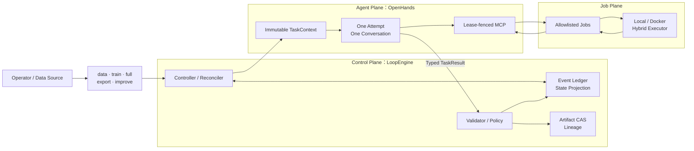
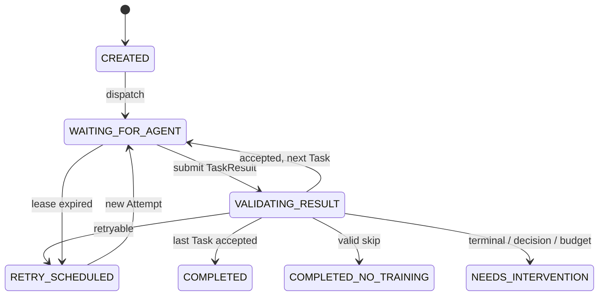
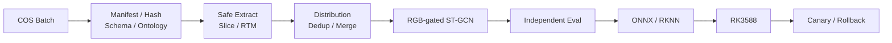
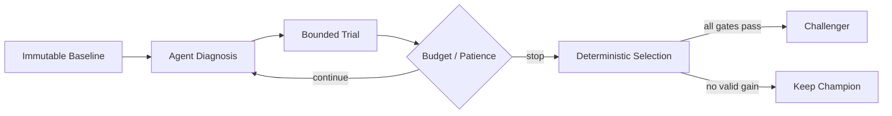

# 从 Coding Agent 到可靠的模型工程控制面

## model-agent：LoopEngine 架构、工程难点与 GraphEngine 演进

> 面试 Presentation 技术说明文档
>
> 建议时长：18～22 分钟
>
> 版本：2026-07-28

---

## 1. 问题定义：人仍然是隐藏的 Controller

使用 Codex、Claude Code 或 OpenHands 时，Agent 已经能完成调参、训练、日志分析和评测。但跨越多个 Conversation 后，人仍要负责：

```text
记住状态 → 检查结果 → 决定重试 → 传递制品
         → 控制预算 → 比较 checkpoint → 触发下一步
```

模型工程中的局部任务有不确定性，但主流程通常是确定的：

```text
固定数据与基线
→ 有界调参
→ 训练
→ 独立评测
→ checkpoint 选择
→ ONNX / RKNN 转换
```

我的设计目标不是构造一个更长生命周期的 Agent，而是在 OpenHands 外部建立确定性 LoopEngine：

> Agent 负责单个任务中的推理，Job 负责可重放计算，Engine 负责跨任务状态、验收、重试、预算和恢复。

本项目真正解决的是：

> **如何把不可信、可能中断的 Agent Conversation，纳入一个长期可靠的模型工程控制面。**

---

## 2. 核心工程亮点

| 难点 | 机制 |
|---|---|
| 状态不能依赖聊天记录 | `Run → Task → Attempt → Conversation` 领域模型与持久化 Ledger |
| Reconciler 重复执行 | watermark、稳定 ID、幂等键、payload digest、乐观版本 |
| 数据库与 OpenHands 双写 | Transactional Outbox + 确定性 Conversation ID |
| 旧 Agent 可能继续写入 | Scheduler Lease + Attempt Lease 两级 fencing |
| Agent 不能自证成功 | Typed `TaskResult` + 独立 Validator + Completion Contract |
| 模型制品难以追溯 | 内容寻址 CAS + candidate/seal + lineage closure |
| GPU 执行面权限过大 | allowlisted Job + Hybrid Executor + digest-pinned Docker |
| Agent 调参可能无限运行 | trial、patience、cost、duration 与资源预算 |

一句话概括：

> 我实现的不是一个替人点按钮的 Agent，而是一个允许 Agent 参与、但不把系统控制权交给 LLM 的 MLOps 状态机。

---

## 3. 总体架构



职责边界：

| 平面 | 负责 | 不负责 |
|---|---|---|
| Control Plane | Run/Task/Attempt、状态、验收、重试、预算、Release/Deployment | 不临场编写训练逻辑 |
| Agent Plane | 理解任务、读日志、诊断失败、提出受限实验建议 | 不推进生命周期，不接受自己的结果 |
| Job Plane | 数据、训练、评测、转换等确定性动作 | 不理解 Run，不触发下一任务 |

核心原则：

> **Agent 负责推理，Job 负责计算，Engine 负责秩序。**

---

## 4. 领域模型与状态机

```text
Run
└── TaskSequence
    ├── Task A
    │   ├── Attempt #1 → Conversation #1
    │   └── Attempt #2 → Conversation #2
    ├── Task B
    │   └── Attempt #1 → Conversation #3
    └── Task C
        └── Attempt #1 → Conversation #4
```

- `Run`：一次完整目标，绑定 watermark、RunSpec、初始 Artifact 和全局 policy。
- `Task`：一个逻辑步骤，包含 Validator、timeout、`maxAttempts` 和 Completion Contract。
- `Attempt`：Task 的一次执行；失败后创建单调递增的新 Attempt。
- `Conversation`：Attempt 的执行器，不是跨任务记忆。

Run 状态机：



后台 Reconciler 默认约每 5 秒扫描非终态 Run。`tick(run_id)` 每次只做一个确定性决策：

```text
终态                → no-op
触发 cost/duration  → stop
VALIDATING_RESULT   → validate
其他非终态          → dispatch current Task
```

因此 Controller 不会阻塞等待数小时训练，而是持续根据 Ledger 中的事实收敛状态。

---

## 5. 难点一：重复 reconcile 下的副作用一致性

Controller 可能崩溃在任意边界：

```text
状态写入前 / 后
Conversation 创建前 / 后
Job 启动前 / 后
外部副作用完成但结果尚未回写
```

系统采用：

> **at-least-once reconciliation + domain-level effectively-once**

不虚称严格 exactly-once，因为数据库、OpenHands、Docker 和 GPU Runtime 无法共享同一个事务。

### 5.1 Run 与领域命令幂等

- `(loop_id, watermark)` 唯一标识一个 Run；
- Task、Attempt、Job、Outbox 使用稳定业务 ID；
- 每个事件具有 `(run_id, idempotency_key)` 唯一约束；
- payload 会 canonicalize 后计算 digest；
- 相同 key + 相同 payload 返回已有结果；
- 相同 key + 不同 payload 抛出 `IdempotencyConflict`。

### 5.2 乐观并发

Run 维护单调递增 `version`。事件写入要求：

```text
expected_version == current_version
```

否则产生 `ConcurrencyConflict`。即使两个 Controller 读取到相同状态，也只有一个能提交。

### 5.3 Transactional Outbox

Conversation 派发是典型双写问题：

1. 事务内写入 `ConversationDispatchRequested` 和 Outbox；
2. 使用确定性 Conversation ID 调用 OpenHands；
3. 成功后事务性绑定 Conversation 与 Attempt；
4. Outbox 标记为 delivered；
5. 中途崩溃则由 Reconciler 重投相同 dispatch intent。

避免两类错误：

- 数据库认为已派发，但 Conversation 未创建；
- Conversation 已创建，数据库却再次创建新 Conversation。

### 5.4 Event + Projection

Ledger 同时保存 append-only event 和当前 projection。

`replay_run()` 可以从事件重建状态，`assert_projection_matches_replay()` 用于检查 projection 漂移。

---

## 6. 难点二：旧 Agent 的权限撤销与 split-brain

Conversation 可能卡死、网络分区，甚至在超时后继续调用工具。仅修改数据库状态不足以阻止旧执行者。

系统使用两级 Lease：

| Lease | 作用 |
|---|---|
| Scheduler Lease | 一个 loop 只有一个 active scheduler，其他 Controller standby |
| Attempt Lease | 只有当前 Attempt 的当前 Agent 可以调用 MCP、操作 Job、stage Artifact 和提交结果 |

每次 MCP 调用必须携带：

```text
attempt_id + lease_id
```

Gateway 校验 Lease 身份、有效期和 Attempt 状态。

Lease 过期后：

```text
旧工具调用被 fencing
→ Attempt 标记 CRASHED
→ 取消该 Attempt 的在途 Job
→ 记录失败证据
→ 预算内创建新 Attempt 和新 Conversation
```

Lease 在这里不是普通 heartbeat，而是写入权限的 fencing token。

另外，Gateway 按 `task.kind` 实施最小能力：

```text
train    → train
evaluate → run-evaluation / evaluate
package  → export-onnx / build-calibration /
           export-rknn / verify-conversion
```

Agent 不能用任意 shell 绕过 Task 边界；输入必须来自当前 `TaskContext`，输出必须属于本 Attempt 的受管 Job。

---

## 7. 难点三：LLM 输出的信任边界

`TaskResult.status == "succeeded"` 不代表 Task 成功。Agent 输出首先只是 proposal。

### 7.1 Typed TaskResult

唯一完成协议由 Pydantic 定义，且 `extra="forbid"`：

```text
task_id / attempt_id / status
artifact_candidates
lineage_proposals
metrics
evidence_refs
next_attempt_proposal
```

- failed 必须包含 `next_attempt_proposal`；
- succeeded 不允许请求下一 Attempt；
- 自然语言 summary 不作为机器证据。

### 7.2 Completion Contract

每个 Task 声明：

```text
required_artifact_kinds
required_evidence
metric_gates
allow_skip_training
```

独立 Validator 检查：

- Artifact kind、URI、size 与 SHA-256；
- Job 输出是否属于当前 Attempt；
- 报告 schema、输入身份与内部一致性；
- evidence 是否存在；
- `gte/gt/lte/lt/eq` 指标门禁；
- lineage proposal 是否引用当前 Run 的 sealed 输入。

Validator 只返回：

```text
accepted | retryable | terminal | needs_decision
```

### 7.3 Retry proposal 也不可信

Agent 提出 `cuda-oom-with-valid-proposal` 时，Controller 还会验证：

- 本 Attempt 是否存在真实失败 Job；
- evidence 是否引用该 Job；
- failure class 是否一致；
- batch size diff 是否为合法正整数；
- failure class 是否在 retry allowlist；
- Attempt 预算是否耗尽。

Agent 不能虚构 OOM 来申请更多 GPU 预算。

### 7.4 Proposal → Fact

验收通过后分两步接受：

```text
内容复验后将 candidate 幂等 seal 到不可变 CAS
→ Ledger 事务追加 TaskResultValidated
→ 登记 sealed Artifact identity
→ 写 lineage edge
→ 更新 Attempt / Task
→ 推进 active_task_ordinal
→ 更新 Run projection
```

Ledger 中任何不变量失败，领域状态整体回滚。CAS 对象是按 hash 写入的外部副作用，极端情况下可能留下“已写入但未被 Ledger 引用”的孤儿对象，但不会导致 Run 被错误推进；后续可以安全重用或垃圾回收。

这形成了两阶段信任模型：

```text
Agent proposal
→ deterministic validation
→ accepted domain fact
```

---

## 8. 难点四：CAS、Artifact 与模型血缘

路径不是制品身份。系统使用：

```text
artifact_id = kind + sha256(content)
```

Job 输出先进入 untrusted staging，形成 `ArtifactCandidate`。Validator 重算 hash/size 后，Controller 才能 seal 到 CAS：

```text
objects/sha256/<prefix>/<full-digest>
```

Agent 无权直接写 sealed CAS。

每条 lineage edge 记录：

- input/output Artifact；
- transform kind；
- code git SHA；
- container image digest；
- config Artifact。

封存 Release 前执行 provenance closure：

1. 从模型、评测、转换产物向上遍历；
2. 每个产物必须到达可信 root；
3. root 包括 raw data、base model、code、image、config、label mapping、tensor contract；
4. 检测 lineage cycle；
5. 不闭合则拒绝 Release。

因此系统可以回答：

> 这个 RKNN 模型来自哪批数据、哪次训练、哪版代码、哪个镜像和哪份评测？

---

## 9. 难点五：GPU Job 的执行隔离

Agent 不执行任意 shell，只能调用 `rightarm-mlops <job-kind>` 形式的 allowlisted argv。

Hybrid Executor 按 Job kind 路由：

- 数据落盘等操作走 Local Executor；
- 训练、评测等 GPU Job 走 Docker Executor；
- route、镜像、网络和 GPU 数由 operator 配置。

Docker 边界：

- image 必须使用 SHA-256 digest；
- root filesystem 只读；
- workspace 和输入只读；
- 仅受管 output 目录可写；
- 默认关闭网络；
- `cap_drop: ALL`；
- `no-new-privileges`；
- `/tmp` 为 `noexec,nosuid` tmpfs；
- CPU、memory、GPU 数固定；
- 非 root UID/GID；
- Job label 绑定 Attempt ID。

Job 同样具备幂等身份：

```text
job_id = hash(attempt_id, idempotency_key)
```

只有 Job 在 `result.json` 中声明的 output，经过 kind、ownership、hash 和 size 检查后才能 stage。

---

## 10. rightArmPerception 业务落地



### 数据工程

- manifest + 最后写入的 `_SUCCESS` 定义封口批次；
- 校验对象数、size、SHA-256、annotation schema 和固定 11 类 ontology；
- tar 安全解包，禁止路径逃逸；
- 按 subject/device/session 分组切分，避免 split 泄漏；
- baseline 与增量数据去重并检查标签冲突；
- 通过 class distribution、`NONE` 占比和 Jensen-Shannon divergence 审查分布；
- 只有确定性 recommendation 为 `merge-all-unique` 才合并。

### 训练、评测与转换

训练身份固定为：

```text
dataset hash + base checkpoint hash + resolved config
+ code SHA + image digest + seed/resources
```

训练日志中的 best metric 不直接决定模型通过。独立评测重新运行统一数据和指标。

转换阶段要求：

- PyTorch/ONNX top-1 parity；
- ONNX/RKNN top-1 parity；
- gate decision consistency；
- calibration 使用真实 validation pipeline；
- 多输入 tensor contract 与 Release 一起保存。

---

## 11. 有界模型改进

`improve` 不是让 Agent 无限调参，而是在固定 baseline 和预算中寻找合规 challenger。



默认 policy 示例：

- 最多 4 个 trials；
- patience = 2；
- 最多 50 epochs；
- batch size、worker、GPU 数有边界；
- macro-F1 满足最小有效提升；
- 最差类别 recall 不显著退化；
- `NONE` false accept rate 不越线。

分工：

| Agent | 确定性代码 |
|---|---|
| 解释日志、混淆矩阵和错误 slice | 固定评测数学与数据 |
| 提出下一实验假设 | 校验参数 allowlist/range |
| 选择优先策略族 | 扣减 trial/patience/cost/duration |
| 提供语义诊断 | winner selection 与 champion gate |

---

## 12. 验证证据与项目边界

2026-07-20 历史审计记录：

- OpenHands MLOps、API/model、Conversation tests：281 passed；
- rightArmPerception adapter tests：8 passed；
- LoopSpec / RunSpec JSON Schema 通过；
- SQLite Ledger、本地 CAS、S3 adapter contract 已验证；
- digest-pinned Docker executor 完成隔离 smoke；
- 当时版本 Ruff、mypy、pre-commit 通过。

比数量更重要的是已验证不变量：

1. 相同 watermark 只创建一个 Run；
2. 多 Task Run 使用多个独立 Conversation；
3. Agent 只有自然语言成功声明时不能推进；
4. OOM retry 必须引用本 Attempt 的真实失败 Job；
5. 相同内容只有一个 Artifact identity；
6. lineage 不闭合时拒绝 Release；
7. Lease 过期后创建新 Attempt 并取消旧 Job；
8. 重复 deployment request 不创建第二个 revision；
9. unhealthy canary 回滚到已证明的 champion；
10. audit 可回答数据、代码、镜像、失败、Job、Release 和 rollback。

准确边界：

> 已完成并验证的是 staging closed loop，不是已经上线的 production gesture deployment。

生产化仍需 PostgreSQL adapter、S3 Object Lock、正式 GPU 镜像、真实 COS→GPU→RK3588 Run、Fleet/OTA、线上监控与生产权限系统。

---

## 13. 从 LoopEngine 到 GraphEngine

线性 `taskSequence` 无法清晰表达：

- 多候选并行；
- 数据不足 skip；
- 多路评测 Join；
- 人工 approval gate；
- canary failure → rollback；
- blocked node 恢复与部分 replay。

GraphEngine 将隐式条件变成显式拓扑：

| Graph 概念 | 演进方式 |
|---|---|
| Node | 复用 TaskSpec、Attempt、Conversation、Completion Contract |
| Edge | 表达 accepted、retryable、terminal、needs-decision |
| Branch | 表达实验候选、skip、人工门禁、rollback |
| Join | 汇聚并行结果，统一评测与选择 |
| Graph State | 从 Event Ledger 投影节点状态与阻塞原因 |

没有一开始就做通用 DAG，是有意取舍：

1. 先用 Sequence 验证 Agent/Controller 信任边界；
2. 先把幂等、Lease、恢复、验证、Artifact 不变量做正确；
3. 再根据真实分支抽象 Graph DSL；
4. 避免业务语义未稳定时过度设计。

兼容演进：

```text
TaskSequence
→ 等价线性 GraphSpec
→ 条件 Edge
→ Branch / Join
→ 并行调度与部分 replay
```

> LoopEngine 先解决执行可靠性，GraphEngine 再解决复杂拓扑表达。

---

## 14. 面试中的关键技术取舍

### 为什么不用一个长 Conversation

- 上下文不是数据库；
- 自然语言不是事实；
- 权限无法按 Attempt 清晰撤销；
- Run 恢复不应依赖聊天历史；
- 长上下文会混入无关任务和旧失败判断。

### 为什么不直接使用 Airflow、Argo 或 Kubeflow Pipelines

它们擅长确定性 DAG Job；本项目额外处理：

- 节点内部是不可信 Agent；
- Attempt 级动态授权与撤销；
- proposal 到 fact 的独立验收；
- retry proposal 的真实性；
- 模型 Artifact、lineage、Release、rollback 领域不变量。

LoopEngine 是 Agentic MLOps domain control plane，不必替代底层调度器。生产环境可以让 Kubernetes/Argo 执行 Job，LoopEngine 继续管理 Agent 与模型生命周期。

### 为什么 staging 使用 SQLite

- 先把事务、事件、幂等与恢复语义做正确；
- WAL + `BEGIN IMMEDIATE` 适合当前单节点 staging；
- 领域 API 不暴露 SQLite 特有类型；
- 生产目标是 PostgreSQL adapter。

### 为什么不宣称 exactly-once

```text
at-least-once reconcile
+ idempotent domain commands
+ payload digest conflict detection
+ optimistic concurrency
+ transactional outbox
+ fenced ownership
= domain-level effectively-once
```

这个表述比“绝不重复执行”更准确。

---

## 15. 建议 PPT 页面

| 页 | 标题 | 重点 |
|---:|---|---|
| 1 | 从 Conversation 到控制面 | 30 秒切入：人是隐藏 Controller |
| 2 | 设计原则 | Agent 推理、Job 计算、Engine 控制 |
| 3 | 总体架构 | Control/Agent/Job 三平面 |
| 4 | 领域模型与状态机 | Run→Task→Attempt→Conversation |
| 5 | 幂等与崩溃恢复 | version、digest、Outbox、replay |
| 6 | 并发与权限撤销 | Scheduler/Attempt Lease、fencing |
| 7 | LLM 信任边界 | TaskResult、Validator、Contract |
| 8 | Artifact 与 lineage | CAS、candidate/seal、closure |
| 9 | GPU 执行隔离 | Hybrid Executor、容器安全策略 |
| 10 | rightArm 业务落地 | COS→dataset→train→eval→RKNN |
| 11 | 有界模型改进 | trial、patience、gate、champion |
| 12 | 测试证据与边界 | 工程不变量、staging/production |
| 13 | GraphEngine 演进 | Edge、Branch、Join、兼容迁移 |
| 14 | 技术取舍与总结 | 为什么不是长 Agent 或普通 DAG |

前两页控制在 2 分钟内，主要时间放在第 5～11 页。

---

## 16. 总结

项目的核心不是“Agent 能跑训练”，而是围绕 Agent 建立了一组不可绕过的工程不变量：

```text
状态不依赖聊天记忆
结果不依赖 Agent 自证
副作用可以幂等恢复
旧执行者可以被 fencing
实验受到预算约束
制品可以追溯到可信输入
生产状态只由确定性外环推进
```

> **最终形成的是一个以 Agent 处理局部不确定性、以确定性 Engine 保证全局可靠性的模型工程控制面。**
