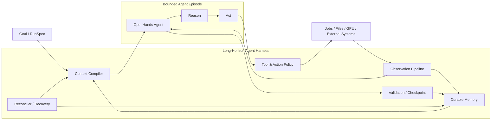
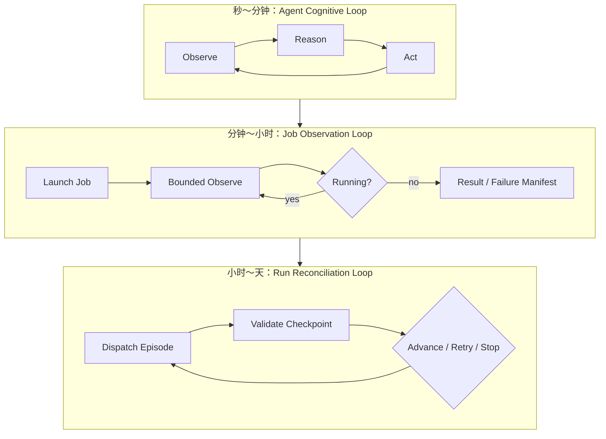
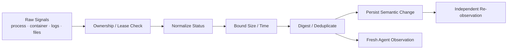
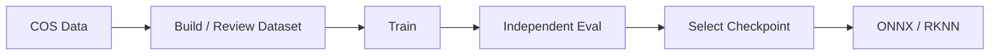

# Engineering a Long-Horizon Agent Harness

## 用 Observation、外部状态与可恢复执行突破单次 Conversation 边界

> 面试 Presentation / 简历项目说明
>
> 建议时长：18～22 分钟
>
> 版本：2026-07-28

---

## 1. 项目应该如何定位

这个项目不应该被定位成“用 Agent 跑 MLOps 流水线”。

更准确的定位是：

> **我设计并实现了一个 long-horizon agent harness，把一次性、短生命周期的 Agent Conversation，扩展成可以跨任务、跨进程、跨数小时或数天持续推进的工程系统。**

模型训练、评测和 checkpoint 选择是验证场景，因为它天然具有：

- 长时间运行；
- 外部环境持续变化；
- 多步骤依赖；
- 中间失败与重试；
- 大量日志和制品；
- 明确的质量门禁；
- 高资源成本。

因此这个场景可以检验 Agent Harness 是否真正具备 long-horizon 能力，而不只是能否完成一次 tool call。

### 一句话简历版本

> 设计并实现面向模型工程的 long-horizon agent harness，通过结构化 Observation、外部状态与制品记忆、Attempt 级 Conversation 隔离、Lease fencing、幂等 Reconciler 和独立结果验证，使 OpenHands Agent 能跨数小时/数天持续执行并在中断后恢复。

---

## 2. 对 Long Horizon 的定义

Long horizon 不是：

- 使用更大的 context window；
- 让一个 Conversation 永远不结束；
- 让 Agent 不停循环调用工具；
- 把所有历史日志继续塞回 prompt。

工程上的 long horizon 是：

> **系统在经历长时间等待、多次环境变化、上下文切换、进程重启和局部失败后，仍能保留目标、恢复可信状态并继续推进。**

它至少需要解决六个问题：

| 能力 | 需要回答的问题 |
|---|---|
| Observation | Agent 如何持续获得新鲜、相关、可解析的环境反馈？ |
| Memory | 哪些信息需要跨 Conversation 保存，哪些不应该保存？ |
| Checkpoint | 什么状态可以被视为可信进度？ |
| Recovery | Agent、Controller 或 Job 中断后从哪里继续？ |
| Control | 如何防止旧 Agent、重复动作和无限重试？ |
| Validation | 如何避免错误 Observation 或幻觉推进长期状态？ |

我的核心判断是：

> **Long horizon 的瓶颈通常不是模型能不能继续推理，而是 Harness 能不能持续提供正确 Observation，并把可信进度外部化。**

---

## 3. Harness 的职责

Agent Harness 是包围在 LLM/Agent 外部的工程系统。



Harness 负责：

1. 把长期目标编译成当前 Episode 可执行的局部目标；
2. 只暴露当前任务允许的 Action；
3. 把原始环境信号转换成有界、结构化 Observation；
4. 在 Conversation 外保存事实、制品和进度；
5. 验证当前 Episode 是否形成可信 checkpoint；
6. Episode 失败或超时时回收权限并创建下一 Episode；
7. 在重启后根据外部状态恢复，而不是依赖聊天记录。

---

## 4. 三层时间尺度

系统不是一个无限循环，而是三个不同时间尺度的嵌套 loop。



### Agent Cognitive Loop

发生在单个 OpenHands Conversation 内：

```text
Observation → reasoning → tool action → new Observation
```

### Job Observation Loop

用于训练、评测等长任务。Agent 不在一次推理中阻塞数小时，而是通过有界 observation window 周期性获得状态。

### Run Reconciliation Loop

位于 Conversation 外部。它负责跨 Task、跨 Attempt 和跨进程推进长期目标。

这三个 loop 的分层，是 long horizon 能成立的基础。

---

## 5. 核心工程：Observation Pipeline

Observation 不是“把 stdout 原样返回给 Agent”。

原始日志通常具有以下问题：

- 数据量无限增长；
- 相同状态被重复返回；
- 成功、失败和运行中缺少稳定语义；
- 日志路径可能指向其他 Attempt；
- 输出文件可能在观察后被修改；
- JSON 可能过大、递归过深或包含非法值；
- Agent 无法区分新 Observation 和缓存结果。

因此我实现的是一条 Observation Pipeline：



### 5.1 Observation 类型

| Observation | 内容 |
|---|---|
| Job Observation | `running/succeeded/failed/cancelled/lost`、return code、log tail |
| Result Observation | `result.json`、声明的 outputs、指标和报告 |
| Failure Observation | `failure.json`、failure class、失败证据 |
| Process Observation | PID/container 是否仍存在、是否被取消 |
| Lease Observation | Conversation 是否仍拥有当前 Attempt |
| Artifact Observation | path ownership、kind、size、SHA-256 |
| Validation Observation | gate、schema、lineage、completion contract |
| Policy Observation | attempt、duration、cost、artifact budget |

### 5.2 状态归一化

Local process 和 Docker container 的底层状态不同，但 Harness 向 Agent 暴露统一语义：

```text
running
succeeded
failed
cancelled
lost
```

成功不由 exit code 单独决定，而以受控 Job 写出的结构化 `result.json` 为准；失败使用 `failure.json`。

这使 Agent 不需要针对不同 Runtime 猜测日志含义。

### 5.3 有界 Observation Window

一次 `observe_job` 最多在一个 Agent iteration 内等待约 240 秒：

- 初始 poll interval 约 1 秒；
- 指数退避；
- 最大 interval 约 15 秒；
- Job 提前终止则立即返回；
- 超过本次 observation window 仍为 running，则把控制权交还 Agent。

这避免了：

- 一个 tool call 阻塞整个 Conversation 数小时；
- Agent 高频轮询浪费 token 和 API；
- Harness 因等待外部 Job 失去响应。

### 5.4 Observation Freshness

长期运行 Job 可能连续多次返回完全相同的 `running` 状态。

对于 Agent Runtime，这些必须是“新的观察动作结果”，否则可能被缓存、折叠或被误认为没有执行。

因此 running observation 会附加：

```text
poll_observation_id = random UUID
```

终态 Observation 保持稳定。

这个设计同时满足：

- Agent 侧：每次合法 poll 都是 fresh observation；
- 持久化侧：相同 running 状态不会无限制造 Event。

### 5.5 Observation Deduplication

Ledger 对 Observation 的语义字段计算 digest：

```text
status
return_code
result
failure
log_path
log_sha256
log_size_bytes
```

对于 `running` 状态，持久化 digest 不纳入持续变化的 log hash/size，避免每增加一行日志就追加一个领域事件。

只有语义状态改变时，才写入新的 `JobAttemptObserved` event。

这区分了两件事：

- Freshness：给 Agent 的每次 poll 都是新的；
- Durability：Ledger 只保存有意义的状态变化。

### 5.6 Observation Boundedness

Harness 不把无限日志和任意文件塞进上下文：

- log tail 最大约 16 KiB；
- structured output 最多读取 16 个文件；
- 单文件最大 256 KiB；
- 总 structured output 最大 1 MiB；
- 只读取成功 Job 明确声明的 JSON output；
- 拒绝非有限 JSON 数值、越界路径和 digest 不一致文件。

Long horizon 依赖信息压缩，而不是历史无限累积。

---

## 6. Observation 的可信性

Observation 需要同时满足：

```text
Fresh
Relevant
Bounded
Owned
Typed
Verifiable
```

### Ownership

每个 Job 绑定 `owner_attempt_id`。Agent 不能观察或 stage 其他 Attempt 的 Job output。

### Declaration

Job 必须在结构化 result manifest 中声明：

- output kind；
- output path；
- size；
- SHA-256。

Harness 会重新检查声明与实际文件。

### Capability

Action 和 Observation 都受当前 Task 能力限制。例如 evaluate Episode 不能启动 train Job。

### Re-observation

Agent 读到的 Observation 仍不直接成为长期事实。

Agent 提交 `TaskResult` 后，独立 Validator 会重新读取 Artifact、报告和指标，进行二次观察：

```text
Environment Observation
→ Agent Interpretation / Proposal
→ Independent Re-observation
→ Accepted Fact
```

这解决了长期 Agent 中最危险的问题之一：

> 一次错误解释如果被写入长期记忆，会在后续多个 Episode 中持续放大。

---

## 7. 外部化 Memory：不把 Conversation 当数据库

Long horizon 的第二个核心是把不同类型的记忆放到 Agent 外部。

| Memory | 实现 | 保存内容 |
|---|---|---|
| Operational Memory | Event Ledger | Run、Task、Attempt、Job、Lease、状态变化 |
| Artifact Memory | Content-addressed CAS | 数据、checkpoint、报告、模型包 |
| Provenance Memory | Lineage Graph | data/code/config/image 到输出的关系 |
| Policy Memory | RunSpec / TaskSpec | 目标、预算、能力、完成条件 |
| Episode Memory | TaskContext | 当前 Episode 需要的最小上下文 |

### Event Ledger

使用 append-only event + query projection：

- Event 提供审计和 replay；
- Projection 提供当前状态查询；
- `replay_run()` 可以重建状态；
- projection 可以与 replay 结果做一致性检查。

### Artifact CAS

使用：

```text
artifact_id = kind + sha256(content)
```

路径不再是身份。下一 Episode 接收的是 sealed Artifact reference，而不是上一段 Conversation 中提到的任意文件路径。

### Context Compiler

新 Conversation 不继承全部聊天历史。Harness 根据当前状态重新编译 `TaskContext`：

```text
局部 objective
Attempt number
Lease
Run policy
已接受输入 Artifact
Completion Contract
本次 retry 的 spec diff
必要 domain references
```

这是一种 selective memory：

> 保存事实，不保存无关推理轨迹；重建当前上下文，不回放全部历史。

---

## 8. Episode：用新的 Conversation 延长系统寿命

一个 Attempt 对应一个 bounded Agent Episode，一个 Episode 对应一个新的 Conversation。

```text
Task
├── Attempt #1 / Conversation #1
├── Attempt #2 / Conversation #2
└── Attempt #3 / Conversation #3
```

为什么不续用原 Conversation：

- 控制 context growth；
- 隔离旧的错误判断；
- 让权限撤销边界清晰；
- 允许使用新的 action norm / skill；
- Run 恢复不依赖 Conversation 内存；
- 每个失败都有独立 evidence 和 cost。

Long horizon 在这里不是“一个 Agent 活得更久”，而是：

> **系统通过多个可替换的短 Episode，保持同一个长期目标持续存在。**

---

## 9. Lease Fencing：让旧 Episode 真正失效

Conversation 超时后可能继续运行。只把 Attempt 标记失败，不能阻止旧 Agent 继续调用工具。

每个 Episode 因此获得 Attempt Lease。每个 MCP 调用都必须携带：

```text
attempt_id + lease_id
```

Gateway 校验：

- Lease 是否存在；
- Lease ID 是否匹配；
- Lease 是否过期；
- Attempt 是否仍为 `RUNNING`。

Lease 过期后：

```text
旧 Agent 的 tool call 被拒绝
→ Attempt 记录为 CRASHED
→ 取消其仍在运行的 Job
→ 记录 agent-conversation-lost Observation
→ 在预算内创建新 Attempt
→ 编译新 TaskContext
→ 启动新 Conversation
```

这是 fencing，不只是 heartbeat。它解决了新旧 Episode 同时写入的 split-brain。

系统还使用 Scheduler Lease，保证同一个 loop 只有一个 active Controller。

---

## 10. Reconciler：在 Agent 外部维持长期目标

后台 Reconciler 周期性扫描非终态 Run：

```text
Observe durable state
→ 检查 policy
→ 恢复过期 Attempt
→ 清理 orphan Job
→ 派发当前 Episode
→ 验证已提交结果
→ 推进 / 重试 / 停止
```

Controller 每次 tick 只做一个确定性决策，因此可以安全重复执行。

### Effectively-once

跨数据库、OpenHands 和 Job Runtime 无法实现严格全局 exactly-once。

系统组合：

```text
at-least-once reconcile
+ stable identity
+ idempotency key
+ payload digest
+ optimistic version
+ transactional outbox
+ lease fencing
= domain-level effectively-once
```

### Conversation Dispatch Outbox

先持久化 dispatch intent，再调用 OpenHands，并使用确定性 Conversation ID。

即使“Conversation 已创建但 HTTP 响应丢失”，下次 reconcile 也会查询或重试同一个 Conversation，而不是创建第二个 Episode。

---

## 11. Checkpoint：什么才算取得长期进度

Agent 的自然语言“完成了”不是 checkpoint。

每个 Task 具有 Completion Contract：

```text
required_artifact_kinds
required_evidence
metric_gates
allow_skip_training
```

Agent 只能提交 typed `TaskResult`。Validator 只返回：

```text
accepted
retryable
terminal
needs_decision
```

只有 `accepted` 才会：

- 把 candidate seal 为不可变 Artifact；
- 写入 lineage；
- 更新 Attempt/Task；
- 推进 Run；
- 让下一 Episode 看见这些结果。

因此 long-horizon memory 中保存的不是 Agent belief，而是 validated checkpoint。

---

## 12. Case Study：模型训练与评测



这个场景验证了 Harness 能力：

| 业务现象 | Harness 问题 |
|---|---|
| 训练持续数小时 | bounded observation + external Job state |
| 日志不断增长 | tail、digest、semantic dedup |
| CUDA OOM | typed failure Observation + bounded retry |
| 多次调参 | Episode 切换 + retry spec diff |
| 多个 checkpoint | CAS identity + lineage |
| 训练自报 best metric | independent re-evaluation |
| Agent 误判完成 | Completion Contract + Validator |
| 服务重启 | Ledger replay + Reconciler |

`improve` Run 进一步验证 bounded autonomy：

- Agent 负责误差分析和下一实验假设；
- Harness 限制参数范围；
- trial、patience、duration、cost 有预算；
- winner selection 由确定性代码执行；
- 没有合规提升时保留 champion。

MLOps 不是项目定位，而是 long-horizon harness 的高强度测试场。

---

## 13. 如何评估 Long-Horizon Harness

不能只看“Agent 最后有没有回答成功”，更应该评估：

### Progress

- Task completion rate；
- accepted checkpoint 数量；
- 无人工介入的最长 Run 时长；
- 跨 Conversation 的任务推进比例。

### Recovery

- Conversation 丢失后的恢复成功率；
- Controller 重启后的恢复时间；
- orphan Job 清理率；
- retry 后重复副作用数量。

### Observation Quality

- Observation 到终态的延迟；
- 无效 poll 和重复 event 比例；
- structured output 解析失败率；
- context 大小随 Run 时长的增长曲线。

### Safety

- stale Lease 拒绝率；
- cross-attempt access 拒绝率；
- 未经 Validator 推进的状态数量，应为 0；
- lineage 不闭合 Release 数量，应为 0。

### Efficiency

- 每个 accepted checkpoint 的 token/GPU/cost；
- Observation 压缩率；
- Agent 等待外部 Job 的空转 token；
- budget stop 是否按预期触发。

当前项目已通过测试验证多 Conversation、Lease expiry recovery、Observation freshness/dedup、projection replay、虚假成功拒绝、基于真实失败 Job 的 retry 和 lineage closure 等不变量。

---

## 14. 从 LoopEngine 到 GraphEngine

LoopEngine 先解决了：

- Episode 生命周期；
- Observation；
- Memory；
- Checkpoint；
- Recovery；
- Control。

当长期目标出现并行候选、条件分支和 Join 时，再把线性 `TaskSequence` 演进为 Graph。

```text
TaskSequence
→ 线性 GraphSpec
→ Conditional Edge
→ Branch / Join
→ Parallel Episode Scheduling
→ Partial Replay
```

GraphEngine 复用现有 Node 执行语义：

- 每个 Node 仍然是 Task；
- 每次执行仍然是 Attempt/Conversation；
- Observation、Lease、Validator、Artifact 不变；
- 只把隐式推进条件变成显式 Edge。

> LoopEngine 解决 long-horizon execution，GraphEngine 解决 long-horizon topology。

---

## 15. 最值得讲的技术洞察

### 1. Long horizon 不等于 long context

上下文越长，噪声、成本和错误累积也越严重。真正可扩展的方法是 external state + selective context reconstruction。

### 2. Observation 比 Prompt 更接近系统瓶颈

Prompt 决定 Agent 如何思考；Observation 决定 Agent 基于什么事实思考。错误、过期或无限的 Observation 会直接破坏长期行为。

### 3. Agent 不应该拥有全局状态

Agent 是可替换的推理单元。长期目标应该由 Harness 持有，Conversation 只是一个 Episode。

### 4. 长期记忆必须分层

事件、制品、策略和当前上下文不是同一种 memory，不能都塞进向量库或 transcript。

### 5. Progress 必须经过验证

如果错误 belief 可以成为下一 Episode 的输入，错误会跨时间放大。Validated checkpoint 是 long horizon 的安全边界。

### 6. Recovery 是正常路径

Agent 丢失、Job 超时和服务重启不是异常边角，而是长周期系统必然发生的状态。

---

## 16. 简历写法

### 一条完整版

> 设计并实现面向模型工程的 long-horizon agent harness，将 OpenHands Conversation 抽象为可恢复的 TaskAttempt/Episode；构建有界 Observation pipeline、Event Ledger/CAS 外部记忆、TaskContext 重建、Lease fencing、幂等 Reconciler、Transactional Outbox 与独立 Validator，支持跨数小时/数天的训练—评测—选优链路及中断恢复。

### 三条项目 Bullet

- 设计 `Run → Task → Attempt → Conversation` 分层执行模型，通过短生命周期 Agent Episode、外部状态 checkpoint 和上下文重建，实现跨 Conversation 的 long-horizon task execution。
- 构建 Job Observation pipeline：统一进程/容器状态，支持 bounded long-poll、fresh poll identity、semantic digest dedup、16 KiB log tail 与受限 structured output，避免长任务造成阻塞和上下文无限增长。
- 实现 Lease fencing、幂等事件、乐观并发、Conversation Dispatch Outbox、CAS/lineage 和独立结果验证，使 Agent/Controller 中断后可恢复，并阻止 stale Agent、虚假成功与重复副作用推进系统状态。

### 更偏 Agent Infra 的版本

> Built a long-horizon agent harness around OpenHands with observation shaping, durable episodic state, context reconstruction, fenced tool execution and validated checkpoints, enabling recoverable multi-episode execution over long-running ML jobs.

### 更偏系统工程的版本

> Designed an event-driven control plane for long-running agents using at-least-once reconciliation, idempotent domain commands, optimistic concurrency, transactional outbox and lease fencing to achieve domain-level effectively-once execution.

---

## 17. 90 秒面试讲法

> 这个项目最开始来自我使用 Codex 和 OpenHands 的体验：单个 Conversation 能很好地改代码和跑命令，但一旦任务跨数小时、包含训练、评测和多次重试，人仍然需要在 Conversation 之间维护状态。
>
> 所以我做的不是一个普通 MLOps pipeline，而是一个 long-horizon agent harness。核心思路是把 Conversation 当成可替换的短 Episode，把长期目标和可信状态放到 Agent 外部。
>
> 技术上我重点做了 Observation Engineering：训练 Job 可以运行几个小时，但 Agent 每次只进行最长约 240 秒的 bounded observation；running poll 对 Agent 保持 fresh identity，对 Ledger 则按 semantic digest 去重；日志只返回有界 tail，结构化输出有数量和大小限制，并且必须通过 ownership、声明和 hash 检查。
>
> 每个 Episode 使用独立 Conversation 和 Lease。Lease 过期后旧 Agent 的工具权限会被 fencing，Reconciler 取消旧 Job 并创建新 Attempt。Agent 的结果只是 proposal，只有独立 Validator 重新检查 Artifact、指标和 lineage 后，才会成为下一 Episode 可见的 checkpoint。
>
> 最终这个系统不是靠无限上下文获得 long horizon，而是靠 Observation、外部 Memory、Episode 切换、validated checkpoint 和 recovery 获得 long horizon。

---

## 18. PPT 建议

| 页 | 标题 | 重点 |
|---:|---|---|
| 1 | Long Horizon ≠ Long Context | 项目重新定位 |
| 2 | Why Existing Agents Stop at One Conversation | 人是隐藏 Controller |
| 3 | What Is an Agent Harness | Context、Tools、Observation、Memory、Checkpoint |
| 4 | Three Nested Loops | Agent / Job / Run 三个时间尺度 |
| 5 | Observation Pipeline | normalize、bound、digest、persist、deliver |
| 6 | Observation Freshness vs Dedup | fresh poll ID 与 semantic event |
| 7 | Externalized Memory | Ledger、CAS、lineage、TaskContext |
| 8 | Episode and Context Reconstruction | Attempt / Conversation |
| 9 | Lease Fencing and Recovery | stale Agent、split-brain |
| 10 | Reconciler and Effectively-once | version、idempotency、Outbox |
| 11 | Validated Checkpoint | proposal → re-observation → fact |
| 12 | MLOps Case Study | 训练—评测—选优作为验证场 |
| 13 | Evaluation and Invariants | recovery、observation、safety、cost |
| 14 | LoopEngine → GraphEngine | execution 到 topology |
| 15 | Engineering Takeaways | 六个技术洞察 |

开场不要花时间介绍五种 Run 入口。前两页控制在 2 分钟，把主要时间放在 Observation、Memory、Episode、Recovery 和 Validation。

---

## 19. 最终总结

这个项目的技术主线可以收束为：

```text
Raw Environment
→ Bounded Structured Observation
→ Agent Episode
→ Proposed Result
→ Independent Validation
→ Durable Checkpoint
→ Context Reconstruction
→ Next Episode
```

> **Long horizon 不是让一个 Agent 永远运行，而是让一个目标能够跨越多个可替换 Agent Episode 持续存在。**
