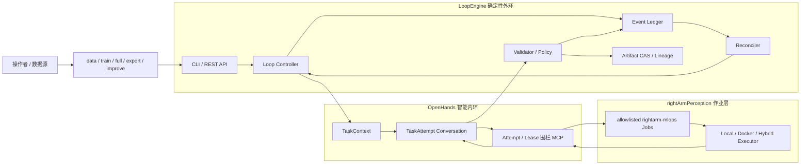
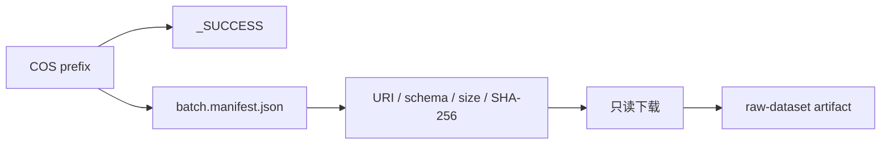
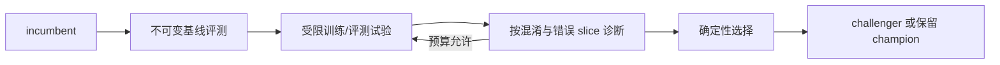
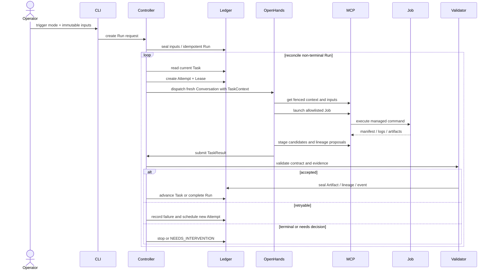

# model-agent LoopEngine：架构、实现与演进

## 摘要

`model-agent` 将 模型 的数据处理、训练、评测、模型转换和发布准备工作组织成一个可持续运行的模型工程闭环。它不是把所有操作交给一个长生命周期 Agent，而是在 OpenHands 外部建立确定性的 LoopEngine，由外环管理事实、状态和策略，由 Agent 处理单个任务中的不确定性，由模型 Job 执行可重放的工程动作。

当前 LoopEngine 已经完成五类人工 Run 入口、Run/Task/Attempt 生命周期、OpenHands 任务分派、带 Lease 的工具边界、结构化结果协议、独立 Validator、内容寻址制品、数据、有限重试、崩溃恢复和审计接口。
它解决的是“模型流程如何长期可靠地转起来”，而不只是“如何运行一次训练”。

GraphEngine 是这一架构后续的自然扩展：当固定任务序列继续增长为候选分支、条件门禁、并行评测和回滚路径时，把已经存在的隐含拓扑显式化。GraphEngine 不替换 LoopEngine，而是在其可靠性基础上增加图编排能力。

## 1. 要解决的问题

rightArmPerception 的完整模型路径涉及业务数据、标注、人体和手部关键点提取、数据集编译、RGB-gated ST-GCN 训练、离线评测、ONNX/RKNN 转换以及 RK3588 验证。单个步骤可以通过脚本完成，但持续运行时会出现一组脚本本身无法解决的问题。

### 1.1 状态问题

模型流程可能持续数小时或数天。状态如果只存在于终端输出、日志或 Agent 对话里，服务中断后就无法准确判断：

- 当前消费的是哪一批数据；
- 哪个任务已经完成；
- 哪次训练属于当前 Run；
- 哪个 checkpoint 通过了评测；
- 失败后是否已经重试；
- 下一步应该继续、停止还是请求人工决策。

### 1.2 可信问题

命令退出码为 0、Agent 回复“完成”，都不能证明模型工程任务真正完成。系统必须独立检查：

- 输入数据和输出文件的内容哈希；
- 报告 schema 和必需字段；
- 指标是否由受信任报告产生；
- 输出制品是否属于当前 Attempt 的受管 Job；
- 数据、模型、代码、配置和镜像的血缘是否闭合；
- 评测、转换和部署门禁是否满足。

### 1.3 恢复问题

网络错误、GPU 节点丢失、CUDA OOM、Agent 崩溃和服务重启需要不同处理。系统必须区分：

- 同一 Conversation 内可以修复的局部错误；
- 需要新 Attempt 的可重试失败；
- 需要调整受限参数的资源失败；
- 不可重试的输入、血缘或权限错误；
- 需要人参与的业务决策。

### 1.4 权限问题

Agent 需要足够能力完成任务，但不能因此获得宿主机、密钥、制品库和生产生命周期的所有权限。工具调用必须绑定当前 Run、Task、Attempt 和 Lease，生产状态只能由确定性外环推进。

### 1.5 持续改进问题

模型改进不是无限试验。系统需要固定数据、基线模型、评测口径和实验预算，在有限候选中选择真正改进且不违反产品门禁的 challenger；没有合规改进时继续保留 champion。

## 2. LoopEngine 总体架构

LoopEngine 采用“确定性外环 + 智能内环 + 模型作业层”的结构。



### 2.1 Loop Controller

Controller 是跨任务生命周期的唯一 owner，负责：

- 按 `(loop_id, watermark)` 或 request ID 幂等创建 Run；
- 找到当前可执行 Task；
- 创建 TaskAttempt 和 Attempt Lease；
- 为 Attempt 构造不可变 `TaskContext`；
- 分派新的 OpenHands Conversation；
- 接收结构化 `TaskResult`；
- 调用独立 Validator；
- 接受制品和血缘，或决定重试、停止和请求决策；
- 在重启后恢复非终态 Run。

Controller 不临场编写训练代码，也不根据 Agent 的自然语言直接推进状态。

### 2.2 OpenHands Task Agent

OpenHands 是单个 Attempt 的智能执行器，负责：

- 理解当前 Task 的目标、输入和完成契约；
- 通过 MCP 查询受管输入；
- 在任务允许范围内启动 Job；
- 观察日志和结构化 Job 结果；
- 分析局部失败并提出有限的下一 Attempt 建议；
- 登记候选制品、血缘提案和证据；
- 提交唯一受支持的结构化完成消息 `TaskResult`。

OpenHands 不负责创建下一任务、分配重试次数、封存 Release 或修改 Deployment 状态。

### 2.3 rightArmPerception Job

Job 是确定性作业接口，负责真正的数据和模型计算。它接收受控参数，输出机器可读 manifest、报告、指标和制品。当前覆盖：

- COS 批次检查和落盘；
- 数据解包、标注检查、切片和 RTM 特征提取；
- 增量数据集生成；
- 基线与增量数据集分布审查和确定性合并；
- RGB-gated ST-GCN 训练；
- checkpoint 评测；
- 有界模型改进试验；
- ONNX、RKNN 和转换一致性产物生成。

Job 不理解 Run 状态，也不能自行触发下一个 Job。

### 2.4 Validator

Validator 是 Agent 提案进入系统事实的准入点。它独立读取候选制品和机器报告，检查：

- 完成契约要求的制品种类；
- SHA-256、字节数和受管输出路径；
- JSON schema、输入身份和报告内部一致性；
- 指标门禁；
- lineage proposal 是否引用当前 Run 的合法输入；
- 失败类别和重试提案是否有真实 Job 证据。

Validator 返回四种 disposition：`accepted`、`retryable`、`terminal` 和 `needs_decision`。生命周期由 Controller 根据该结果和 policy 推进。

### 2.5 Ledger 与 Artifact Store

Ledger 持久化 Run、Task、Attempt、Lease、Event、Job、Artifact、Lineage、Release、Deployment 和 Approval。Artifact Store 以内容哈希封存不可变制品。两者共同承担跨进程记忆，OpenHands Conversation 不承担这一职责。

## 3. 当前已经完成的任务路径

### 3.1 五种人工入口

人工入口允许从不同阶段开始一个可审计 Run，而不要求每次都从原始业务数据执行完整路径。

| 入口 | 必需输入 | Task 序列 | 主要结果 |
|---|---|---|---|
| `data` | COS URI、三个 RTM 模型、可信基线数据集 | `inspect-data` → `build-dataset` → `review-dataset-distribution` | 增量数据报告、分布审查、合并后的训练数据集 |
| `train` | MMAction 数据集、base model | `train-challenger` → `evaluate-challenger` → `package-rknn` | checkpoint、评测、ONNX/RKNN 和一致性报告 |
| `full` | COS URI、三个 RTM 模型、可信基线数据集、base model | 数据路径 → 训练 → 评测 → 打包 | 从封口业务批次到模型包的完整血缘 |
| `export` | checkpoint、MMAction 数据集 | `evaluate-challenger` → `package-rknn` | 重新评测和转换后的模型包 |
| `improve` | MMAction 数据集、incumbent/base model | `improve-challenger` | 基线评测、有限候选试验、误差诊断和模型选择 |

所有入口支持 `--dry-run`。Dry-run 只验证参数、文件身份和输入完整性，不复制输入、不创建 Run，也不启动训练。

正式触发时，本地输入先进入用户私有导入区并计算 SHA-256；Controller 封存后，Task 只接收 Artifact ID，而不是操作者提供的任意路径。

### 3.2 数据检查与不可变落盘

`inspect-data` 处理已经封口的 COS 批次。约定批次包含 manifest 和最后写入的 `_SUCCESS` 标记。



这一阶段验证：

- URI 必须是合法 `cos://bucket/non-empty-prefix/`；
- prefix、manifest 和 completion marker 符合约定；
- 对象数量、大小和 SHA-256 与 manifest 一致；
- annotation schema 和固定 11 类 ontology 合法；
- COS 凭据不进入 Agent Conversation；
- 下载结果以不可变 raw dataset 和 validation report 输出。

### 3.3 数据集构建

`build-dataset` 将 raw dataset 转换为模型训练输入：

```text
安全解包
  → 标注与视频引用检查
  → 按标注切片
  → RTMDet / RTMPose 特征提取
  → 生成 21 点手部骨架和 RGB ROI 输入
  → 按 subject / device / session 分组划分
  → 生成 11 类 MMAction 数据集和报告
```

关键约束包括：

- tar 解包不能逃逸任务目录；
- 标注引用的视频必须存在；
- 分组切分避免同一 subject/device/session 跨 split 泄漏；
- 输出 bundle 使用可移植相对路径；
- 数据不足可以产生有证据的 `COMPLETED_NO_TRAINING`，而不是强制训练。

### 3.4 数据分布审查与合并

`review-dataset-distribution` 对可信基线数据集和本轮增量数据集执行确定性比较。该阶段已经从“人工先合并 PKL”升级为可验证 Job。

审查内容包括：

- 样本 canonical identity；
- 基线内部和增量内部去重；
- 增量样本与基线样本的重复或标签冲突；
- class distribution 和 `NONE` 类占比变化；
- projected train distribution 的 Jensen-Shannon divergence；
- 增量与基线规模比例；
- subject/device/session group 的 split 泄漏。

只有确定性 recommendation 为 `merge-all-unique` 时才允许合并。合并 Job 会重新计算分布报告并校验报告 digest，不能直接相信调用方提交的合并决定。输出包括：

- `dataset-distribution-report.json`；
- `dataset-merge-plan.json`；
- 合并后的可移植数据集；
- `dataset-merge-report.json`；
- 从基线和增量输入到合并输出的 lineage。

### 3.5 模型训练

`train-challenger` 固定模型训练所需的工程身份：

- sealed dataset；
- base checkpoint；
- reviewed config；
- code revision；
- executor image identity；
- GPU 数、batch size、worker、seed 和 epoch；
- best/last checkpoint；
- resolved config、训练日志和 metrics。

训练过程不能接受任意 shell 或任意 MMEngine 参数。模型 Job 只允许受审查的 config 和参数集合，输出必须由受管 Job manifest 声明。

### 3.6 独立评测

`evaluate-challenger` 不采信训练日志里的最佳指标，而是基于不可变数据集重新执行评测并生成机器报告。Validator 从报告中复算或提取受信任指标，再应用门禁。

标准长期 RunSpec 包含：

- macro-F1 相对 champion 的变化；
- 最差类别 recall 相对 champion 的变化；
- `NONE` false accept rate；
- PyTorch/ONNX top-1 一致性；
- ONNX/RKNN top-1 一致性；
- gate decision 一致性；
- RK3588 端到端 P95 延迟相对 champion 的变化。

人工 `train` 和 `export` 路径覆盖到离线评测与模型打包；板端和生产门禁需要真实外部基础设施后才能形成完整生产闭环。

### 3.7 ONNX/RKNN 打包与一致性

`package-rknn` 将通过评测的 checkpoint 转换为部署制品。路径包含：

```text
PyTorch checkpoint
  → ONNX
  → 使用真实验证 pipeline 生成 calibration 数据
  → RKNN FP16 / INT8
  → PyTorch / ONNX / RKNN parity report
```

转换结果不是只检查文件存在，而是要求结构化 parity report 和对应制品 hash。模型输入包含 keypoint、RGB ROI、handedness 和 global trajectory，多输入张量契约必须与发布制品一同保留。

### 3.8 有界模型改进

`improve` 入口把“让 Agent 调参”限制为一个有明确搜索空间、评测口径和停止策略的工程任务。

流程为：



默认 policy：

- 最多 4 个 trials；
- patience 为 2；
- 目标 macro-F1 增量 0.002；
- 最小有效改进 0.0005；
- 最多 50 epochs；
- batch size、worker 和 GPU 数具有边界；
- 停止原因只能是 target reached、patience exhausted 或 trial budget exhausted。

Agent 可以在允许的策略族中提出实验假设，例如 optimizer、regularization、augmentation、motion ablation 和 gesture gate；实际参数会经过 allowlist、范围校验和规范化。评测数学、guardrail 和 winner selection 由确定性代码负责。

因此 `improve` 的自主性是“在受控实验空间中选择下一步”，不是“任意修改代码并无限训练”。

## 4. LoopEngine 的运行原理

### 4.1 一个 Attempt 对应一个 Conversation

Run 生命周期可能很长，但 Agent 上下文保持 task-local。每个 Attempt 创建新的 Conversation，避免：

- 长上下文累积无关历史；
- 旧错误结论污染新任务；
- Conversation 崩溃导致整个 Run 丢失；
- Agent 把自然语言记忆误当成制品事实。

新的 Conversation 只从 Controller 获取当前 TaskContext 和已接受 Artifact。

### 4.2 一次 Run 的推进过程



### 4.3 Proposal 与事实分离

Agent 的输出被称为 proposal，因为 LLM 可能误读日志、遗漏文件或构造错误结论。系统使用两阶段接受过程：

1. Agent 在 Attempt 范围内提交候选 Artifact、lineage 和 TaskResult；
2. Validator 独立检查后，Controller 才把它们写成 accepted domain facts。

这条原则同时适用于成功和失败。Agent 提出的 `cuda-oom-with-valid-proposal` 只有在引用当前 Attempt 的真实失败 Job，并给出允许范围内的 batch size 变化时，才可能触发新 Attempt。

### 4.4 智能内环与确定性外环

系统把工作分成两类：

| 智能内环适合处理 | 确定性外环必须处理 |
|---|---|
| 理解任务目标 | 创建 Run、Task 和 Attempt |
| 选择当前任务允许的工具 | 分配 Lease 和能力 |
| 阅读日志和诊断失败 | 验证报告、hash 和指标 |
| 提出下一实验假设 | 扣减预算并决定是否重试 |
| 解释误差和候选差异 | 接受 Artifact 和 lineage |
| 提交结构化建议 | 推进 Release、Deployment 和 rollback |

Agentic 不等于把所有确定性责任交给 LLM。Agent 负责不确定问题中的推理，外环负责不可破坏的系统不变量。

### 4.5 Completion Contract

每个 TaskSpec 包含机器可验证的完成契约：

- 必需 Artifact kinds；
- 是否要求 evidence；
- 指标门禁；
- 是否允许 `skip_training`。

TaskResult 状态为 succeeded 仍不代表任务成功。如果缺少 required artifact、evidence 或 gate，Validator 会拒绝结果。

### 4.6 MCP 能力围栏

Task MCP Gateway 根据当前 task kind 只暴露允许的 Job 能力。每次工具调用同时验证：

- Run、Task、Attempt 是否匹配；
- Attempt 是否仍处于 RUNNING；
- Lease 是否有效；
- Job kind 是否属于当前任务能力；
- 输入 Artifact 是否已由外环封存；
- 输出是否由当前 Attempt 的受管 Job 声明。

旧 Conversation 即使继续运行，也会在 Lease 失效后被拒绝，不能影响新的 Attempt。

## 5. 当前交付与边界

### 5.1 已交付能力

| 范围 | 已完成内容 | 形成的结果 |
|---|---|---|
| 统一入口 | `data`、`train`、`full`、`export`、`improve` 和 `status`，支持 dry-run | 可以从不同阶段创建同一种可审计 Run |
| 数据闭环 | COS 检查、不可变落盘、数据集构建、分布审查、去重和确定性合并 | 从封口业务批次得到带报告和血缘的训练数据集 |
| 训练闭环 | 固定数据、base model、config、code、image 和资源参数 | 训练结果可复现并关联 best/last checkpoint、日志和指标 |
| 评测与打包 | 独立评测、指标门禁、ONNX/RKNN 转换和 parity 报告 | 训练日志中的自报指标不能直接决定模型通过 |
| 模型改进 | 基线复评、执行有限个受限试验、误差诊断、patience 和确定性选择 | 有合规提升时输出 challenger，否则保留 champion |
| Agent 执行 | 每个 Attempt 创建独立 OpenHands Conversation，并注入当前 TaskContext | Agent 负责局部推理，不依赖长对话保存全局状态 |
| 外环控制 | Controller 管理 Run、Task、Attempt、Validator、重试、停止和恢复 | Agent 的自然语言不能直接推进模型生命周期 |
| 制品事实 | Artifact CAS、SHA-256、lineage、Release/Deployment 状态 | 数据、模型、评测、代码和镜像可以被统一追溯 |
| 作业运行 | Local、Docker 和 Hybrid Job Manager，任务能力和 Lease 围栏 | GPU Job 可以路由到锁定镜像，旧 Attempt 不能继续写入 |
| 操作与审计 | CLI、REST API、状态查询、Event Ledger 和 Run audit | 可以查询当前步骤、失败记录、制品和生命周期决策 |

### 5.2 已有验证证据

2026-07-20 的完成度审计记录了当时：

- 281 个 OpenHands MLOps/API/Conversation 测试通过；
- 8 个 rightArm adapter 测试通过；
- LoopSpec 和 RunSpec schema 校验通过；
- SQLite Ledger、本地 CAS 和 S3 adapter contract 已验证；
- digest-pinned Docker executor 完成隔离 smoke；
- 多 Conversation、结果独立验证、重试恢复、血缘闭合和 canary rollback 等不变量具有测试证据。

这份审计是项目已有能力的历史基线。当前工作区之后新增的数据分布审查、确定性合并、有界模型改进和 Hybrid Executor 改动，需要在最新代码收口后重新运行测试并更新审计数字。

### 5.3 尚需真实基础设施完成的部分

- 保存并验证可用的 OpenHands LLM/Agent Profile；
- 发布并锁定真实 GPU 训练与评测镜像；
- 注册 base model、RTM、冻结评测集等环境制品；
- 执行一次真实 COS → GPU → ONNX/RKNN 的端到端 Run；
- 接入 RK3588 实机实验室；
- 接入 registry、fleet/OTA、线上监控和生产权限系统；
- 用真实基础设施验证 canary、扩流和 rollback。

因此当前准确表述是：

> Staging LoopEngine 已实现，核心生命周期和安全边界已通过本地/隔离测试验证；生产模型部署闭环仍需要真实外部基础设施接入和端到端验收。

## 6. 向 GraphEngine 的下一步演进

当前 LoopEngine 的主任务仍由线性 `taskSequence` 表达。随着数据决策、多个候选实验、复合评测门禁和部署回滚增加，分支关系逐渐分散在 Controller、Validator、Job 和 policy 中。GraphEngine 的作用是把这些隐含关系统一为显式拓扑。

GraphEngine 只新增必要的图抽象：

| 图概念 | 从现有 LoopEngine 演进 |
|---|---|
| Node | 复用 TaskSpec、AgentTask 和 TaskAttempt |
| Edge | 显式表达 accepted、retryable、needs-decision、terminal 等推进条件 |
| Branch | 表达数据不足、评测拒绝、人工确认和 rollback |
| Join | 将多个候选实验汇聚到统一评测与选择 |
| Graph state | 从现有 Event Ledger 投影节点、边和阻塞原因 |

演进过程保持增量兼容：

1. 将现有 `taskSequence` 无行为变化地转换为线性 GraphSpec；
2. 把 Controller 中已有的条件推进迁移为显式 EdgeSpec；
3. 将 `improve` 内部的候选实验拆成可观察的 Branch/Join 节点；
4. 基于现有 Ledger 增加图状态查询、路径解释和 replay。

LoopEngine 已建立的不变量继续保留：Agent 不能推进领域状态、结果必须独立验证、Artifact 必须按 hash 和 lineage 传递、重试必须有预算、生产操作必须受权限控制。

## 7. 代码索引

| 能力 | 主要位置 |
|---|---|
| Loop Controller | `openhands/mlops_loop/controller.py` |
| Reconciler 与恢复 | `openhands/mlops_loop/run_reconciler.py` |
| 领域协议 | `openhands/mlops_loop/models.py` |
| Ledger 与事件 | `openhands/mlops_loop/ledger.py` |
| Artifact Store | `openhands/mlops_loop/artifact_store.py` |
| 五种入口 | `openhands/mlops_loop/manual_runs.py` |
| LoopSpec / RunSpec | `openhands/mlops_loop/specs/` |
| rightArm Validator | `openhands/mlops_loop/rightarm_validators.py` |
| MCP 与 Job Manager | `openhands/app_server/mlops_task/` |
| Agent 任务规范 | `skills/agentic-mlops-task-agent/SKILL.md` |
| rightArm Job | `workspace/rightArmPerception/rightarm_mlops/` |
| 历史完成度审计 | `docs/agentic-mlops-v1-completion-audit.md` |
