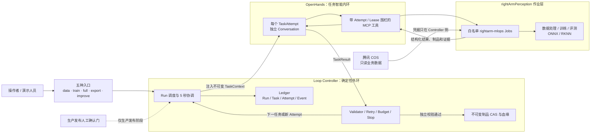
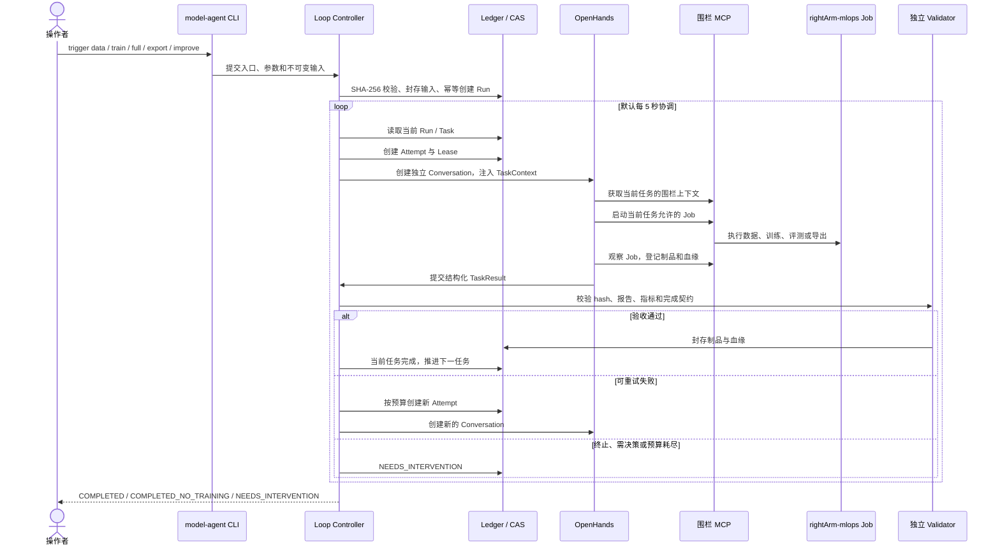
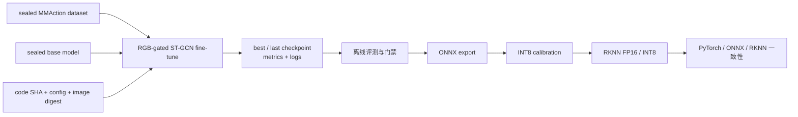
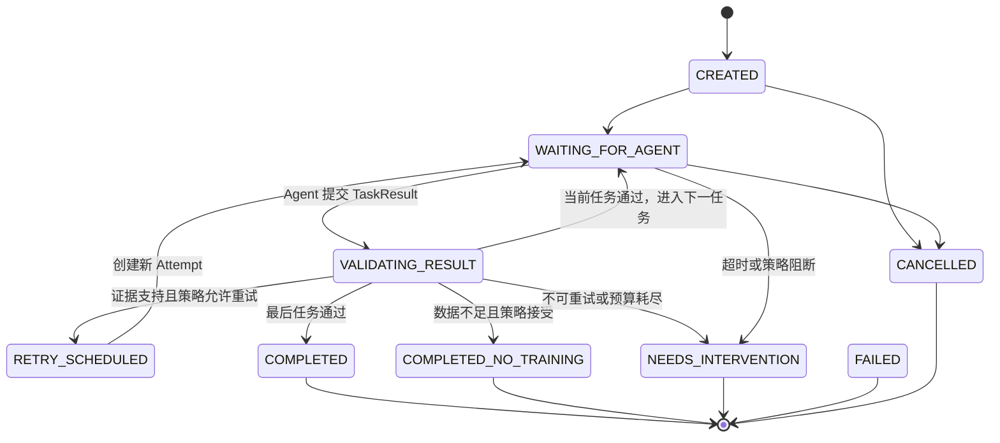
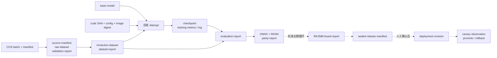

# model-agent 工程成果展示

## OpenHands 驱动的 rightArmPerception 可审计 MLOps 循环

> 文档版本：2026-07-23
>
> 项目仓库：`https://git.cyto.one/wangning/model-agent`

## 1. 项目结论

`model-agent` 把三部分能力组合成一个可以持续运行、可以审计、可以恢复的
手势模型工程：

- **OpenHands**：负责单个任务中的分析、工具调用、日志观察、局部修正和结果提交；
- **Loop Controller**：负责触发、状态推进、任务验收、持久化、重试、预算和停止；
- **rightArmPerception**：提供数据处理、训练、评测、ONNX 和 RKNN 导出的确定性作业。

操作者从 `data`、`train`、`full`、`export`、`improve` 五种入口创建 Run。Controller
默认每 5 秒协调一次已有 Run，为每个 TaskAttempt 创建一个独立 OpenHands
Conversation。正常路径不需要人工逐步告诉 OpenHands 下一步做什么；只有输入不完整、
验证不通过、有限重试耗尽、不可恢复错误或生产发布确认门才会停下。

当前准确的交付结论是：

> **staging 闭环代码已经实现，OpenHands 与 Controller 服务已经容器化运行；**
> **真实无人值守 GPU 训练仍需保存 LLM 设置、锁定 GPU 作业镜像并完成一次端到端冒烟 Run。**

这里的 `full` 表示“腾讯 COS 数据到评测与 ONNX/RKNN 模型包”的完整 Run，
当前不包含 RK3588 实机验证、生产部署和线上监控。后面三个阶段存在于标准长期循环
规范中，但需要真实板卡、镜像仓库和 fleet/OTA 接口后才能启用。

## 2. 已交付工程组成

| 组成 | 作用 | 主要位置 |
|---|---|---|
| OpenHands 网页与 Agent | 执行一个 TaskAttempt 内的推理和工具操作 | `openhands/`、`frontend/` |
| Loop Controller | Run 状态机、调度、验证、重试、审计 | `openhands/mlops_loop/` |
| Task MCP Gateway | 为 Agent 暴露带 Attempt/Lease 围栏的工具 | `openhands/app_server/mlops_task/` |
| rightArm MLOps Jobs | 数据、训练、评测、导出等确定性命令 | `workspace/rightArmPerception/rightarm_mlops/` |
| 任务规范 | 任务顺序、完成契约、尝试次数和发布门 | `openhands/mlops_loop/specs/` |
| Agent 操作规范 | 单次任务的计划、作业、证据和结果提交规则 | `skills/agentic-mlops-task-agent/` |
| Ledger | 持久化 Run、Task、Attempt、Event、Job 和审批 | SQLite staging ledger |
| CAS/Artifact Store | 以内容哈希封存不可变制品和血缘 | 本地 CAS 或 S3 兼容存储 |
| 操作入口 | 五种 trigger、状态查询和 dry-run | `./model-agent` |
| 部署封装 | 同时启动 OpenHands 与 Controller | `docker-compose.yml`、`start.sh` |

仓库结构：

```text
model-agent/
├── openhands/                       # OpenHands 后端
│   └── mlops_loop/                  # Loop Controller 领域内核
├── frontend/                        # OpenHands 网页
├── workspace/rightArmPerception/    # 模型和确定性流水线代码
├── skills/                          # Agent 任务操作规范
├── configs/                         # 非秘密配置与作业白名单
├── docs/                            # 架构、设计、审计和本展示文档
├── docker-compose.yml               # OpenHands + Loop Controller
├── model-agent                      # 操作员统一入口
├── setup.sh                         # 首次配置
└── start.sh                         # 一键启动
```

## 3. 总体架构

系统采用“**智能内环 + 确定性外环**”：



三个层次的职责不能互换：

1. **OpenHands 不决定 Run 是否成功。** 自然语言中的“已完成”不会改变状态。
2. **Controller 不临场编写训练代码。** 它只做确定性的调度、验收和生命周期决策。
3. **Job 不直接推进流程。** Job 只输出结构化 manifest、日志、指标和制品。

## 4. 五种人工入口

### 4.1 入口与任务序列

| 入口 | 必需输入 | 实际任务序列 | 主要输出 |
|---|---|---|---|
| `data` | COS URI、3 个 RTM ONNX | `inspect-data` → `build-dataset` | 原始快照、数据报告、MMAction PKL |
| `train` | MMAction PKL、base model | `train-challenger` → `evaluate-challenger` → `package-rknn` | checkpoint、评测、ONNX、RKNN |
| `full` | COS URI、3 个 RTM ONNX、base model | 数据检查 → 数据集 → 训练 → 评测 → 打包 | 数据到模型包的完整血缘 |
| `export` | checkpoint、评测 PKL | `evaluate-challenger` → `package-rknn` | 重新评测、ONNX、RKNN、一致性报告 |
| `improve` | MMAction PKL、incumbent checkpoint | `improve-challenger`：基线评测 → 有界试验 → 误差诊断 → 候选选择 | 改进报告、试验历史、合规 challenger 或保留 champion |

```mermaid
flowchart TB
    subgraph DATA["data：COS 到训练数据集"]
        D0["COS URI + 3 个 RTM ONNX"] --> D1["inspect-data"]
        D1 --> D2["build-dataset"]
        D2 --> D3["MMAction PKL + dataset report"]
    end

    subgraph TRAIN["train：已有 PKL 到模型包"]
        T0["MMAction PKL + base model"] --> T1["train-challenger"]
        T1 --> T2["evaluate-challenger"]
        T2 --> T3["package-rknn"]
        T3 --> T4["Checkpoint + Evaluation<br/>ONNX + RKNN + Parity"]
    end

    subgraph FULL["full：COS 到模型包"]
        F0["COS URI + RTM ONNX + base model"] --> F1["inspect-data"]
        F1 --> F2["build-dataset"]
        F2 --> F3["train-challenger"]
        F3 --> F4["evaluate-challenger"]
        F4 --> F5["package-rknn"]
    end

    subgraph EXPORT["export：已有模型重新评测导出"]
        E0["Checkpoint + MMAction PKL"] --> E1["evaluate-challenger"]
        E1 --> E2["package-rknn"]
        E2 --> E3["Evaluation + ONNX + RKNN + Parity"]
    end

    subgraph IMPROVE["improve：有界模型改进"]
        I0["Incumbent checkpoint + MMAction PKL"] --> I1["baseline evaluation"]
        I1 --> I2["bounded train/evaluate trials"]
        I2 --> I3["error diagnosis + deterministic selection"]
        I3 --> I4["Improvement report + challenger or champion"]
    end
```



### 4.2 操作命令

```bash
# 只处理 COS 数据
./model-agent trigger data \
  --cos-uri cos://bucket/prefix/batch-001/

# 从现有 PKL 开始训练、评测和导出
./model-agent trigger train \
  --pkl /path/to/merged-gesture-11.pkl

# 从 COS 开始执行数据到模型包的完整 Run
./model-agent trigger full \
  --cos-uri cos://bucket/prefix/batch-001/

# 使用现有 checkpoint 重新评测并导出
./model-agent trigger export \
  --checkpoint /path/to/best.pth

# 基于现有模型做有界训练、评测、诊断和候选选择
./model-agent trigger improve \
  --pkl /path/to/merged-gesture-11.pkl \
  --checkpoint /path/to/best.pth

# 查看最近的 Run、状态和当前任务
./model-agent status
```

所有入口都支持 `--request-id`。执行前增加 `--dry-run`，只检查输入和配置，
不会复制文件、创建 Run 或启动训练：

```bash
./model-agent trigger train \
  --pkl /path/to/merged-gesture-11.pkl \
  --dry-run
```

## 5. 一次 Run 如何运转



关键行为：

- 一个 Run 包含多个 Task；
- 一个 Task 可以有多个 Attempt；
- 每个 Attempt 使用一个新的 OpenHands Conversation；
- Conversation 记忆不是跨任务事实来源，跨任务事实只从 Ledger 和 Artifact Store 恢复；
- 前一任务的结果必须通过独立 Validator，Controller 才会分派下一任务；
- Controller 重启后会从 Ledger 恢复非终态 Run，不依赖旧对话记忆继续运行。

## 6. 数据到模型包的业务流水线

### 6.1 数据路径

```mermaid
flowchart LR
    COS["COS batch<br/>manifest + _SUCCESS"]
    Check["前缀、manifest、大小和 SHA-256 校验"]
    Land["只读下载与不可变落盘"]
    Extract["安全解包"]
    Annotation["标注检查与视频切片"]
    RTM["RTMDet / RTMPose 提取"]
    Split["按 subject / device / session 分组划分"]
    PKL["11 类 MMAction PKL"]
    Bundle["可移植 dataset bundle + report"]

    COS --> Check --> Land --> Extract --> Annotation --> RTM --> Split --> PKL --> Bundle
```



数据层已经具备的工程约束包括：

- COS URI 格式和允许前缀校验；
- manifest schema、对象大小和 SHA-256 完整性校验；
- COS 配置拒绝符号链接，凭据只读挂载；
- tar 安全解包与路径边界检查；
- 标注引用的视频存在性检查；
- 以 subject、device、session 组合做分组切分，避免跨 split 泄漏；
- 生成 11 类 `rightarm-gesture-11.pkl`；
- 输出 dataset report、pipeline report 和可移植 bundle；
- 数据不足时允许形成 `COMPLETED_NO_TRAINING`，而不是强制启动训练。

当前 `build-dataset` Job 生成一份新的 11 类 PKL；“与指定的可信 11 类基线
PKL 合并”尚未封装成独立、可验证的 Job。现阶段可以把预先合并好的 PKL 交给
`train`，但在补齐 `merge-dataset` Job、去重规则和合并报告前，不能把
`data/full` 描述成已经完成了可信基线合并。

### 6.2 训练、评测和导出路径



训练 Job 固定记录：

- 数据集 artifact；
- base checkpoint；
- resolved config；
- code SHA；
- image digest；
- GPU 数、batch size、worker、seed 和 epoch；
- best/last checkpoint；
- 训练日志和 metrics；
- 输入到输出的 lineage。

## 7. Run 状态与自动恢复



自动重试不是无限重跑。只有以下结构化失败类别可以在证据和次数预算允许时重试：

- `transient-network`；
- `provider-rate-limit`；
- `gpu-node-lost`；
- `executor-timeout`；
- `cuda-oom-with-valid-proposal`。

CUDA OOM 必须给出有效的新 `batch_size`，并引用当前 Attempt 的真实失败 Job。
Agent 自己编造一个“可重试错误”不能触发重试。各任务最多 2～3 次 Attempt，
Run 还受最长运行时间、成本和制品体积限制。

## 8. 制品与血缘



实线是五种人工入口当前覆盖的主要范围；虚线是标准长期循环中的板端和发布扩展。

所有被接受的制品都必须具有：

- 类型；
- SHA-256；
- 字节数；
- 生产它的 TaskAttempt；
- 输入制品到输出制品的 lineage；
- 必需的日志、报告或指标证据。

只有 Validator 接受后，候选制品才会从 staging 进入 sealed CAS。

## 9. 安全与权限边界

| 边界 | 工程措施 |
|---|---|
| OpenHands 与宿主机 | OpenHands 容器不挂载宿主机 Docker socket |
| 作业执行 | 只有 Controller 可以启动白名单 `rightarm-mlops` Job |
| 命令注入 | Job 使用 argv 且 `shell=False`；外部脚本前缀由操作员目录锁定 |
| COS 凭据 | 只读挂载给 Controller，不进入 Conversation、工作区或 Git |
| LLM 密钥 | 保存在每个用户自己的 OpenHands 状态中，不提交 Git |
| 本地输入 | 先进入私有导入区，校验 SHA-256 后封存 |
| Agent 能力 | 每个 Attempt 使用独立 Lease 和任务能力围栏 |
| 生命周期 | Agent 不能直接写 Ledger、创建 Attempt 或接受自己的结果 |
| 制品 | Agent 只能登记当前 Job manifest 声明过的输出 |
| Docker 执行器 | 镜像必须使用不可变 SHA-256 digest；默认只读、无网络、去 capabilities |
| 生产发布 | `deploy-canary` 具有认证的人工确认门 |
| 网络暴露 | OpenHands 与 Controller 端口默认只绑定服务器 `127.0.0.1` |

## 10. 手工触发与长期触发

当前默认：

```text
MLOPS_TRIGGER_MODE=manual
MLOPS_RECONCILE_INTERVAL_SECONDS=5
MLOPS_POLL_INTERVAL_SECONDS=86400
```

这三个值分别表示：

- `manual`：不会自动发现新批次，必须执行一次 `./model-agent trigger ...`；
- `5` 秒：已经存在的 Run 每 5 秒推进一次；
- `86400` 秒：只有启用 `local` 或 `command` watcher 后，才每 24 小时发现一次新数据。

因此“24 小时轮询”不会让人工触发的 Run 等待 24 小时。人工 trigger 成功创建
Run 后，常驻 Reconciler 会立即按 5 秒周期推进。

长期模式可以选择：

- `local`：观察操作员管理的本地 incoming 目录；
- `command`：调用操作员白名单命令发现已经封口的云批次；
- `manual`：只接受显式 trigger，适合当前交付和演示阶段。

## 11. 启动与演示

### 11.1 首次启动

```bash
git clone https://git.cyto.one/wangning/model-agent.git
cd model-agent
./start.sh
```

`start.sh` 会启动：

1. OpenHands 网页和 Agent；
2. Loop Controller、REST API、MCP Gateway 和常驻 Reconciler。

使用 VSCode SSH 时，在“端口”面板转发脚本打印的 OpenHands 端口，然后打开：

```text
http://localhost:<转发后的 OpenHands 端口>
```

首次使用需要在 OpenHands Settings 保存：

- LLM model；
- Base URL；
- API Key。

### 11.2 推荐演示顺序

```bash
# 1. 查看服务状态
./status.sh

# 2. 查看现有 Run
./model-agent status

# 3. 只检查输入，不产生副作用
./model-agent trigger train \
  --pkl /path/to/merged-gesture-11.pkl \
  --dry-run

# 4. 正式创建一个可审计 Run
./model-agent trigger train \
  --pkl /path/to/merged-gesture-11.pkl

# 5. 持续查看 Run 状态
./model-agent status

# 6. 机器可读状态
./model-agent status --json
```

演示中可以同时展示：

- OpenHands 中自动创建的 MLOps Conversation；
- 当前任务和 Attempt 编号；
- Job 日志；
- `TaskResult`；
- Validator 的接受/拒绝事件；
- sealed artifacts 和 lineage；
- 最终 Run 状态。

## 12. 当前就绪度

以下是 2026-07-23 在当前服务器上的准确状态快照：

| 层级 | 状态 | 说明 |
|---|---|---|
| 代码、任务规范和安全边界 | 已实现 | Controller、MCP、Job、Validator、Ledger、CAS 均已入库 |
| 五种人工入口 | 已实现 | `data`、`train`、`full`、`export`、`improve` 和 `status` 可用 |
| OpenHands 容器 | 运行健康 | 本机仅绑定 `127.0.0.1` |
| Loop Controller 容器 | 运行健康 | 常驻 Reconciler 已启用 |
| 当前 Run | 尚未执行 | 当前 Ledger 中没有 MLOps Run |
| 触发模式 | 人工模式 | `MLOPS_TRIGGER_MODE=manual` |
| Run 协调 | 已启用 | 每 5 秒推进非终态 Run |
| 自动数据发现 | 未启用 | 24 小时参数仅在 watcher 模式生效 |
| OpenHands LLM | 未就绪 | 当前 Settings API 返回 `Settings not found` |
| 作业执行器 | staging/local | 当前 `MLOPS_EXECUTOR=local` |
| local 作业依赖 | 未就绪 | Controller 镜像不包含完整 Torch/OpenMMLab/ONNX/RKNN 栈 |
| GPU Docker Job | 未就绪 | 需要真实镜像 digest 和生成的 image catalog |
| 自动循环基线制品 | 未完整注册 | base、RTM、frozen test 等需按部署环境封存 |
| 可信基线 PKL 合并 | 未实现为独立 Job | 当前生成新 PKL，或由 `train` 接收预合并 PKL |
| Agent Skill 加载 | 待显式接线 | 运行时已有 TaskContext 与 MCP 约束，但未传入 `plugin_source` |
| RK3588 实机验证 | 接口阶段 | 需要真实板卡适配器和实验室端点 |
| 生产部署/监控 | 未声称完成 | 需要 fleet/OTA、registry、观测系统和人工授权 |

项目当前可以准确表述为：

> **Staging closed loop implemented and verified; production gesture deployment is not yet live.**

仓库中的 2026-07-20
[完成度审计](agentic-mlops-v1-completion-audit.md)记录了 281 个
OpenHands MLOps/API/Conversation 测试和 8 个 rightArm adapter 测试通过，
并记录了静态检查、Schema、CAS 与 Docker executor smoke 证据。这是已有审计记录，
不是本次文档编写过程中重新执行的测试结果。

## 13. 达到“触发后不用管”的验收条件

在声称无人值守之前，应完成以下一次性验收：

- [ ] OpenHands Settings 中已经持久化可用的 LLM model、Base URL 和 API Key；
- [ ] 触发一个真实 Task 后，自动 Conversation 能进入运行状态；
- [ ] base model、RTM ONNX 和评测 PKL 已经按 SHA-256 封存；
- [ ] 可信基线 PKL 合并已成为带去重、血缘和报告的确定性 Job；
- [ ] `MLOPS_EXECUTOR=docker`；
- [ ] 每种 Job 的镜像都锁定为真实 `@sha256:` digest；
- [ ] 训练 Job 的 GPU 数与 Controller 策略一致；
- [ ] `data --dry-run`、`train --dry-run`、`full --dry-run`、`export --dry-run`、`improve --dry-run` 全部通过；
- [ ] 一次小数据 `train` 冒烟 Run 达到 `COMPLETED`；
- [ ] 一次小 COS `data` Run 达到 `COMPLETED`；
- [ ] Controller 重启后能够恢复一个运行中的 Run；
- [ ] 一个故意制造的可重试错误能创建新 Attempt；
- [ ] 一个不可重试错误能准确停在 `NEEDS_INTERVENTION`；
- [ ] 产出的 checkpoint、评测、ONNX、RKNN 和报告均可从 artifact audit 找回。
- [ ] Task Agent Skill 已显式挂载，或其运行规则已由等价的版本化 Agent Profile 固定。

满足这些条件后，五种人工入口可以采用以下运行承诺：

> 操作者只负责选择入口和提供不可变输入；OpenHands 执行单任务，Loop Controller
> 负责持续推进、独立验证和有限恢复。正常路径无需人工逐步干预，异常路径以
> `NEEDS_INTERVENTION` 明确停止，不会无限尝试或绕过安全门。

## 14. 核心实现与验证证据

- [根 README](../README.md)
- [Loop Controller](../openhands/mlops_loop/controller.py)
- [OpenHands Dispatcher](../openhands/mlops_loop/dispatcher.py)
- [五种入口任务选择](../openhands/mlops_loop/manual_runs.py)
- [rightArm LoopSpec](../openhands/mlops_loop/specs/right-arm-gesture-loop-v1-loop.yaml)
- [Task MCP Gateway](../openhands/app_server/mlops_task/mcp_server.py)
- [任务 Agent 规范](../skills/agentic-mlops-task-agent/SKILL.md)
- [rightArm MLOps CLI](../workspace/rightArmPerception/rightarm_mlops/cli.py)
- [COS materializer](../workspace/rightArmPerception/rightarm_mlops/cos_materialize.py)
- [数据流水线](../workspace/rightArmPerception/rightarm_mlops/pipeline.py)
- [完成度审计](agentic-mlops-v1-completion-audit.md)
- [完整设计说明](right-arm-gesture-loop-v1.md)
