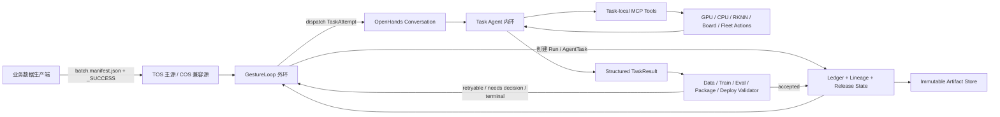

# rightArmPerception Agentic MLOps Loop V1

状态：具体任务设计稿
日期：2026-07-20
OpenHands 基线：`93c0871951f9247cc87a63940972ae7e25d46b6f`
模型仓库基线：`rightArmPerception@41eddabba3516521bf0538afd57ef37da23097a1`

## 1. 结论

V1 把打包在 `workspace/rightArmPerception` 中的 RGB gated ST-GCN 手势模型接成一条可持续循环：

```text
业务批次在云上封口
  -> 不可变数据快照
  -> 数据校验与训练集编译
  -> 增量微调
  -> 离线评测
  -> ONNX / RKNN 转换与一致性评测
  -> RK3588 小流量发布
  -> 业务观测
  -> 全量、拒绝或回滚
```

它不是一个永不结束、不断改写自身历史的 Run。V1 增加一个长期存在的 Loop Engineering 外环 `GestureLoop`，每个封口的数据 watermark 创建一个不可变 `MLOpsRun`。一个 Run 被分解为多个 `AgentTask`；每个 `TaskAttempt` 才对应一个 OpenHands Conversation。这样既能持续转，又能对每次分派、验证、重试、制品和发布做完整审计。

V1 不引入 Airflow、Argo、Kubeflow 等通用工作流引擎。Loop Engineering 外环负责发现/触发、任务分解、分派 Agent、独立验证结果、持久化状态以及 attempt 级重试/停止；OpenHands Agent 只负责一个 task 内的事件历史、LLM、Action、Tool/Workspace、Observation 和再推理。

## 2. 已确认的真实链路

### 2.1 数据

仓库已经记录了两类云对象源：

- 火山 TOS：`tos://cybopal/...`；
- 腾讯 COS：`cos://cytoderm-ai-shanghai-1389948562/...`。

已有统一标注格式为 CSV：

| 字段 | 含义 |
|---|---|
| `视频名` | 带扩展名的视频文件名 |
| `起始帧号` | 闭区间起始帧 |
| `终止帧号` | 闭区间终止帧 |
| `类别名` | 手势标签 |

已有数据代码可以检查标注、按 CSV 切片，并对片段执行 RTMDet / RTMPose 推理。但最新训练所依赖的 `rtm_generate_50k.pkl` 和 `rtm_add.pkl` 的完整生成过程没有作为一条可重放命令提交到仓库。

### 2.2 当前候选模型

当前分支 `feature/rgb-gated-fusion` 的最新路线是 V3 两阶段训练：

1. 使用 `rtm_generate_50k.pkl` 做 10 类生成数据预训练；
2. 使用 `rtm_add.pkl` 做 11 类真实数据微调。

真实数据微调的标签顺序是：

```text
WAVE_IN, WAVE_OUT, FIVE, CLICK, ROTATE, SLIDE_DOWN,
SLIDE_UP, OK, CURSOR, GUN, NONE
```

模型输入由四路组成：

| 输入 | Shape | 含义 |
|---|---:|---|
| `keypoint` | `(1, 16, 21, 4)` | 21 点手骨架的 x、y、z、score |
| `imgs` | `(1, 16, 3, 96, 96)` | 手部 RGB ROI |
| `handedness` | `(1,)` | Left / Right / Unknown |
| `global_traj` | `(1, 16, 5)` | delta xyz + absolute xy |

模型输出 `cls_score` 和 `gate_logit`。`gate_logit` 是手势与 `NONE` 的二分类门，用于抑制线上误触发。

### 2.3 部署

仓库已有以下转换代码：

- PyTorch checkpoint -> ONNX；
- 由真实验证 pipeline 生成多输入 INT8 calibration 数据；
- ONNX -> RKNN FP16 / INT8；
- ONNX 与 RKNN simulator 的一致性检查。

目标硬件是 RK3588。已有踩坑记录证明，C++ RKNN 路径必须把 keypoint 的物理布局从 `(1,T,V,C)` 转为 `(1,V,C,T)` 后以 NHWC 传入；错误布局不会报错，只会静默产生错误预测。因此真实板端 C++ 验证是 Release 的硬门禁，Python simulator 不能替代它。

## 3. 当前不可直接自动化的缺口

这些是盘点结果，不是长期设计目标：

1. 干净 checkout 不可复现当前 V3：最新 config 导入的 `mmaction/models/data_preprocessors/gcn_rgb_preprocessor.py` 和 `handoff/__init__.py` 当前是未跟踪文件；
2. Dockerfile 依赖未入库的 `docker_wheels/`，镜像不能从干净仓库稳定构建；
3. 数据、checkpoint 和 work directory 使用 `/home/results/...` 等机器绝对路径；
4. `rtm_add.pkl` 的端到端编译入口缺失，文档引用的部分 `data/hand21_3d/*` 脚本不在仓库；
5. 当前 test dataloader 仍读取 `split="val"`，没有独立、冻结的产品 test set；
6. 当前评测以 top-1 和 confusion matrix 为主，缺少统一的 `evaluation.json`、macro-F1、`NONE` 误接受率和板端性能指标；
7. 仓库包含 RKNN 制品转换，但没有发现机器人 fleet / OTA 发布 API 或对应部署仓库；
8. 没有可供下一轮比较的已注册 champion release。

所以 V1 的首要工作不是让 Agent 临场拼 shell，而是先把这些隐式步骤变成带输入、输出和结果清单的确定性 Job。

## 4. V1 范围

### 4.1 第一条可用闭环

V1 只支持一条产品路线：

- 模型：RGB gated ST-GCN；
- 输入：业务端封口的视频与 CSV 标注批次；
- 训练：基于固定 base checkpoint 的 11 类真实数据微调；
- 评测：冻结 test set + 鲁棒性 slices + 转换一致性 + RK3588 实机；
- 发布：测试 fleet -> 1% canary -> 分阶段扩大；
- 回滚：回到最近一个已成功部署且 sealed 的 release。

50k 生成数据预训练不在每轮业务数据到达时重复执行。它作为 base model artifact 被 lineage 引用。只有标签体系、模型结构或场景分布出现重大变化时，外环才根据 policy 或一个 accepted decision-task result 创建新的 pretrain Run，再把其输出设为后续微调的 base artifact。

### 4.2 V1 非目标

- 自动生成或自动修正人工标注；
- 同时搜索 TSM、ST-GCN、Transformer 等多个模型家族；
- 把模型二进制直接无保护地推到全部机器人；
- 用 LLM 对话历史代替数据库、对象 hash 或 release manifest；
- 在一轮数据不足时强制训练。

## 5. Loop、Run 与 Conversation



### 5.1 `GestureLoop`

一个长期外环对象，负责发现/触发、分派、验证、持久化、重试/停止，并保存：

- `loop_id=rightarm-gesture-v1`；
- 数据源和最后消费的 watermark；
- 当前 champion release；
- 待累积但尚不足以训练的数据 batch；
- 训练触发策略；
- 当前 active Run，V1 同一 loop 最多一个；
- 下一次观察时间。

Source Watcher 报告“某个封口批次已出现”。Loop Controller 以 `(loop_id, watermark)` 幂等创建 Run，根据状态机创建下一 `AgentTask`，独立验证 `TaskResult`，然后确定性地推进、创建 attempt、停止或请求决策。

### 5.2 `MLOpsRun`

一次 Run 固定：

- 本轮 batch manifest 列表；
- 上一版 champion release；
- base checkpoint；
- code SHA；
- config artifact；
- image digest；
- 数据和评测门槛；
- 成本、时长和重试预算；
- task 列表、每个 task 的 completion contract 和 validator。

Run 不绑定单个 Conversation。它依次产生 data、train、eval、package、board、deploy 和 monitor tasks。所有跨任务事实都从 ledger 恢复。

### 5.3 `AgentTask` 与 `TaskAttempt`

建议的 task kinds：

```text
inspect_data -> build_dataset -> train -> evaluate -> package_rknn
  -> verify_board -> deploy_canary -> monitor_canary -> decision
```

每个 task 可以有多个 attempts。一个 attempt 关联一个 OpenHands Conversation，内环只处理该 task：

```text
事件历史 -> LLM -> Action -> Tool/Workspace -> Observation -> 再推理
```

Agent 最终提交 `TaskResult`。外环 validator 不接受之前，Agent 的“完成”、artifact、lineage、metric 或发布建议都不是领域事实。

### 5.4 数据不足时也算一个有结论的 Run

数据诊断 Agent 可以提交 `skip_training` 建议，例如：

- 有效新增样本少于策略下限；
- 只有已有数据的重复对象；
- 缺少 `NONE` 或关键困难 slice；
- 标签还未封口；
- 新数据分布与当前训练集没有实质差异。

data validator 验证样本计数、重复率和策略后，外环记录证据，将 accepted dataset 追加到 loop 的 pending pool，并以 `COMPLETED_NO_TRAINING` 结束。下一批数据到达后，新 Run 可以引用这些 pending dataset artifacts。跳过不是失败，也不能丢失血缘。

## 6. 业务数据落盘契约

V1 假设 TOS 是业务新增数据主入口，COS adapter 用于读取现有历史数据。实际 bucket 和 prefix 在部署时配置，不写入 Agent prompt。

建议每个批次使用以下结构：

```text
<source-prefix>/batches/<batch_id>/
  videos/<device_id>/<session_id>/*.mp4
  annotations.csv
  batch.manifest.json
  _SUCCESS
```

`_SUCCESS` 必须最后写入。Agent 永远不消费未封口目录。

`batch.manifest.json` 至少包含：

```json
{
  "schema_version": "rightarm.gesture.batch/v1",
  "batch_id": "2026-07-20-prod-0001",
  "created_at": "2026-07-20T12:00:00Z",
  "producer": "rightarm-business-recorder",
  "annotation_revision": "rev-1",
  "label_ontology": "rightarm-gesture-11/v1",
  "objects": [
    {
      "uri": "tos://bucket/prefix/video.mp4",
      "bytes": 123456,
      "sha256": "...",
      "device_id": "device-001",
      "session_id": "session-001"
    }
  ],
  "annotations": {
    "uri": "tos://bucket/prefix/annotations.csv",
    "bytes": 4567,
    "sha256": "..."
  }
}
```

manifest 中不得包含真实用户身份。需要分组切分时使用不可逆的 `subject_group_id`。
可直接交付给业务生产端的 JSON Schema 位于
`rightArmPerception/mlops/contracts/rightarm-gesture-batch-v1.schema.json`。

### 6.1 Landing 的确定性行为

Landing Job 必须：

1. 使用只读凭据读取封口 manifest；
2. 对每个对象校验 size 和 sha256；
3. 把对象复制到以内容 hash 寻址的 staging / CAS；
4. 输出 canonical manifest，记录 source URI、etag、version id 和 content hash；
5. 重复执行时返回相同 artifact identity；
6. 不覆盖同名旧对象，不依赖 bucket listing 顺序。

## 7. 数据编译与验证

V1 将现在的零散脚本封装为一个可重放的 `build-dataset` Job，但内部保留阶段产物：

```text
raw videos + annotations.csv
  -> annotation inspection report
  -> immutable clip videos
  -> RTMDet / RTMPose per-frame annotations
  -> canonical sample records
  -> train / val / test assignment
  -> MMAction PoseDataset PKL
  -> dataset report + dataset manifest
```

每一阶段输出 hash 和 lineage edge。最终 PKL 不能只保存本机绝对路径；视频引用必须是 artifact URI 或由运行时 materializer 映射的相对路径。

### 7.1 硬数据门禁

- CSV schema、编码和帧号合法；
- manifest 引用的视频全部存在且 hash 一致；
- 视频可解码，帧数覆盖标注区间；
- 标签全部属于 `rightarm-gesture-11/v1`；
- 同一 span 不得拥有冲突标签；
- 主 hand track 覆盖率达到训练 pipeline 的最低要求；
- 21 个关键点、score、RGB ROI 和 global trajectory shape 正确；
- 数据集中每个 label 和关键 slice 都输出计数；
- 去重以内容 hash 和近重复指纹共同执行；
- split 按 `subject_group_id + device_id + session_id` 分组，禁止同一 session 跨 train / val / test；
- 冻结的 product test set 不参与训练，也不随每轮新增数据重切分。

### 7.2 软诊断

Agent读取报告后提交接受、累计、隔离或退回的建议；外环根据 data policy 和 validator 结果决定：

- 类别不均衡；
- `NONE` 覆盖不足；
- 远距离、暗光、相机倾斜、遮挡、左右手和不同设备分布变化；
- RTM detector / pose score 漂移；
- 新数据与当前 champion 错误样本的覆盖关系。

## 8. 训练策略

### 8.1 常规业务数据 Run

常规 Run 只执行真实数据微调，起点是 sealed base checkpoint：

```bash
bash tools/dist_train.sh \
  handoff/stgcn_hand21_3d/configs/stgcn_hand21-rgb-bs64-gated-v3-ft-rtm_add-11cls.py \
  4 \
  --work-dir <attempt-output>
```

实施时不能直接使用仓库里的硬编码 config。`rightarm-mlops train` wrapper 必须通过参数覆盖：

- `ann_file`；
- `load_from`；
- `work_dir`；
- GPU 数、batch size、worker 数；
- seed；
- max epochs；
- 输出 manifest 路径。

训练输入是：validated dataset、base checkpoint、code SHA、frozen config、image digest。输出至少包含 best checkpoint、last checkpoint、训练日志、metrics JSON、resolved config 和 result manifest。

### 8.2 生成数据预训练

只有以下情况之一满足时才创建独立 pretrain Run：

- label ontology 改变；
- 输入 tensor contract 改变；
- 模型结构改变导致旧 base checkpoint 不兼容；
- 真实数据诊断表明某些 slice 无法靠微调恢复；
- Agent 有明确实验假设且预算允许。

pretrain 的输出是新的 sealed base model artifact，不能静默替换旧 base。

## 9. 评测与晋级门禁

评测必须输出单一、版本化的 `evaluation.json`，同时保存 confusion matrix、逐样本预测和报告。V1 的门禁以 champion-relative 为主，避免在没有可靠产品基线时拍绝对阈值。

### 9.1 离线模型门禁

- macro-F1 相对 champion 不低于 0.5 个百分点；
- 最差类别 recall 相对 champion 不低于 2 个百分点；
- `NONE -> gesture` false accept rate 不高于 1%，且不劣于 champion；
- 每个产品关键 slice 都不能出现大于约定阈值的回退；
- 新增数据专用 holdout 上必须有正向收益；
- 不允许只凭 train / val top-1 晋级。

最初阈值是 shadow policy。第一次上线前，需要用当前线上 champion 和冻结 test set 计算并封存基线。

### 9.2 转换门禁

- PyTorch 与 ONNX 在 parity set 上 top-1 match = 100%；
- ONNX 与 RKNN FP16 top-1 match >= 99.5%；
- ONNX 与 RKNN INT8 top-1 match >= 99.5%；
- gate decision match >= 99.5%；
- INT8 不通过时允许 Agent 选择新的 calibration attempt，或将 FP16 作为候选；
- 任意 fallback 都生成不同 artifact 和 release manifest，不能覆盖 INT8 结果。

### 9.3 板端门禁

在真实 RK3588 与生产 C++ 路径上执行：

- golden input tensors 逐输入 checksum；
- keypoint NHWC 物理布局断言；
- top-1、top-3、gate 与 ONNX 对比；
- 冷启动、p50 / p95 / p99 latency、内存和 NPU 错误；
- 连续视频端到端 smoke test；
- 模型 manifest 与 runtime provider compatibility。

板端验证报告必须记录硬件型号、runtime 版本、部署 binary SHA 和输入预处理版本。

## 10. 制品与血缘

每轮至少注册以下不可变 artifacts：

| Kind | 内容 |
|---|---|
| `source-manifest` | 业务原始 batch manifest |
| `raw-dataset` | 内容寻址的视频与原始标注快照 |
| `data-validation-report` | 硬门禁与软诊断 |
| `clips-dataset` | 切片视频及 manifest |
| `pose-dataset` | RTM 输出及 manifest |
| `mmaction-dataset` | PKL、split 和 label mapping |
| `code` | rightArmPerception Git SHA |
| `container-image` | 训练 image digest |
| `training-config` | 完全展开后的 config |
| `base-model` | 本轮微调起点 |
| `checkpoint` | best checkpoint |
| `evaluation-report` | 离线指标与逐样本预测引用 |
| `onnx-model` | ONNX 及 input contract |
| `calibration-dataset` | 平衡的四输入 `.npy` manifest |
| `rknn-model` | FP16 或 INT8 RKNN |
| `parity-report` | PyTorch / ONNX / RKNN 对比 |
| `board-report` | 真实 RK3588 验证 |
| `release-manifest` | 所有生产必需制品及其 hash |
| `deployment-observation` | canary 指标快照 |

核心血缘闭包是：

```text
source batches
  -> raw dataset
  -> validated / compiled dataset
  -> training attempt + base model + code + config + image
  -> checkpoint
  -> evaluation
  -> ONNX
  -> calibration + RKNN
  -> board verification
  -> sealed release
  -> deployment revision
```

任意边缺失时，`mlops_seal_release` 必须失败。

## 11. Loop Engineering 外环与 OpenHands 内环

### 11.1 Loop Engineering 外环负责

- 发现 TOS/COS `_SUCCESS` 或接收事件触发；
- 以 watermark 幂等创建 Run；
- 按状态机创建 data/train/eval/package/board/deploy/monitor tasks；
- 固定每个 task 的输入 artifacts、completion contract、validator 和预算；
- 分派 TaskAttempt 到 OpenHands；
- 独立验证 `TaskResult`，不信任自然语言完成声明；
- 持久化 CAS hash、manifest、lineage、attempt、release 和 deployment；
- 根据 validator、retry policy、预算和 Agent proposal 创建下一 attempt 或停止；
- 只有门禁与 provenance closure 通过后才 seal release；
- 推进 canary、全量或回滚；语义不明确时创建 decision task；
- 在 Conversation 丢失后从 ledger 重新分派。

### 11.2 OpenHands Task Agent 内环负责

- 理解一个 task 的 objective、输入和完成条件；
- 检查代码、数据、日志和前序 evidence；
- 调用 `rightarm-mlops` jobs，观察结果并在同一 Conversation 内做 action 级修正；
- 诊断 OOM、数据问题、转换偏差或板端异常；
- 提交 artifact candidates、lineage proposals、metrics 和 evidence；
- 提交 failure classification 与 next-attempt proposal；
- 用结构化 `TaskResult` 干净结束。

Agent 无权直接推进 Run / Release / Deployment 状态，也无权分配新 attempt number。它可以建议“batch size 32 -> 16”或“INT8 改 FP16”，但由外环验证证据、检查预算后决定是否分派。

### 11.3 如何理解“Agent 承担确定性职责”

这里的 Agent 应理解为完整的 agentic system，而不是单次 LLM Conversation：

- 不确定推理放在 OpenHands 内环；
- 确定性 orchestration 放在 Loop Engineering 外环；
- 数据血缘、重试、制品版本和发布状态是外环持久化的系统事实；
- OpenHands Agent 通过 task result 贡献 evidence 和 proposal，但不充当数据库或 workflow state machine。

这与 mentor 的原则一致：**Agent 负责解决任务，Loop 负责保证任务被正确触发、验收、记住、重试并最终停止。**

## 12. 重试策略

| 失败 | OpenHands 内环输出 | Loop Engineering 外环行为 |
|---|---|---|
| TOS / COS timeout、429、临时网络错误 | 记录 observation，可建议 retry | policy 指数退避，创建相同 spec 的新 attempt |
| manifest hash 与对象不一致 | 提交 hash evidence | validator 判 terminal，拒绝 batch，等待新 revision |
| CSV 引用缺失视频或越界帧 | 定位问题行与视频 | validator 判 terminal，不盲重试 |
| RTM 任务显存不足 | 建议降 batch / worker 或拆 shard | 校验参数边界后创建带 spec diff 的新 attempt |
| 训练 CUDA OOM | 建议 batch / grad accumulation 修改 | 检查预算后创建新 attempt |
| GPU 节点丢失 | 记录节点故障 | 创建相同输入的新 attempt，不重复已有 job |
| 指标未过门禁 | 分析 regression slices | validator 拒绝候选；新实验是新 task/run，不是相同 retry |
| ONNX parity 失败 | 定位导出差异、提出代码修复 | 新 code SHA 后才允许新 attempt |
| RKNN INT8 掉点 | 建议 calibration / mmse / FP16 | package policy 选择新 attempt 或 decision task |
| 板端布局或 smoke test 失败 | 提交真实 C++ evidence | validator 阻断，修部署代码后新 attempt |
| canary 回退 | 分析指标与可能根因 | hard gate 触发外环立即回滚上一 sealed release |

同一 AgentTask 最多 3 个 attempts。只有外环能分配 attempt number；达到预算后进入 `NEEDS_INTERVENTION`，不能通过改 task 名绕过预算。

## 13. Release 与发布状态

```text
DRAFT
  -> EVALUATED
  -> SEALED
  -> STAGING_VERIFIED
  -> CANARY
  -> PROMOTED

CANARY -> ROLLED_BACK
任意 seal 前状态 -> REJECTED
```

Release manifest 至少固定：

- `.rknn` 与可选 `.onnx`；
- label mapping；
- 四输入 tensor contract；
- gate threshold；
- preprocessing version；
- C++ keypoint layout contract；
- runtime / provider compatibility；
- dataset、checkpoint、evaluation、parity 和 board report；
- rollback target。

V1 在生产发布前保留一次人工确认，RunSpec 使用 `confirm-production`。确认只授权外环创建生产 deployment task；OpenHands Agent 在该 task 的授权范围内执行动作，validator 验收 observation，外环再推进 canary、扩流或回滚。当 shadow 数据证明门禁可靠后，可把 policy 改为 `full`。

## 14. 任务专用 Job 接口

V1 在 `rightArmPerception` 内补一层薄 CLI，所有命令都遵守同一个结果协议：成功时输出 `result.json`，失败时输出 `failure.json`，产物写入调用方指定目录，不修改领域数据库。

```text
rightarm-mlops inspect-batch
rightarm-mlops land-batch
rightarm-mlops build-dataset
rightarm-mlops train
rightarm-mlops evaluate
rightarm-mlops export-onnx
rightarm-mlops build-calibration
rightarm-mlops export-rknn
rightarm-mlops verify-conversion
rightarm-mlops verify-board
rightarm-mlops build-release
```

Job 的 `result.json` 至少包含：

```json
{
  "protocol": "rightarm.mlops.job-result/v1",
  "job_kind": "train",
  "status": "succeeded",
  "inputs": [{"artifact_id": "mmaction-dataset:sha256:..."}],
  "outputs": [{"kind": "checkpoint", "path": "best.pth", "sha256": "..."}],
  "metrics": {"best_acc_top1": 0.0},
  "runtime": {"image_digest": "sha256:...", "code_sha": "..."}
}
```

OpenHands Agent 只能通过 task-local `mlops_launch_job` 启动这些命令，再提交 artifact / lineage proposals 和 `TaskResult`。Job 与 Agent 都不能推进 Run 或 Release 状态；只有外环 validator 接受结果后才能持久化。

## 15. OpenHands 接入点

外环作为独立服务消费 OpenHands API/event callback；任务工具可以作为很薄的 OpenHands 模块或 Plugin。即使 V1 同进程部署，也保持代码边界：

```text
services/rightarm_mlops_loop/
  loop_controller.py
  source_watcher.py
  task_planner.py
  task_dispatcher.py
  retry_policy.py
  result_collector.py
  validators/
    data.py
    training.py
    evaluation.py
    package.py
    board.py
    deployment.py
  adapters/
    openhands.py
    object_store_tos.py
    object_store_cos.py
    docker_gpu_executor.py
    rk3588_lab.py
    rightarm_fleet.py
  policies/
    rightarm_gesture_v1.py

openhands/app_server/mlops_task/
  task_context.py
  task_result.py
  mcp_server.py
```

MLOps Plugin 为 Task Agent 注入：

- 当前 task objective、输入 artifacts、completion contract 和 attempt budget；
- rightArm gesture domain skill；
- task-local MLOps MCP tools；
- `pre_tool_use` 生产动作检查；
- `post_tool_use` attempt lease、artifact candidate hash 和权限检查。

## 16. LoopSpec 与首个 RunSpec

`openhands/mlops_loop/specs/` 中有两个不同层级的规范：

- `right-arm-gesture-loop-v1-loop.yaml`：外环配置，描述 TOS trigger、task sequence、Agent Profiles、validators、持久化、retry 和 stop；
- `right-arm-gesture-loop-v1-run.yaml`：单轮业务数据增量微调模板，描述该轮数据、训练、评测与部署目标。

两者分别通过 `agentic-mlops-v1-loop-spec.schema.json` 和 `agentic-mlops-v1-run-spec.schema.json` 校验。LoopSpec 引用 RunSpec template；每个新 watermark 产生一个解析完成、不可变的 RunSpec 实例。

模板中的以下值必须在真正创建 Loop 或 Run 前被解析为不可变值：

- `<business-prefix>`；
- `<batch-id>`；
- `<champion-base-model-artifact>`；
- `<frozen-test-set-artifact>`；
- `<rtm-detector-artifact>`；
- `<rtm-person-pose-artifact>`；
- `<rtm-hand-pose-artifact>`；
- `<champion-evaluation-artifact>`；
- `<code-artifact>`；
- `<container-image-artifact>`；
- `<label-mapping-artifact>`；
- `<tensor-contract-artifact>`；
- `<image-digest>`；

模板不是用占位符执行的许可证；`mlops_create_run` 应拒绝任何未解析的 `<...>`。

## 17. 实施顺序

### Phase 0：让 rightArmPerception 可重放

1. 提交当前未跟踪但 V3 必需的 preprocessor 和 package 文件；
2. 把 `rtm_add.pkl` 的生成链路补齐为 `build-dataset`；
3. 参数化所有 `/home/results/...`；
4. 让 Docker image 从干净 checkout 构建并记录 digest；
5. 增加冻结 test split 和统一 `evaluation.json`；
6. 把 ONNX / RKNN / board 验证封装成结果协议；
7. 注册当前线上 champion；如果没有，就先建立 `baseline-0`，只允许 staging。

### Phase 1：Loop Engineering 骨架

1. 实现 Run / AgentTask / TaskAttempt、ledger、dispatcher 和 validator 接口；
2. 用 fake Agent 证明发现/触发 -> 分派 -> 验证 -> 持久化 -> retry/stop；
3. 证明相同 watermark 和 dispatch idempotency 不产生重复 Run/Conversation；
4. 不接生产发布。

### Phase 2：OpenHands 内环与单 Run 闭环

1. 实现 task-local Plugin/MCP 和结构化 `TaskResult`；
2. 使用本地或固定云 batch 完成 data -> model -> eval -> RKNN -> staging；
3. 验证 Agent final answer 未经 validator 不能推进状态；
4. 注入 Conversation crash，证明外环创建新 attempt 后可恢复。

### Phase 3：云触发、板端 canary 与回滚

1. 接 TOS source watcher、`_SUCCESS`、watermark、pending pool 和单活 Run；
2. 接真实 fleet / OTA API，先测试设备组，再 1% canary；
3. 注入坏 release，证明 validator 拒绝结果或 hard gate 触发外环回滚；
4. 连续处理多个 batch，验证重复通知不会重复训练；
5. 达到 shadow 期要求后再考虑 `autonomy=full`。

## 18. “Loop 转起来”的验收标准

V1 完成不等于成功跑过一次训练。必须同时满足：

1. 连续三个不同 watermark 都被恰好处理一次；
2. 数据不足的一轮能累计而不是丢失或强训；
3. 任意 deployment 可追溯到 source batch、dataset、base model、code、config、image、checkpoint、eval 和 board report；
4. 注入一次 GPU 临时失败后，Agent 写出 failure classification 和 retry proposal，外环验证后创建带 spec diff 的新 attempt 并成功恢复；
5. 相同内容重复注册只产生一个 artifact identity；
6. 指标不合格的 candidate 不产生 sealed release；
7. 同一个 release 的重复部署请求不产生两个 deployment revision；
8. canary 失败后外环回滚到已验证 champion，champion pointer 不被错误候选覆盖；
9. OpenHands 或 Agent 重启后，外环能从 ledger 创建新 TaskAttempt/Conversation，而不是让 LLM 重头猜测；
10. 生产发布历史能回答“当前是哪一版、为什么上线、用了哪些数据、失败过几次、如何回滚”。
11. 一个 Run 至少产生两个独立 Conversations，证明 Run lifecycle 没有被塞回 Agent 内环；
12. Agent 在 final answer 中声称成功但缺少 artifact 或指标时，validator 必须拒绝且状态不推进。

## 19. 实施前必须补齐的外部信息

设计不依赖这些值，但实施必须提供：

1. 业务新增数据的实际 TOS / COS bucket、prefix、region 和封口责任方；
2. 云对象事件通知方式，或允许的轮询频率；
3. artifact store / registry 地址和凭据引用名；
4. GPU executor 的机器、调度入口和预算；
5. 当前线上模型、真实 label mapping、gate threshold 和 release binary；
6. 机器人部署仓库或 fleet / OTA API，以及 test / canary 设备组；
7. 产品认可的绝对延迟、误触发和每类 recall 门槛。

在这些信息到位前，可以完成 Phase 0、Phase 1 的 staging 闭环和全部领域内核，但不能声称已经实现生产发布闭环。
