# FreiHAND Dataset

FreiHAND 是一个大规模的手部姿态估计数据集，由德国弗莱堡大学 (University of Freiburg) 发布。该数据集提供了高质量的RGB图像和对应的手部3D姿态标注，广泛用于手部姿态估计、手部重建等任务的研究。

**论文**: [FreiHAND: A Dataset for Markerless Capture of Hand Pose and Shape from Single RGB Images](https://arxiv.org/abs/1909.04349) (ICCV 2019)

**官方网站**: https://lmb.informatik.uni-freiburg.de/projects/freihand/

---

## 数据集概览

| 项目 | 训练集 (Training) | 评估集 (Evaluation) |
|------|------------------|---------------------|
| 原始样本数 | 32,560 | 3,960 |
| 图像数量 | 130,240 (4倍增强) | 3,960 |
| 图像尺寸 | 224 × 224 | 224 × 224 |
| 关键点数量 | 21 | 21 |
| xyz/K 标注 | ✅ 公开 (32,560) | ✅ 公开 (3,960) |
| Mask 文件 | ✅ 32,560 个 | ✅ 3,960 个 |

---

## 目录结构

```
FreiHAND/
├── training/                      # 训练集
│   ├── rgb/                       # RGB图像 (130,240张 .jpg)
│   │   ├── 00000000.jpg
│   │   └── ...
│   └── mask/                      # 手部分割mask (32,560张 .jpg)
│       ├── 00000000.jpg
│       └── ...
│
├── evaluation/                    # 评估集
│   ├── rgb/                       # RGB图像 (3,960张 .jpg)
│   ├── segmap/                    # 手部分割mask (3,960张 .png)
│   ├── anno/                      # 标注文件
│   ├── colormap/                  # 手部语义分割 (不同部位颜色编码)
│   ├── facemap/                   # MANO面片索引图
│   └── verts_offset_map/          # 顶点偏移图
│
├── training_xyz.json              # 训练集3D关键点坐标 (32,560)
├── training_K.json                # 训练集相机内参矩阵 (32,560)
├── training_scale.json            # 训练集尺度因子
├── training_mano.json             # 训练集MANO模型参数
├── training_verts.json            # 训练集手部网格顶点
│
├── evaluation_xyz.json            # 评估集3D关键点 (3,960)
├── evaluation_K.json              # 评估集相机内参 (3,960)
└── evaluation_scale.json          # 评估集尺度因子
```

---

## 文件格式详解

### 1. RGB图像 (`training/rgb/`, `evaluation/rgb/`)

- **格式**: JPEG (`.jpg`)
- **尺寸**: 224 × 224 × 3 (BGR)
- **命名规则**: `{index:08d}.jpg` (8位数字，不足补零)
- **示例**: `00000000.jpg`, `00000001.jpg`, ..., `00130239.jpg`

**注意**: 训练集有130,240张图像，是原始32,560个样本的4倍数据增强版本。增强方式为随机背景替换。

### 2. 手部分割Mask

#### 训练集 (`training/mask/`)

- **格式**: JPEG (`.jpg`)
- **尺寸**: 224 × 224 × 3 (3通道，但3个通道值相同)
- **数值**: 非严格二值，由于JPEG压缩存在中间灰度值
- **命名规则**: `{index:08d}.jpg`
- **数量**: 32,560 个 (仅覆盖原始样本)

#### 评估集 (`evaluation/segmap/`)

- **格式**: PNG (`.png`)
- **尺寸**: 224 × 224
- **命名规则**: `{index:08d}.png`
- **数量**: 3,960 个

> ⚠️ **训练集 Mask 覆盖率**:
> - 130,240 张图像，但只有 **32,560 个mask文件**（覆盖率 25%）
> - 只有原始样本（索引 0-32559）有mask
> - 4倍增强后的图像（索引 32560-130239）可复用原始mask：`mask_idx = img_idx % 32560`

> ⚠️ **Mask 格式注意事项**:
> - 训练集 mask 是 3 通道 JPEG，3个通道值相同
> - 由于 JPEG 压缩，mask 不是严格二值 (0/255)，建议使用阈值 `> 128` 进行二值化

### 3. 3D关键点坐标 (`training_xyz.json`, `evaluation_xyz.json`)

```json
[
    [                              // 第0个样本
        [x0, y0, z0],              // 第0个关键点 (Wrist)
        [x1, y1, z1],              // 第1个关键点 (Thumb_CMC)
        ...
        [x20, y20, z20]            // 第20个关键点 (Pinky_TIP)
    ],
    ...
]
```

- **格式**: JSON数组
- **形状**: `[N, 21, 3]`
  - training: N = 32,560
  - evaluation: N = 3,960
- **单位**: 米 (meters)
- **坐标系**: 相机坐标系 (Camera Coordinate System)
  - X轴: 向右
  - Y轴: 向下
  - Z轴: 向前 (远离相机)

### 4. 相机内参矩阵 (`training_K.json`, `evaluation_K.json`)

```json
[
    [                              // 第0个样本的相机内参
        [fx, 0, cx],               // 第1行
        [0, fy, cy],               // 第2行
        [0, 0, 1]                  // 第3行
    ],
    ...
]
```

- **格式**: JSON数组
- **形状**: `[N, 3, 3]`
- **参数说明**:
  - `fx`, `fy`: 焦距 (像素单位)
  - `cx`, `cy`: 主点坐标 (通常接近图像中心 112, 112)

**3D到2D投影公式**:
```
u = fx * X/Z + cx
v = fy * Y/Z + cy
```

### 5. 尺度因子 (`training_scale.json`)

- **格式**: JSON数组
- **形状**: `[N]`
- **用途**: 用于将3D坐标从归一化空间转换到真实世界尺度

### 6. MANO模型参数 (`training_mano.json`)

- **格式**: JSON数组
- **参数说明**:
  - **pose**: 48维向量 (16个关节 × 3个旋转角度)
  - **shape**: 10维向量 (MANO形状空间的PCA系数)

### 7. 手部网格顶点 (`training_verts.json`)

- **格式**: JSON数组
- **形状**: `[N, 778, 3]`
- **说明**: MANO手部模型的778个网格顶点坐标

### 8. 评估集额外数据

| 文件夹 | 内容 | 用途 |
|--------|------|------|
| `colormap/` | 手部语义分割图 | 不同手指/手掌区域用不同颜色标注 |
| `facemap/` | MANO面片索引图 | 每个像素对应MANO模型的三角面片ID |
| `verts_offset_map/` | 顶点偏移图 | 每个像素到最近MANO顶点的3D偏移 |

---

## 关键点定义

FreiHAND使用21个手部关键点，与 **MediaPipe** 手部关键点定义完全一致：

```
    Index   Name           Description
    -----   ----           -----------
      0     Wrist          手腕
      1     Thumb_CMC      拇指掌腕关节
      2     Thumb_MCP      拇指掌指关节
      3     Thumb_IP       拇指指间关节
      4     Thumb_TIP      拇指指尖
      5     Index_MCP      食指掌指关节
      6     Index_PIP      食指近端指间关节
      7     Index_DIP      食指远端指间关节
      8     Index_TIP      食指指尖
      9     Middle_MCP     中指掌指关节
     10     Middle_PIP     中指近端指间关节
     11     Middle_DIP     中指远端指间关节
     12     Middle_TIP     中指指尖
     13     Ring_MCP       无名指掌指关节
     14     Ring_PIP       无名指近端指间关节
     15     Ring_DIP       无名指远端指间关节
     16     Ring_TIP       无名指指尖
     17     Pinky_MCP      小指掌指关节
     18     Pinky_PIP      小指近端指间关节
     19     Pinky_DIP      小指远端指间关节
     20     Pinky_TIP      小指指尖
```

### 骨架连接关系

```
Wrist (0) ─┬─ Thumb:  1 ─ 2 ─ 3 ─ 4      (红色)
           ├─ Index:  5 ─ 6 ─ 7 ─ 8      (绿色)
           ├─ Middle: 9 ─ 10 ─ 11 ─ 12   (蓝色)
           ├─ Ring:   13 ─ 14 ─ 15 ─ 16  (黄色)
           └─ Pinky:  17 ─ 18 ─ 19 ─ 20  (紫色)
```

---

## 数据增强说明

训练集的130,240张图像来自32,560个原始样本的4倍增强：

| 索引范围 | 增强类型 |
|----------|----------|
| 0 - 32,559 | 原始图像 |
| 32,560 - 65,119 | 增强版本1 (背景替换) |
| 65,120 - 97,679 | 增强版本2 (背景替换) |
| 97,680 - 130,239 | 增强版本3 (背景替换) |

**标注对应关系**: 图像索引 `i` 对应的标注索引为 `i % 32560`

**增强图像与原始数据的关系**:
- 增强只替换了背景，手部区域保持不变
- 增强图像可以复用原始样本的 mask 和标注

---

## 使用示例

### 3D到2D关键点投影

```python
import json
import numpy as np

# 加载数据
with open('training_xyz.json', 'r') as f:
    xyz_list = json.load(f)
with open('training_K.json', 'r') as f:
    K_list = json.load(f)

# 获取第i个样本
i = 0
xyz = np.array(xyz_list[i])  # (21, 3)
K = np.array(K_list[i])      # (3, 3)

# 投影到2D
def project_3d_to_2d(xyz, K):
    uv = K @ xyz.T
    uv = uv[:2, :] / uv[2:, :]
    return uv.T

uv = project_3d_to_2d(xyz, K)  # (21, 2)
uv = np.clip(uv, 0, 223)       # 限制在图像范围内
```

### 从Mask获取边界框

```python
import cv2
import numpy as np

# 训练集 mask 是 .jpg 格式
mask = cv2.imread('training/mask/00000000.jpg')

# 转换为灰度图 (3通道值相同)
if len(mask.shape) == 3:
    mask_gray = cv2.cvtColor(mask, cv2.COLOR_BGR2GRAY)
else:
    mask_gray = mask

# 使用阈值二值化 (mask 不是严格二值)
coords = np.column_stack(np.where(mask_gray > 128))

if coords.size > 0:
    y_min, x_min = coords.min(axis=0)
    y_max, x_max = coords.max(axis=0)
    bbox = [x_min, y_min, x_max - x_min, y_max - y_min]
```

### 处理增强图像

```python
# 增强图像复用原始标注
img_idx = 50000  # 增强图像索引
anno_idx = img_idx % 32560  # 对应的标注索引 = 17440

# 加载增强图像
img = cv2.imread(f'training/rgb/{img_idx:08d}.jpg')

# 使用原始标注
xyz = np.array(xyz_list[anno_idx])
K = np.array(K_list[anno_idx])
mask = cv2.imread(f'training/mask/{anno_idx:08d}.jpg')
```

---

## EDA 可视化示例

每个样本包含 6 列：原图、Mask、Mask叠加、GT骨架+边界框、**MediaPipe检测结果**、边界框

> ⚠️ **MediaPipe 检测能力**: 部分图像 MediaPipe 无法检测出手部关键点（显示 "No hand detected"），尤其在手部被物体遮挡、姿态极端或图像较小的情况下检测失败率较高。

### 训练集样本

#### 原始样本 (有对应mask)

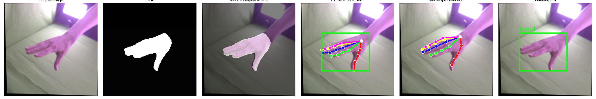

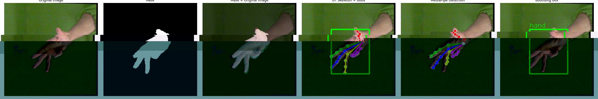

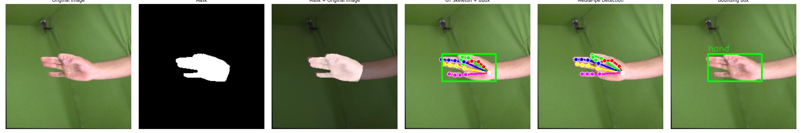

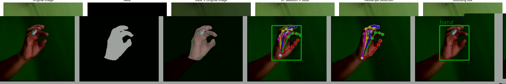

#### 增强样本 (复用原始mask)

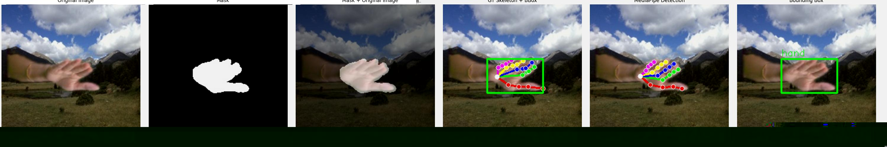

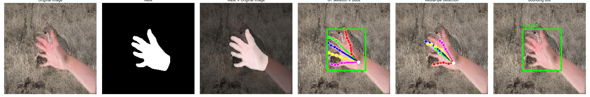

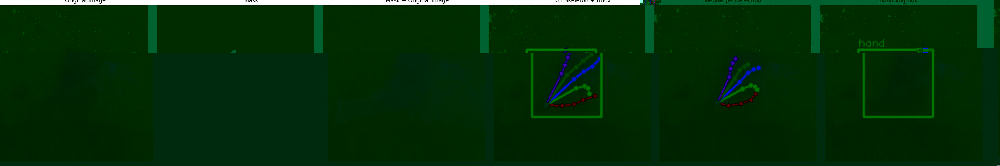

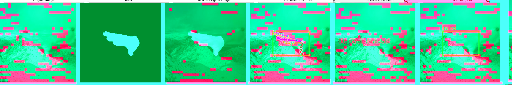

### 评估集样本

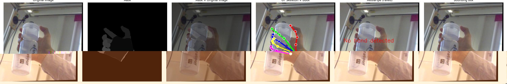

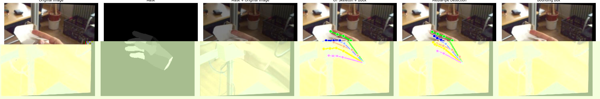

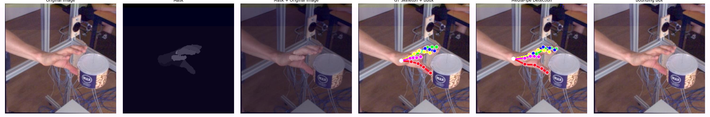

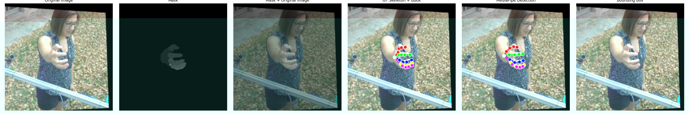

---

## 数据集准备

### 1. 从火山云 (TOS) 下载

数据集存储在火山云对象存储 (TOS)：

```bash
# 训练集 + 评估集完整包 (约 3.62GB)
tosutil cp tos://cytoderm-embodied-ai/datasets/rest_gesture_dataset/FreiHAND/FreiHAND_pub_v2.zip ./

# 或仅下载评估集
tosutil cp tos://cytoderm-embodied-ai/datasets/rest_gesture_dataset/FreiHAND/FreiHAND_pub_v2_eval.zip ./
```

> **注意**: 需要先配置 `tosutil` 工具，详见火山云文档。

### 2. 解压数据集

```bash
# 解压到目标目录
unzip FreiHAND_pub_v2.zip -d /path/to/FreiHAND

# 解压后目录结构应为:
# /path/to/FreiHAND/
# ├── training/
# ├── evaluation/
# ├── training_xyz.json
# ├── training_K.json
# └── ...
```

### 3. 转换为 Ultralytics 格式

```bash
# 进入脚本目录
cd /path/to/rightArmPerception/data/hand_data/FreiHAND

# 运行转换脚本
python process_ultralytics.py \
    --data_root /path/to/FreiHAND \
    --output_dir /path/to/output/freihand_yolo \
    --visibility 2

# 可选参数:
#   --no-augmented  只处理原始32,560张图像，不含4倍增强
#   --symlink       使用符号链接节省磁盘空间
#   --visibility 2  关键点可见性 (推荐使用2)
```

### 完整流程示例

```bash
# 1. 下载
tosutil cp tos://cytoderm-embodied-ai/datasets/rest_gesture_dataset/FreiHAND/FreiHAND_pub_v2.zip ./

# 2. 解压
mkdir -p /home/models/rightArm_collection/FreiHAND
unzip FreiHAND_pub_v2.zip -d /home/models/rightArm_collection/FreiHAND

# 3. 转换
python process_ultralytics.py \
    --data_root /home/models/rightArm_collection/FreiHAND \
    --output_dir /home/models/rightArm_collection/FreiHAND_ultralytics \
    --visibility 2
```

---

## 相关脚本

| 脚本 | 功能 |
|------|------|
| `eda.py` | 数据探索性分析 (EDA)，包含GT标注可视化和MediaPipe推理对比 |
| `process_ultralytics.py` | 将数据集转换为 Ultralytics YOLO-Pose 格式 |
| `3d_2_2d_pose_2_ultralytics.py` | 原始转换脚本 (建议使用 process_ultralytics.py) |

### 运行EDA

```python
# 在 eda.py 中
if __name__ == "__main__":
    eda_train()   # 训练集 EDA (含 MediaPipe 对比)
    eda_eval()    # 评估集 EDA (含 MediaPipe 对比)
```

> **依赖**: 需要在脚本同目录下放置 `hand_landmarker.task` 模型文件（MediaPipe Tasks API）。
> 下载地址: `https://storage.googleapis.com/mediapipe-models/hand_landmarker/hand_landmarker/float16/latest/hand_landmarker.task`

### 转换为 Ultralytics 格式

```bash
# 基本用法 (包含所有130,240张图像)
python process_ultralytics.py --data_root /path/to/FreiHAND --output_dir ./freihand_yolo

# 只处理原始样本 (32,560张，不含增强)
python process_ultralytics.py --data_root /path/to/FreiHAND --output_dir ./output --no-augmented

# 使用符号链接节省磁盘空间
python process_ultralytics.py --data_root /path/to/FreiHAND --output_dir ./output --symlink

# 设置可见性为2 (标注且可见)
python process_ultralytics.py --data_root /path/to/FreiHAND --output_dir ./output --visibility 2
```

**输出目录结构**:
```
output_dir/
├── images/
│   ├── train/          # 训练图像
│   └── val/            # 验证图像 (evaluation集)
├── labels/
│   ├── train/          # 训练标签 (.txt)
│   └── val/            # 验证标签 (.txt)
└── dataset.yaml        # 数据集配置文件
```

**Ultralytics 标签格式** (每行):
```
<class_id> <cx> <cy> <w> <h> <x1> <y1> <v1> <x2> <y2> <v2> ... <x21> <y21> <v21>
```
- 所有坐标归一化到 [0, 1]
- visibility: 0=不标注, 1=标注但不可见, 2=标注且可见

---

## 参考文献

```bibtex
@inproceedings{zimmermann2019freihand,
    title={FreiHAND: A Dataset for Markerless Capture of Hand Pose and Shape from Single RGB Images},
    author={Zimmermann, Christian and Ceylan, Duygu and Yang, Jimei and Russell, Bryan and Argus, Max and Brox, Thomas},
    booktitle={Proceedings of the IEEE/CVF International Conference on Computer Vision (ICCV)},
    pages={813--822},
    year={2019}
}
```

---

## License

FreiHAND数据集仅供非商业研究使用。详细许可条款请参见官方网站。
