# Halpe Full-Body 136 Keypoint Dataset

Halpe 是一个大规模的全身关键点数据集，由上海交通大学 MVIG 实验室发布，用于全身（身体、面部、手部、脚部）姿态估计。每个人物实例标注了 **136 个关键点**，是目前覆盖最全面的 2D 人体姿态估计数据集之一。

**论文**: [PaStaNet: Toward Human Activity Knowledge Engine](https://arxiv.org/abs/2004.00945) (CVPR 2020)

**官方仓库**: https://github.com/Fang-Haoshu/Halpe-FullBody

**MMPose 文档**: https://mmpose.readthedocs.io/en/latest/dataset_zoo/2d_wholebody_keypoint.html#halpe

**原始数据位置**: `tos://cytoderm-embodied-ai/datasets/rest_gesture_dataset/Halpe/Halpe.tar`

---

## 数据集概览

| 项目 | 训练集 (Train) | 验证集 (Val) |
|------|---------------|-------------|
| 图像来源 | HICO-Det (train2015) | COCO val2017 |
| 标注文件 | halpe_train_v1.json | halpe_val_v1.json |
| 每实例关键点数 | 136 | 136 |
| 标注格式 | COCO JSON | COCO JSON |

> 具体图像数量和标注数量请运行 `python eda.py --split val` 和 `python eda.py --split train` 获取。

---

## 目录结构

```
Halpe/
├── annotations/
│   ├── halpe_train_v1.json           # 训练集标注 (COCO JSON 格式)
│   └── halpe_val_v1.json             # 验证集标注 (COCO JSON 格式)
│
├── hico_20160224_det/                 # 训练集图像 (来自 HICO-Det 数据集)
│   ├── images/
│   │   ├── train2015/                 # 训练图像
│   │   │   ├── HICO_train2015_00000001.jpg
│   │   │   └── ...
│   │   └── test2015/
│   ├── anno_bbox.mat
│   ├── anno.mat
│   └── README
│
├── val2017/                           # 验证集图像 (来自 COCO val2017)
│   ├── 000000000139.jpg
│   ├── 000000000285.jpg
│   └── ...
│
├── person_detection_results/          # 人体检测结果
│   └── COCO_val2017_detections_AP_H_56_person.json
│
├── eda.py                             # EDA 可视化脚本
├── process_ultralytics.py             # Ultralytics 格式转换脚本
└── README.md                          # 本文件
```

---

## 标注格式

Halpe 采用标准 **COCO JSON** 格式，主要字段：

### images

```json
{
    "id": 139,
    "file_name": "000000000139.jpg",
    "width": 640,
    "height": 426
}
```

### annotations

```json
{
    "id": 1,
    "image_id": 139,
    "category_id": 1,
    "keypoints": [x0, y0, v0, x1, y1, v1, ..., x135, y135, v135],
    "bbox": [x, y, width, height],
    "area": 12345.6,
    "iscrowd": 0,
    "num_keypoints": 80
}
```

- **keypoints**: 长度为 `136 × 3 = 408` 的数组
  - 每个关键点包含 3 个值: `(x, y, visibility)`
  - `v = 0`: 未标注
  - `v = 1`: 标注但不可见 (被遮挡)
  - `v = 2`: 标注且可见
- **bbox**: COCO 格式边界框 `[x, y, width, height]`

---

## 136 关键点定义

Halpe 的 136 个关键点分为 4 个部分：

### 1. Body (0-25): 26 个身体关键点

扩展了 COCO 的 17 个身体关键点，增加了 Head、Neck、Hip (center) 和 6 个脚部关键点。

```
    Index   Name           Description
    -----   ----           -----------
      0     Nose           鼻子
      1     LEye           左眼
      2     REye           右眼
      3     LEar           左耳
      4     REar           右耳
      5     LShoulder      左肩
      6     RShoulder      右肩
      7     LElbow         左肘
      8     RElbow         右肘
      9     LWrist         左手腕
     10     RWrist         右手腕
     11     LHip           左臀
     12     RHip           右臀
     13     LKnee          左膝
     14     RKnee          右膝
     15     LAnkle         左踝
     16     RAnkle         右踝
     17     Head           头顶
     18     Neck           脖子
     19     Hip            臀部中心
     20     LBigToe        左大脚趾
     21     RBigToe        右大脚趾
     22     LSmallToe      左小脚趾
     23     RSmallToe      右小脚趾
     24     LHeel          左脚跟
     25     RHeel          右脚跟
```

### 2. Face (26-93): 68 个面部关键点

采用 68 点面部标注方案 (与 dlib/iBUG 一致):

```
    Index Range   Region
    -----------   ------
    26-42         下颌轮廓 (Jaw contour, 17 点)
    43-47         左眉毛 (Left eyebrow, 5 点)
    48-52         右眉毛 (Right eyebrow, 5 点)
    53-56         鼻梁 (Nose bridge, 4 点)
    57-61         鼻尖/鼻翼 (Nose bottom, 5 点)
    62-67         左眼 (Left eye, 6 点)
    68-73         右眼 (Right eye, 6 点)
    74-85         外嘴唇 (Outer lip, 12 点)
    86-93         内嘴唇 (Inner lip, 8 点)
```

> **💡 头部位姿估计潜力**: 68 个面部关键点与 dlib/iBUG 标准一致，可以通过 **PnP (Perspective-n-Point)** 方法，利用其中鼻尖 (56)、下巴 (34)、左眼角 (62)、右眼角 (71)、左嘴角 (74)、右嘴角 (80) 等稳定关键点，配合通用 3D 人脸模型，估计头部的 yaw/pitch/roll 位姿。这为后续**头部位姿估计伪标签生成**提供了数据基础。

### 3. Left Hand (94-114): 21 个左手关键点

采用 MediaPipe 风格的 21 点手部标注:

```
    Index   Offset   Name           Description
    -----   ------   ----           -----------
     94       0      L_Wrist        左手腕
     95       1      L_Thumb_CMC    左拇指掌腕关节
     96       2      L_Thumb_MCP    左拇指掌指关节
     97       3      L_Thumb_IP     左拇指指间关节
     98       4      L_Thumb_TIP    左拇指指尖
     99       5      L_Index_MCP    左食指掌指关节
    100       6      L_Index_PIP    左食指近端指间关节
    101       7      L_Index_DIP    左食指远端指间关节
    102       8      L_Index_TIP    左食指指尖
    103       9      L_Middle_MCP   左中指掌指关节
    104      10      L_Middle_PIP   左中指近端指间关节
    105      11      L_Middle_DIP   左中指远端指间关节
    106      12      L_Middle_TIP   左中指指尖
    107      13      L_Ring_MCP     左无名指掌指关节
    108      14      L_Ring_PIP     左无名指近端指间关节
    109      15      L_Ring_DIP     左无名指远端指间关节
    110      16      L_Ring_TIP     左无名指指尖
    111      17      L_Pinky_MCP    左小指掌指关节
    112      18      L_Pinky_PIP    左小指近端指间关节
    113      19      L_Pinky_DIP    左小指远端指间关节
    114      20      L_Pinky_TIP    左小指指尖
```

### 4. Right Hand (115-135): 21 个右手关键点

与左手结构相同，偏移 21:

```
    Index   Offset   Name           Description
    -----   ------   ----           -----------
    115       0      R_Wrist        右手腕
    116       1      R_Thumb_CMC    右拇指掌腕关节
    ...       ...    ...            ...
    135      20      R_Pinky_TIP    右小指指尖
```

### 骨架连接关系

```
Body:
  Head: 0─1, 0─2, 1─3, 2─4, 0─17, 17─18
  Torso: 5─18, 6─18, 5─19, 6─19
  Left arm: 5─7─9
  Right arm: 6─8─10
  Left leg: 19─11─13─15
  Right leg: 19─12─14─16
  Left foot: 15─20, 15─24, 20─22
  Right foot: 16─21, 16─25, 21─23

Hand (Left 94-114 / Right 115-135):
  Wrist (+0) ─┬─ Thumb:  +1 ─ +2 ─ +3 ─ +4      (红色)
              ├─ Index:  +5 ─ +6 ─ +7 ─ +8      (绿色)
              ├─ Middle: +9 ─ +10 ─ +11 ─ +12   (蓝色)
              ├─ Ring:   +13 ─ +14 ─ +15 ─ +16  (黄色)
              └─ Pinky:  +17 ─ +18 ─ +19 ─ +20  (紫色)

Face (26-93):
  Jaw contour, Eyebrows, Eyes, Nose, Lips 按顺序连接
```

---

## 数据特点

### 与其他数据集的对比

| 特征 | Halpe | COCO-WholeBody | FreiHAND | OneHand10K |
|------|-------|----------------|----------|------------|
| 关键点数 | 136 (全身) | 133 (全身) | 21 (手) | 21 (手) |
| Body 关键点 | 26 | 17 | ❌ | ❌ |
| Face 关键点 | 68 | 68 | ❌ | ❌ |
| Hand 关键点 | 21×2 (左右手) | 21×2 | 21 | 21 |
| Foot 关键点 | 含在 Body 中 (6个) | 6 | ❌ | ❌ |
| 图像来源 | HICO-Det + COCO | COCO | 绿幕实验室 | 真实场景 |
| 标注格式 | COCO JSON | COCO JSON | JSON | TFRecord |
| 3D 标注 | ❌ | ❌ | ✅ | ❌ |

### 主要特点

1. **全身覆盖**: 136 个关键点覆盖身体、面部、左右手和脚部
2. **多人场景**: 每张图像可能包含多个人物标注
3. **真实场景**: 图像来自 HICO-Det (人物交互) 和 COCO (通用场景)
4. **手部关键点**: 左右手各 21 个关键点，与 MediaPipe 定义兼容
5. **面部关键点**: 68 点 iBUG 方案，可用于 PnP 头部位姿估计
6. **部分遮挡**: 包含真实场景中的遮挡情况，关键点可见性有完整标注

---

## EDA 可视化结果

### EDA 流程说明

EDA 脚本 (`eda.py`) 包含以下分析流程：

1. **基础统计**: 图像数、标注数、关键点可见性分布、分部位统计
2. **手部大小分布分析**: 遍历所有标注，计算每只手的 bbox (由可见关键点外接框得到) 面积占图像面积的比例
3. **全图标注可视化**: 随机采样图像，绘制完整标注 (Body 骨架 + Face 轮廓 + 左右手骨架 + 手部 BBox)
4. **分层手部可视化**: 按手部大小分 bin 采样，对较大手部区域执行 MediaPipe 手部关键点检测并对比

#### 手部大小分布 (Hand Size Distribution)

手部大小通过 **手部 bbox 面积占图像面积的百分比** (`area_ratio`) 来度量：

```
area_ratio = hand_bbox_area / image_area × 100%
```

根据 `area_ratio` 将手部分为 4 个等级：

```
  tiny       small       medium       large
|----------|----------|----------|---------->  area_ratio
0%       0.5%       2.0%       5.0%
          ↑           ↑          ↑
       分界线1     分界线2     分界线3
```

| 等级 | area_ratio 范围 | 含义 | MediaPipe 可行性 |
|------|----------------|------|-----------------|
| **tiny** | < 0.5% | 手非常小，几乎看不清 | ❌ 不可行 |
| **small** | 0.5% - 2.0% | 手较小 | ❌ 困难 |
| **medium** | 2.0% - 5.0% | 手中等大小 | ⚠️ 部分可行 (crop 后) |
| **large** | ≥ 5.0% | 手较大，较清晰 | ✅ 可行 (crop 后) |

分布直方图中还包含手部 bbox 最大边的**绝对像素值**分布，其中 32px / 64px / 128px 参考线用于直观判断手部实际像素大小（与分 bin 无关，仅供参考）。

> **MediaPipe 推理方式**: 对 medium 和 large 等级的手部，先用 GT 关键点外接框裁剪手部区域 (crop)，放大到 256px 后送入 MediaPipe HandLandmarker 检测，得到的关键点坐标映射回 crop 坐标系进行可视化对比。

---

### 手部大小分布直方图

#### 训练集

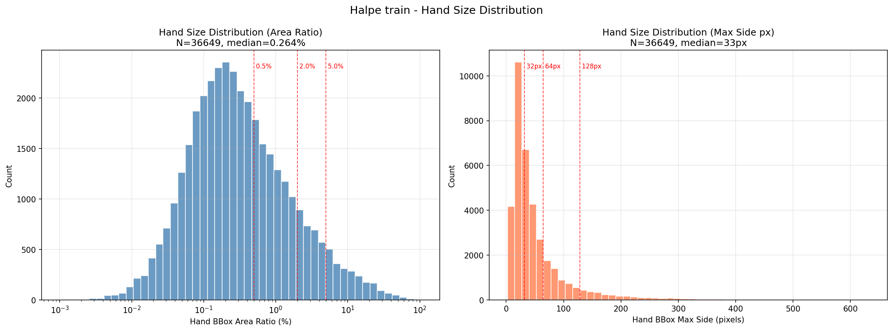

#### 验证集

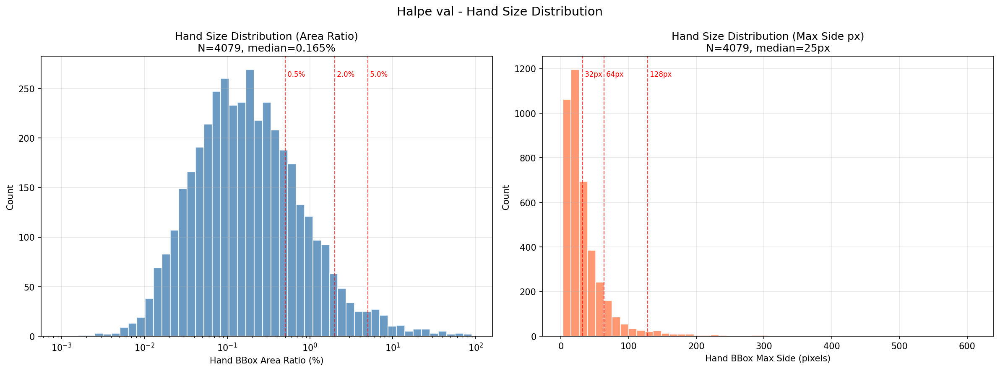

---

### 全图标注可视化

每张可视化包含两列：
- **左**: 原始图像
- **右**: GT 标注可视化，包括：
  - 身体骨架 (绿色系，左右侧不同颜色)
  - **面部 68 关键点** (浅蓝色轮廓连接) — 可用于 PnP 头部位姿估计伪标签生成
  - 左手骨架 + bbox (橙黄色)
  - 右手骨架 + bbox (粉紫色)
  - 人物 bbox (绿色)
  - 手部 bbox 标签显示面积占比 (如 `LHand 1.23%`)

#### 训练集样本

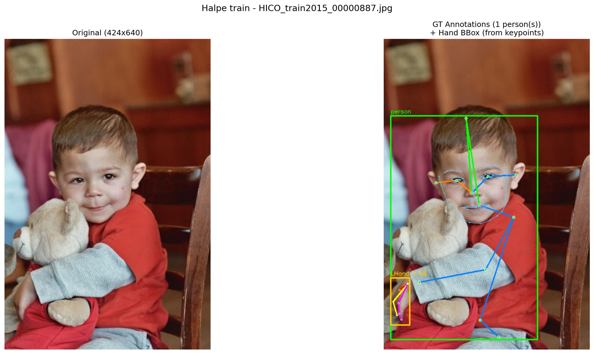


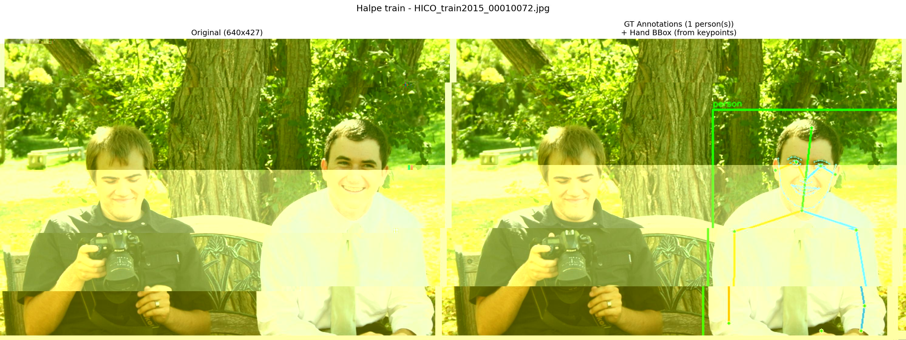

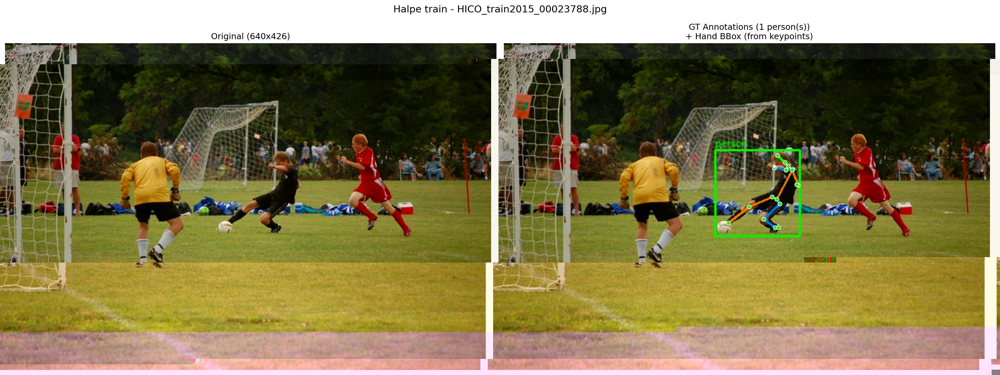

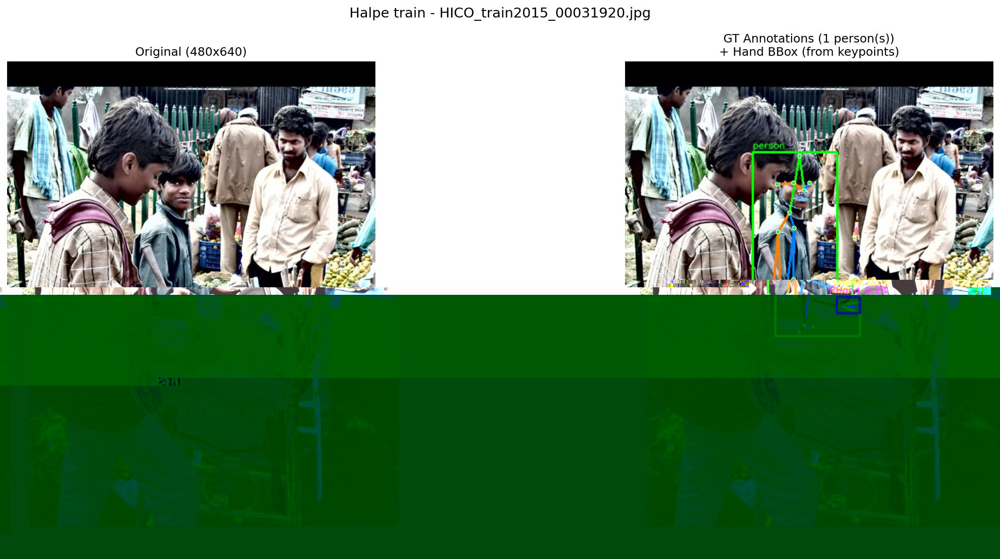

#### 验证集样本

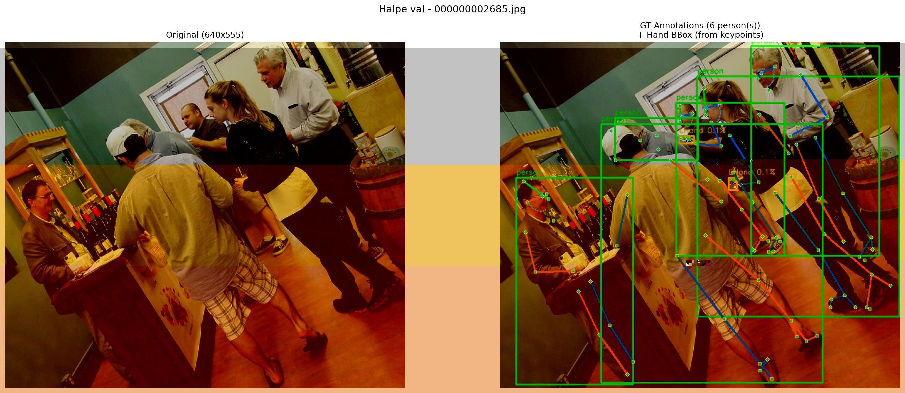

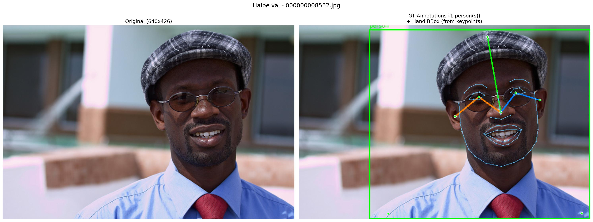

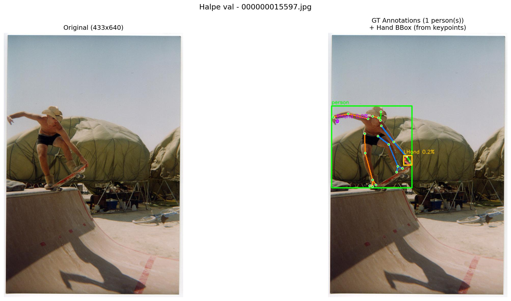

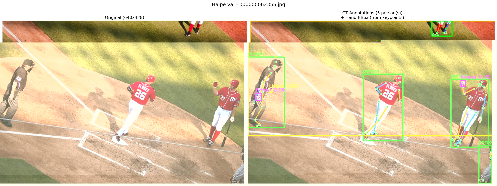

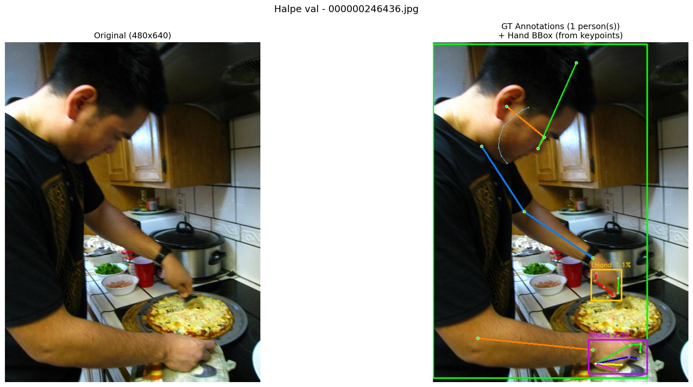

---

### 分层手部可视化 (按手部大小 bin)

按手部面积占比分为 tiny / small / medium / large 四个等级，每个等级随机采样展示。

- **tiny / small**: 仅展示全图 + GT crop (手部太小，不执行 MediaPipe)
- **medium / large**: 展示全图 + GT crop + MediaPipe 检测 + GT vs MediaPipe 对比

#### Tiny (area_ratio < 0.5%)

手非常小，基本无法做手部关键点检测。

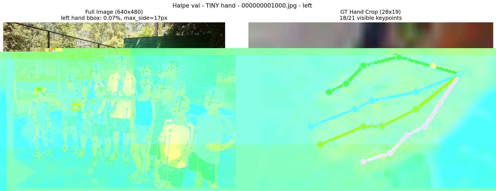

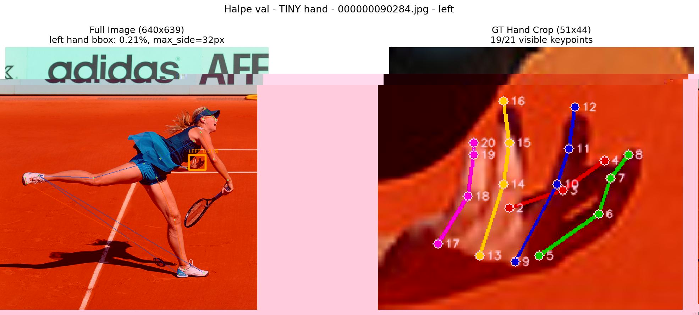

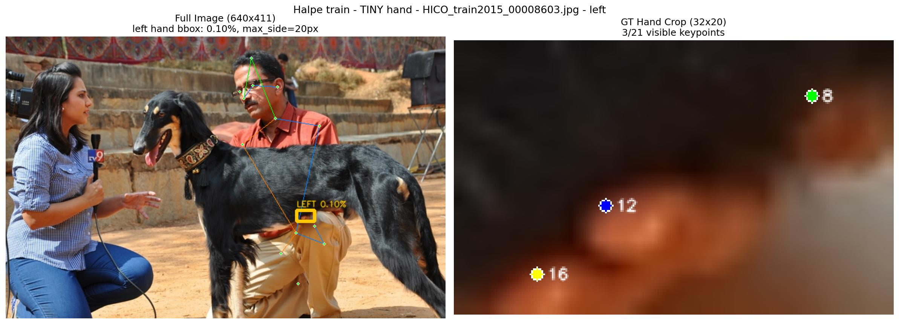

#### Small (0.5% ≤ area_ratio < 2.0%)

手较小，MediaPipe 检出困难。

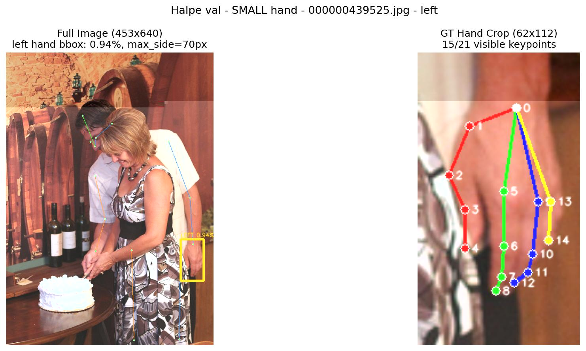

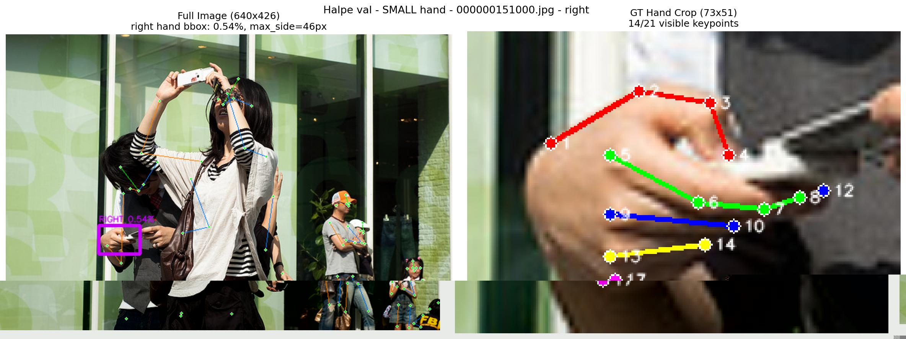

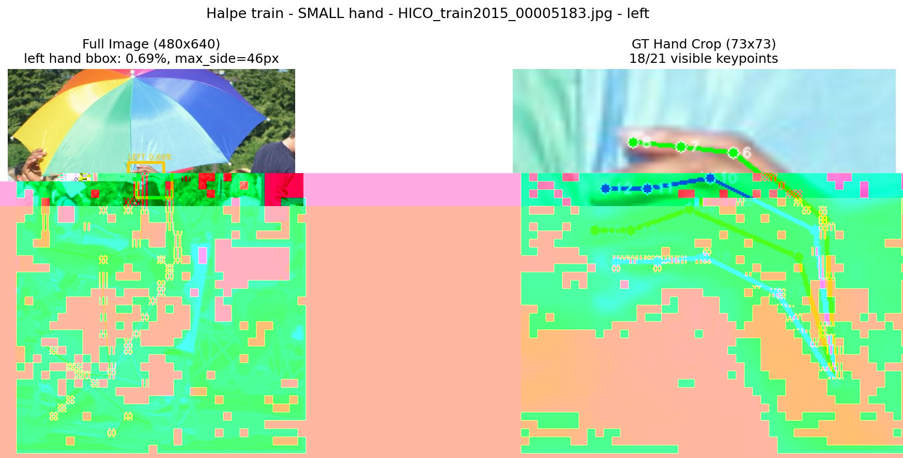

#### Medium (2.0% ≤ area_ratio < 5.0%)

手中等大小，crop 放大后 MediaPipe 部分可检出。4 列子图：全图 → GT crop → MediaPipe 检测 → GT(彩色) vs MP(橙色) 对比。

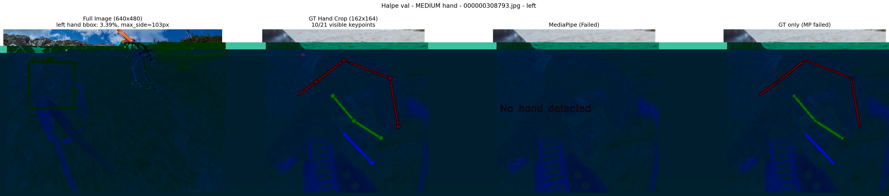

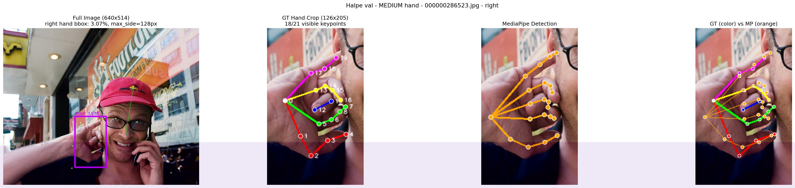

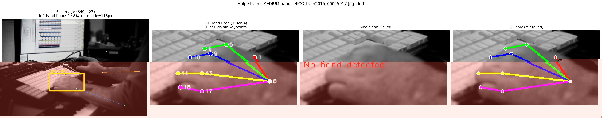

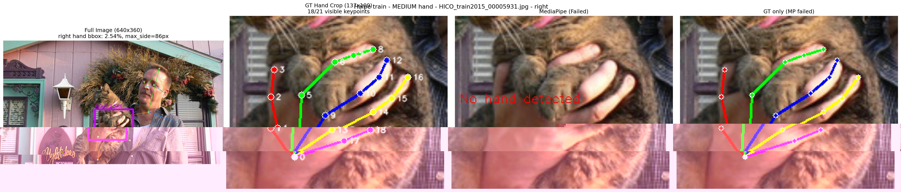

#### Large (area_ratio ≥ 5.0%)

手较大且清晰，crop 后 MediaPipe 检出率较高。

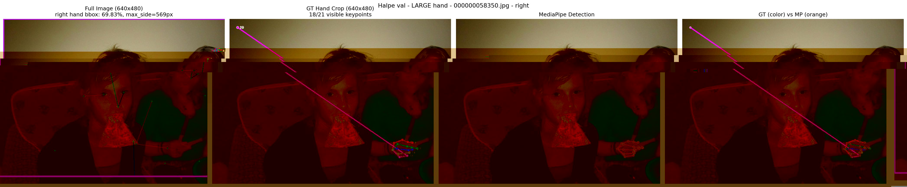

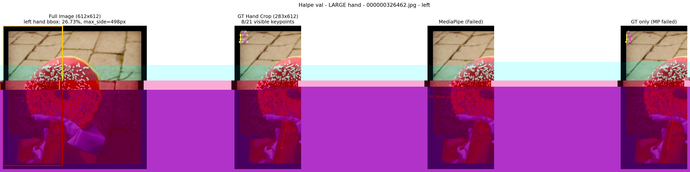

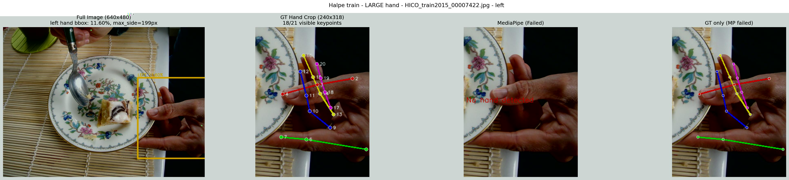

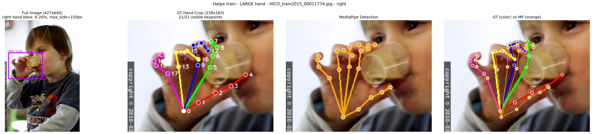

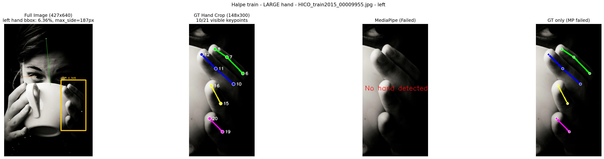

---

## 面部关键点与头部位姿估计

Halpe 的 68 个面部关键点 (索引 26-93) 与 dlib/iBUG 标准完全一致，可通过 **PnP (Perspective-n-Point)** 方法估计头部位姿 (yaw / pitch / roll)。

### 可用于 PnP 的关键点

| 68-landmark 索引 | Halpe 索引 | 名称 |
|-----------------|-----------|------|
| 30 | 56 | Nose tip (鼻尖) |
| 8 | 34 | Chin (下巴) |
| 36 | 62 | Left eye left corner (左眼左角) |
| 45 | 71 | Right eye right corner (右眼右角) |
| 48 | 74 | Left mouth corner (左嘴角) |
| 54 | 80 | Right mouth corner (右嘴角) |

### 用途

- **头部位姿伪标签生成**: 利用 GT 面部关键点 + 通用 3D 人脸模型 + `cv2.solvePnP()` 可以估计每个人物实例的头部朝向 (yaw/pitch/roll)，生成伪标签用于下游任务
- **注意力方向判断**: 判断人是否看向特定方向（正脸、侧脸、低头等）
- **局限性**: 没有实际相机标定参数，使用 `focal_length ≈ img_width` 近似，得到的是相对位姿而非精确绝对位姿

---

## 使用示例

### 加载标注

```python
import json

with open('annotations/halpe_val_v1.json', 'r') as f:
    data = json.load(f)

print(f"Images: {len(data['images'])}")
print(f"Annotations: {len(data['annotations'])}")

# 获取第一个标注
ann = data['annotations'][0]
keypoints = ann['keypoints']  # 长度 408 = 136 * 3
bbox = ann['bbox']            # [x, y, w, h]
```

### 解析关键点

```python
import numpy as np

def parse_keypoints(kpts_flat):
    """解析为 (136, 3) 数组, 每行 [x, y, visibility]"""
    return np.array(kpts_flat).reshape(-1, 3)

kpts = parse_keypoints(ann['keypoints'])

# 提取手部关键点
left_hand = kpts[94:115]   # (21, 3) 左手
right_hand = kpts[115:136]  # (21, 3) 右手

# 检查可见性
lhand_visible = np.sum(left_hand[:, 2] > 0)
rhand_visible = np.sum(right_hand[:, 2] > 0)
print(f"Left hand visible: {lhand_visible}/21")
print(f"Right hand visible: {rhand_visible}/21")
```

---

## 快速开始

### 1. 查看样本 (EDA)

```bash
# 验证集 EDA (默认 10 个全图样本, 每个手部大小 bin 3 个样本)
python eda.py --split val --n_samples 10 --n_per_bin 3

# 训练集 EDA
python eda.py --split train --n_samples 10 --n_per_bin 5
```

EDA 输出目录结构:
```
{data_root}/eda_output/{split}/
├── hand_size_distribution.png       # 手部大小分布直方图
├── samples/                         # 全图标注可视化 (原图 + GT 标注)
├── hand_size_tiny/                  # tiny 手部: 全图 + GT crop
├── hand_size_small/                 # small 手部: 全图 + GT crop
├── hand_size_medium/                # medium 手部: 全图 + GT crop + MediaPipe
└── hand_size_large/                 # large 手部: 全图 + GT crop + MediaPipe
```

### 2. 转换为 Ultralytics 格式

```bash
python process_ultralytics.py \
    --data_root /home/models/rightArm_collection/Halpe/Halpe \
    --output_dir /home/models/rightArm_collection/Halpe/ultralytics
```

---

## 相关脚本

| 脚本 | 功能 |
|------|------|
| `eda.py` | 数据探索性分析: 基础统计 + 手部大小分布 + 全图可视化 + 分层 MediaPipe 对比 |
| `process_ultralytics.py` | 将数据集转换为 Ultralytics YOLO-Pose 格式 |

### 运行 EDA

```bash
python eda.py \
    --data_root /home/models/rightArm_collection/Halpe/Halpe \
    --split val \
    --n_samples 10 \
    --n_per_bin 5
```

> **依赖**: MediaPipe 对比功能需要 `hand_landmarker.task` 模型文件 (放在 `../FreiHAND/` 目录下)。
> 下载地址: `https://storage.googleapis.com/mediapipe-models/hand_landmarker/hand_landmarker/float16/latest/hand_landmarker.task`

---

## 参考文献

```bibtex
@inproceedings{li2020pastanet,
    title={PaStaNet: Toward Human Activity Knowledge Engine},
    author={Li, Yong-Lu and Xu, Liang and Liu, Xinpeng and Huang, Xijie
            and Xu, Yue and Wang, Shiyi and Fang, Hao-Shu and Ma, Ze
            and Chen, Mingyang and Lu, Cewu},
    booktitle={CVPR},
    year={2020}
}
```

---

## License

Halpe 数据集基于 HICO-Det 和 COCO 数据集构建。训练集图像遵循 HICO-Det 许可条款，验证集图像遵循 COCO 许可条款。仅供非商业研究使用。
