# OneHand10K Dataset

OneHand10K 是一个大规模的 2D 手部姿态估计与手部分割数据集，包含来自多种真实场景的手部图像。每张图像标注了 21 个手部关键点和像素级手部分割 mask，用于手部姿态估计、手部分割等任务的训练和评估。

**论文**: [Mask-pose Cascaded CNN for 2D Hand Pose Estimation from Single Color Image](https://ieeexplore.ieee.org/document/8785997) (IEEE Transactions on Multimedia, 2019)

**Kaggle TFRecords 版本**: https://www.kaggle.com/datasets/rustyelectron/onehand10k-tfrecords

**参考 Notebook**: https://www.kaggle.com/code/rustyelectron/inspect-onehand10k-tfrecords

---

## 数据集概览

| 项目 | 训练集 (Train) | 验证集 (Valid) | 测试集 (Test) |
|------|---------------|---------------|--------------|
| 样本数 | 8,000 | ~2,000 | ~1,700 |
| TFRecord 文件数 | 30 | 10 | 10 |
| 图像尺寸 | 256 × 256 | 256 × 256 | 256 × 256 |
| 关键点数量 | 21 | 21 | 21 |
| Mask 标注 | ✅ | ✅ | ✅ |

> **总计约 11,700 张图像**，涵盖不同手势、光照、背景和遮挡条件。

---

## 目录结构

数据以 TFRecords 格式存储：

```
OneHand10K/
├── onehand10k-tfrecords/
│   ├── train/                           # 训练集 (30 个 TFRecord 文件)
│   │   ├── training_data_0.tfrecords
│   │   ├── training_data_1.tfrecords
│   │   └── ... (training_data_29.tfrecords)
│   │
│   ├── valid/                           # 验证集 (10 个 TFRecord 文件)
│   │   ├── validation_data_0.tfrecords
│   │   ├── validation_data_1.tfrecords
│   │   └── ... (validation_data_9.tfrecords)
│   │
│   └── test/                            # 测试集 (10 个 TFRecord 文件)
│       ├── testing_data_0.tfrecords
│       ├── testing_data_1.tfrecords
│       └── ... (testing_data_9.tfrecords)
│
├── eda.py                               # EDA 脚本 (可视化 + MediaPipe 对比)
└── README.md                            # 本文件
```

---

## TFRecord 数据格式

每条 TFRecord 包含以下三个字段：

| 字段 | 类型 | 形状 | 说明 |
|------|------|------|------|
| `image_raw` | `bytes_list` | 196,608 bytes | 原始 RGB 像素数据 (256×256×3, uint8) |
| `image_mask` | `bytes_list` | 65,536 bytes | 手部分割 mask (256×256, 单通道, uint8) |
| `label` | `float_list` | 42 floats | 21 个关键点坐标，交错排列 [x₀,y₀,x₁,y₁,...,x₂₀,y₂₀] |

### 坐标格式

关键点坐标采用 **中心归一化格式 [-0.5, 0.5]**：
- 原点 `(0, 0)` 对应图像中心
- 左上角为 `(-0.5, -0.5)`，右下角为 `(0.5, 0.5)`

**反归一化公式**（转换为像素坐标）：
```
pixel_x = (normalized_x + 0.5) × 256
pixel_y = (normalized_y + 0.5) × 256
```

### 无效关键点

- 部分样本存在**关键点缺失**（遮挡、截断等原因）
- 无效关键点的原始值远小于 `-0.5`（通常为 `-1.0`）
- 反归一化后 `pixel < 0`，可通过 `x < 0` 判断并跳过
- 每个样本的有效关键点数量在 **0 ~ 21** 之间不等

---

## 标注内容详解

### 1. RGB 图像 (`image_raw`)

- **格式**: 原始 RGB 像素数据 (非 JPEG/PNG 编码)
- **尺寸**: 256 × 256 × 3 (uint8)
- **解码方式**: `tf.io.decode_raw(image_raw, tf.uint8)` → `tf.reshape(_, [256, 256, 3])`
- **场景**: 包含日常场景中的单手图像，背景多样（室内、室外、工作台等）

### 2. 手部分割 Mask (`image_mask`)

- **格式**: 原始像素数据 (非编码)
- **尺寸**: 256 × 256 (单通道, uint8)
- **解码方式**: `tf.io.decode_raw(image_mask, tf.uint8)` → `tf.reshape(_, [256, 256])`
- **数值**: 0 = 背景, >0 = 手部区域
- **用途**: 手部分割任务；也可用于提取手部边界框 (bounding box)

### 3. 关键点标注 (`label`)

- **格式**: 42 个 float32 值
- **排列**: 交错格式 `[x₀, y₀, x₁, y₁, ..., x₂₀, y₂₀]`
- **reshape**: `tf.reshape(label, [21, 2])` 得到 `(21, 2)` 数组，每行 `[x, y]`
- **坐标范围**: `[-0.5, 0.5]` (中心归一化)
- **无效标记**: 原始值 `< -0.5` (如 `-1.0`) 表示该关键点无标注

---

## 关键点定义

OneHand10K 使用 21 个手部关键点，与 **MediaPipe** 手部关键点定义完全一致（1:1 恒等映射，无需重排）：

```
    Index   Name           Description
    -----   ----           -----------
      0     Wrist          手腕
      1     Thumb_CMC      拇指掌腕关节
      2     Thumb_MCP      拇指掌指关节
      3     Thumb_IP       拇指指间关节
      4     Thumb_TIP      拇指指尖
      5     Index_MCP      食指掌指关节
      6     Index_PIP      食指近端指间关节
      7     Index_DIP      食指远端指间关节
      8     Index_TIP      食指指尖
      9     Middle_MCP     中指掌指关节
     10     Middle_PIP     中指近端指间关节
     11     Middle_DIP     中指远端指间关节
     12     Middle_TIP     中指指尖
     13     Ring_MCP       无名指掌指关节
     14     Ring_PIP       无名指近端指间关节
     15     Ring_DIP       无名指远端指间关节
     16     Ring_TIP       无名指指尖
     17     Pinky_MCP      小指掌指关节
     18     Pinky_PIP      小指近端指间关节
     19     Pinky_DIP      小指远端指间关节
     20     Pinky_TIP      小指指尖
```

### 骨架连接关系

```
Wrist (0) ─┬─ Thumb:  1 ─ 2 ─ 3 ─ 4      (红色)
           ├─ Index:  5 ─ 6 ─ 7 ─ 8      (绿色)
           ├─ Middle: 9 ─ 10 ─ 11 ─ 12   (蓝色)
           ├─ Ring:   13 ─ 14 ─ 15 ─ 16  (黄色)
           └─ Pinky:  17 ─ 18 ─ 19 ─ 20  (紫色)
```

骨架连接对 (POSE_PAIRS)：

```python
POSE_PAIRS = [
    [0,1],[1,2],[2,3],[3,4],           # Thumb
    [0,5],[5,6],[6,7],[7,8],           # Index
    [0,9],[9,10],[10,11],[11,12],      # Middle
    [0,13],[13,14],[14,15],[15,16],    # Ring
    [0,17],[17,18],[18,19],[19,20]     # Pinky
]
```

---

## 使用示例

### 解析 TFRecord

```python
import tensorflow as tf
import numpy as np

IMG_SIZE = 256

def parse_tfrecord(example):
    features = {
        'image_raw': tf.io.FixedLenFeature([], tf.string),
        'image_mask': tf.io.FixedLenFeature([], tf.string),
        'label': tf.io.FixedLenFeature([42], tf.float32),
    }
    parsed = tf.io.parse_single_example(example, features)

    # 解码图像
    image = tf.io.decode_raw(parsed['image_raw'], tf.uint8)
    image = tf.reshape(image, [IMG_SIZE, IMG_SIZE, 3])

    # 解码 mask
    mask = tf.io.decode_raw(parsed['image_mask'], tf.uint8)
    mask = tf.reshape(mask, [IMG_SIZE, IMG_SIZE])

    # 解析关键点
    label = tf.reshape(parsed['label'], [21, 2])

    return image, mask, label

# 加载数据集
dataset = tf.data.TFRecordDataset('path/to/training_data_0.tfrecords')
dataset = dataset.map(parse_tfrecord)
```

### 关键点坐标反归一化

```python
def unnormalize_keypoints(keypoints, img_size=256):
    """
    将关键点从 [-0.5, 0.5] 中心归一化坐标转换为像素坐标
    
    Args:
        keypoints: (21, 2) 数组, 归一化坐标
        img_size: 图像尺寸 (默认 256)
    
    Returns:
        (21, 2) 数组, 像素坐标 (无效关键点保持 < 0)
    """
    return (keypoints + 0.5) * img_size
```

### 过滤无效关键点

```python
# 反归一化后判断有效性
pixel_keypoints = unnormalize_keypoints(label_np)

# 有效关键点: 像素坐标 >= 0
valid_mask = pixel_keypoints[:, 0] >= 0
n_valid = valid_mask.sum()
n_invalid = (~valid_mask).sum()

print(f"有效关键点: {n_valid}/21, 无效: {n_invalid}/21")

# 仅使用有效关键点
valid_keypoints = pixel_keypoints[valid_mask]
```

### 从 Mask 提取边界框

```python
import cv2
import numpy as np

def get_bbox_from_mask(mask):
    """从 mask 提取边界框 (x_min, y_min, x_max, y_max)"""
    coords = np.column_stack(np.where(mask > 0))
    if coords.size == 0:
        return None
    y_min, x_min = coords.min(axis=0)
    y_max, x_max = coords.max(axis=0)
    return (int(x_min), int(y_min), int(x_max), int(y_max))
```

---

## EDA 可视化示例

每个样本可视化包含 5 列：原图 (256×256)、Mask Overlay + BBox、GT 骨架 + BBox、MediaPipe 检测结果、GT vs MediaPipe 对比

> ⚠️ **关键点缺失**: 部分样本仅有 7~15 个有效关键点标注，缺失的关键点在可视化中不显示。
>
> ⚠️ **MediaPipe 检测**: 在手部被物体遮挡、姿态极端、图像较模糊的情况下，MediaPipe 可能无法检测出手部（显示 "No hand detected"）。

### 训练集样本

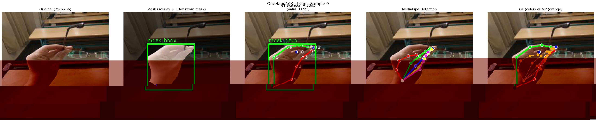

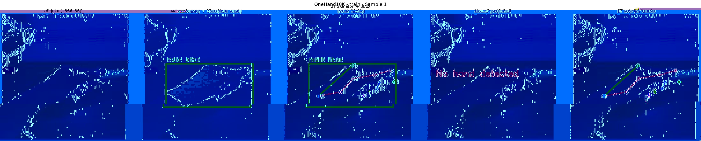

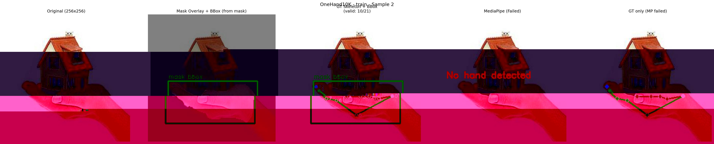

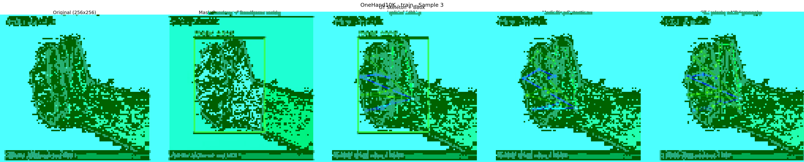

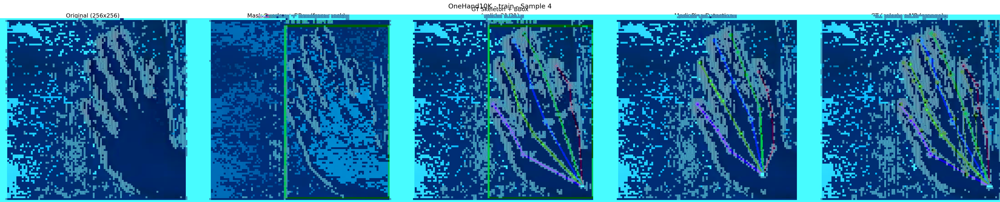

### 验证集样本

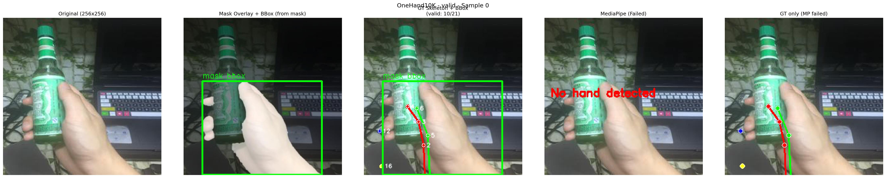

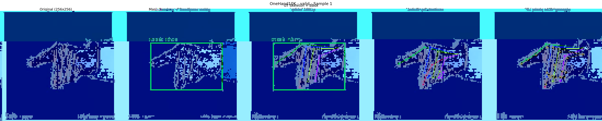

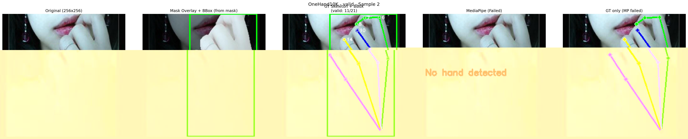

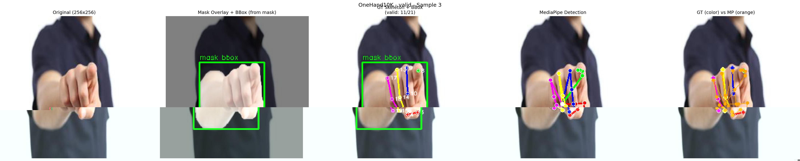

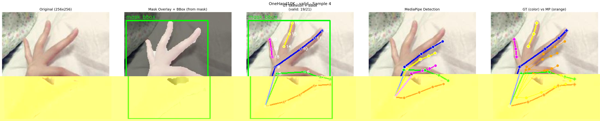

### 测试集样本

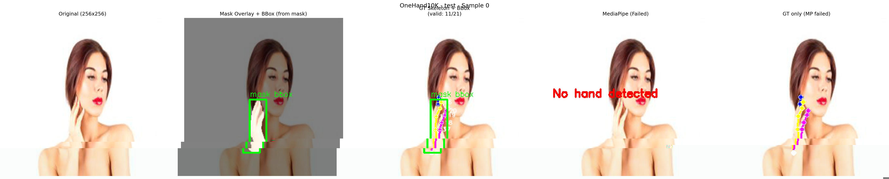

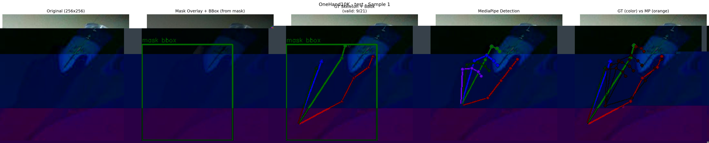

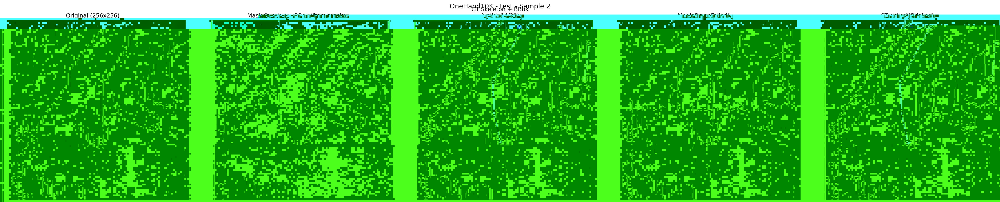

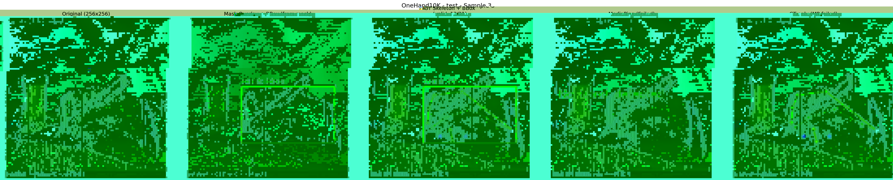

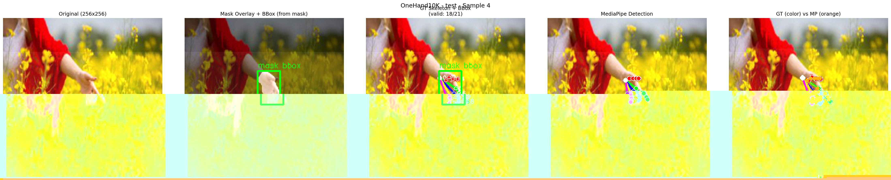

---

## 数据集特点

### 与 FreiHAND 的对比

| 特征 | OneHand10K | FreiHAND |
|------|-----------|----------|
| 图像来源 | 真实场景采集 | 绿幕实验室 + 背景合成 |
| 图像尺寸 | 256 × 256 | 224 × 224 |
| 关键点维度 | 2D (x, y) | 3D (x, y, z) + 相机内参 |
| 关键点数量 | 21 | 21 |
| Mask 标注 | ✅ 每张图像 | ✅ 原始样本 |
| 关键点缺失 | ✅ 部分缺失 (x=-1) | ❌ 全部标注 |
| 数据增强 | ❌ 无 | ✅ 4倍背景替换增强 |
| MANO 参数 | ❌ | ✅ |
| 3D 网格顶点 | ❌ | ✅ |
| 数据格式 | TFRecord | JSON + JPEG |

### 数据特点

1. **真实场景**: 图像来自真实的日常场景，包含多种光照、背景和手部姿态
2. **丰富的遮挡**: 包含手持物体（瓶子、手机、笔等）、手指互相遮挡等场景
3. **部分标注**: 被遮挡的关键点标记为无效 (`x = -1`)，需在训练时正确处理
4. **标准骨架定义**: 21 关键点顺序与 MediaPipe 完全一致，便于跨数据集使用

### ⚠️ 已知数据质量问题

Kaggle TFRecords 版本中存在**少量异常样本**，表现为：

- **Mask 覆盖整张图像**（bbox 面积 > 90% 图像面积）
- **关键点坐标与图像不匹配**（骨架画在图像内容之外或严重错位）

**根因分析**：OneHand10K 原始图像尺寸各异，在制作 TFRecords 时统一缩放至 256×256。部分样本的原始尺寸与 256×256 差异较大，resize/padding 过程中 mask 被拉伸填满整图，但关键点坐标未被正确变换，导致标注与图像不对齐。

**处理方式**：`extract_image_label.py` 提取时会自动检测并**剔除**这类异常样本（bbox 面积占图像 > 90%），被剔除样本的原始 TFRecord 索引保存在 `skipped_indices.json` 中，方便溯源。提取后的数据均为经过清洗的干净样本。

---

## 快速开始

### 1. 下载数据

从火山云 TOS 下载 TFRecords 压缩包并解压：

```bash
# 下载
tos cp tos://cytoderm-embodied-ai/datasets/rest_gesture_dataset/Onehand10k/onehand10k-tfrecords.tar /home/models/rightArm_collection/OneHand10K/

# 解压
cd /home/models/rightArm_collection/OneHand10K
tar -xf onehand10k-tfrecords.tar
```

解压后目录结构：
```
/home/models/rightArm_collection/OneHand10K/
└── onehand10k-tfrecords/
    ├── train/   (30 个 .tfrecords)
    ├── valid/   (10 个 .tfrecords)
    └── test/    (10 个 .tfrecords)
```

### 2. 查看样本 (EDA)

运行 `eda.py` 查看样本可视化 & MediaPipe 对比：

```bash
python eda.py --split train --n_samples 10
```

### 3. 提取图像与标注

运行 `extract_image_label.py` 从 TFRecords 中提取图像、mask、关键点和 bbox（自动剔除异常样本）：

```bash
python extract_image_label.py \
    --data_root /home/models/rightArm_collection/OneHand10K \
    --output_dir /home/models/rightArm_collection/OneHand10K/extracted
```

### 4. 转换为 Ultralytics 格式

运行 `process_ultralytics.py` 将提取结果转换为 YOLO-Pose 训练格式：

```bash
python process_ultralytics.py \
    --extracted_dir /home/models/rightArm_collection/OneHand10K/extracted \
    --output_dir /home/models/rightArm_collection/OneHand10K/ultralytics
```

---

## 相关脚本

| 脚本 | 功能 |
|------|------|
| `eda.py` | 数据探索性分析 (EDA)，包含 GT 标注可视化和 MediaPipe 推理对比 |
| `extract_image_label.py` | 从 TFRecords 提取图像/mask/关键点/bbox，自动剔除异常样本 |
| `process_ultralytics.py` | 将提取结果转换为 Ultralytics YOLO-Pose 格式 (valid+test 合并为 val) |

### 运行 EDA

```bash
# 训练集 EDA (默认 10 个样本)
python eda.py --split train --n_samples 10

# 验证集 EDA
python eda.py --split valid --n_samples 5

# 测试集 EDA
python eda.py --split test --n_samples 5
```

> **依赖**: 需要在脚本同目录下放置 `hand_landmarker.task` 模型文件（MediaPipe Tasks API）。
> 下载地址: `https://storage.googleapis.com/mediapipe-models/hand_landmarker/hand_landmarker/float16/latest/hand_landmarker.task`

### 数据提取

```bash
# 提取全部 split (自动剔除异常样本 + 可视化验证)
python extract_image_label.py \
    --data_root /home/models/rightArm_collection/OneHand10K \
    --output_dir /home/models/rightArm_collection/OneHand10K/extracted

# 仅验证已提取的结果
python extract_image_label.py --verify_only --n_verify 20
```

提取输出结构：
```
extracted/
├── train/
│   ├── images/           # RGB 图像 (PNG, {08d}.png)
│   ├── masks/            # 手部分割 mask (PNG, 单通道)
│   ├── keypoints.json    # [ [[x0,y0],...,[x20,y20]], ... ]  像素坐标
│   ├── bboxes.json       # [ [x1,y1,x2,y2] | null, ... ]   xyxy 格式
│   └── skipped_indices.json  # 被剔除的异常样本原始索引
├── valid/
│   └── ...
└── test/
    └── ...
```

> **注意**: 提取过程会自动剔除 bbox 面积 > 90% 图像面积的异常样本（详见[已知数据质量问题](#⚠️-已知数据质量问题)）。

### Ultralytics 格式转换

```bash
# 将提取结果转换为 YOLO-Pose 格式
python process_ultralytics.py \
    --extracted_dir /home/models/rightArm_collection/OneHand10K/extracted \
    --output_dir /home/models/rightArm_collection/OneHand10K/ultralytics
```

输出结构：
```
ultralytics/
├── images/
│   ├── train/          # 符号链接到 extracted/train/images/*.png
│   └── val/            # 符号链接到 extracted/valid+test/images/*.png
├── labels/
│   ├── train/          # YOLO-Pose 格式标签 (.txt)
│   └── val/            # valid + test 合并
└── dataset.yaml        # Ultralytics 数据集配置
```

标签格式 (每行)：
```
<class_id> <cx> <cy> <w> <h> <x1> <y1> <v1> ... <x21> <y21> <v21>
```

- `class_id`: 0 (hand)
- `cx, cy, w, h`: 归一化 bbox (中心坐标 + 宽高)
- `xi, yi, vi`: 归一化关键点坐标 + 可见性 (0=无标注, 2=可见)
- images 使用符号链接，不拷贝
- valid 和 test 合并为 val

---

## 参考文献

```bibtex
@article{wang2019mask,
    title={Mask-pose Cascaded CNN for 2D Hand Pose Estimation from Single Color Image},
    author={Wang, Yangang and Zhang, Bo and Peng, Chenguang},
    journal={IEEE Transactions on Circuits and Systems for Video Technology},
    volume={29},
    number={11},
    pages={3258--3268},
    year={2019},
    publisher={IEEE}
}
```

---

## License

OneHand10K 数据集仅供非商业研究使用。详细许可条款请参见原论文及 Kaggle 数据集页面。
